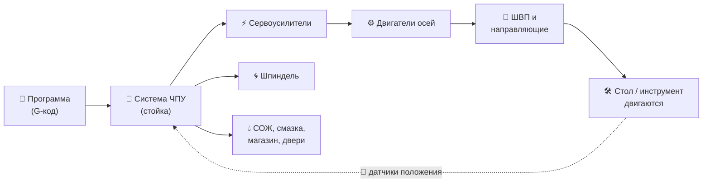

# 🏭 Модуль 1. Устройство станков с ЧПУ

> [!abstract] Для кого этот модуль
> Для тех, кто **ни разу не работал на станке с ЧПУ**, но хочет за пару недель понять, как он устроен, и уверенно разговаривать на собеседовании на должность **оператора станков с ЧПУ**.
> Уровень — примерно как у оператора с **годом опыта**: без глубокой теории, но с пониманием, *что* делает каждый узел, *зачем* он нужен и *что с ним может пойти не так*.

---

## 🗺️ Карта модуля

| №   | Урок                                                    | О чём                                                                 | Время  |
| --- | ------------------------------------------------------- | --------------------------------------------------------------------- | ------ |
| 01  | [[01. Что такое ЧПУ]]                                   | Что такое ЧПУ, как станок «понимает» программу, кто такой оператор    | 25 мин |
| 02  | [[02. Виды станков с ЧПУ]]                              | Токарные, фрезерные, обрабатывающие центры, 3/4/5 осей, марки          | 30 мин |
| 03  | [[03. Оси и системы координат]]                         | X Y Z, A B C, нуль станка и нуль детали, G54                          | 40 мин |
| 04  | [[04. Механика станка]]                                 | Станина, направляющие, ШВП, люфт, тепловые деформации                 | 30 мин |
| 05  | [[05. Приводы и обратная связь]]                        | Серводвигатели, энкодеры, линейки, замкнутый контур                    | 30 мин |
| 06  | [[06. Система ЧПУ и пульт оператора]]                   | Стойки (Fanuc, Siemens…), режимы работы, кнопки, безопасный запуск     | 45 мин |
| 07  | [[07. Шпиндель и инструментальная система]]             | Шпиндель, оправки, магазины, револьверная головка, корректоры         | 45 мин |
| 08  | [[08. Закрепление заготовок]]                           | Тиски, прихваты, патроны, кулачки, задняя бабка, люнет                | 30 мин |
| 09  | [[09. Вспомогательные системы]]                         | СОЖ, смазка, воздух, гидравлика, стружка, щупы                        | 30 мин |
| 10  | [[10. Обслуживание и безопасность]]                     | Включение/выключение, ежедневный осмотр, ТБ, что делать при аварии     | 30 мин |
| 11  | [[11. Вопросы для собеседования]]                       | 40+ вопросов с ответами — тренажёр                                     | 60 мин |
| 12  | [[12. Глоссарий]]                                       | Словарь терминов (русский / английский / на экране станка)             | —      |

---

## 🧭 Как станок устроен — одной картинкой

Каждый блок этой схемы разобран в отдельном уроке. Возвращайтесь к ней, если потеряли общую картину.

---

## 📚 Как пользоваться конспектом

1. Проходите уроки **по порядку** — каждый опирается на предыдущий.
2. В конце каждого урока есть блок **«Проверь себя»** — ответы спрятаны, нажмите на заголовок, чтобы раскрыть.
3. Перед собеседованием прогоните [[11. Вопросы для собеседования]] — вслух, своими словами.

### Условные обозначения

> [!info] Справка
> Полезный факт или пояснение.

> [!example] Пример
> Разбор на конкретных цифрах или ситуации.

> [!tip] 💬 Скажи на собеседовании
> Готовая формулировка, которая покажет работодателю, что вы «в теме».

> [!warning] Внимание
> Типичная ошибка новичка или то, что может сломать станок.

> [!danger] Опасно
> Правила, от которых зависит здоровье и жизнь.

> [!question]- Проверь себя (нажми, чтобы открыть ответ)
> Вот так выглядят вопросы для самопроверки.

### Цвета осей на всех схемах

**X — красный** · **Y — зелёный** · **Z — синий** — так же, как в большинстве CAD/CAM-программ.

---

> [!quote] Главная мысль модуля
> Станок с ЧПУ — это обычный станок, у которого маховики вместо рабочего крутят **моторы**, а моторами командует **компьютер** по **программе**. Оператор — это человек, который следит, чтобы всё это работало правильно и безопасно.

➡️ Начать: [[01. Что такое ЧПУ]]
