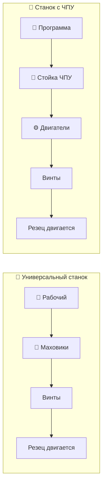
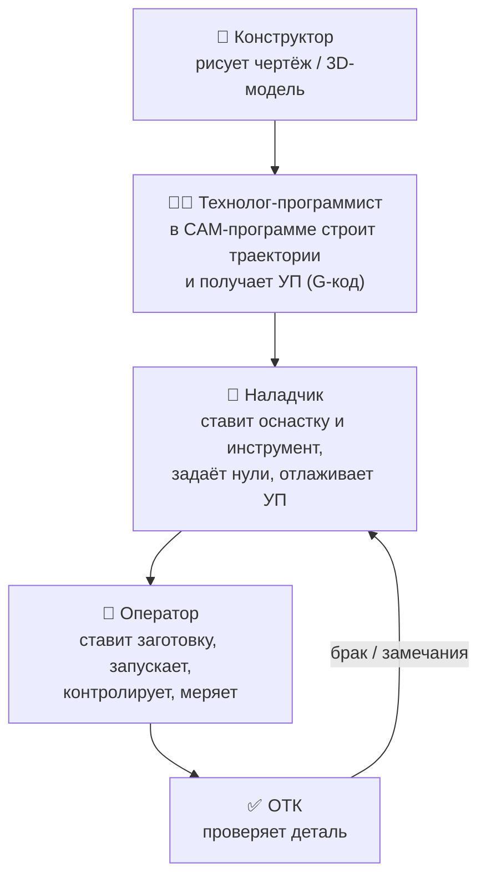

# 🤖 Урок 1. Что такое ЧПУ и как станок «понимает» программу

> [!abstract] О чём урок
> - что означает «ЧПУ» и чем такой станок отличается от обычного;
> - путь от чертежа до готовой детали;
> - из каких основных узлов состоит любой станок с ЧПУ;
> - чем занимается оператор, а чем — наладчик и программист.
>
> ⏱ ~25 минут

---

## 1. Расшифровка

**ЧПУ — числовое программное управление.**
Английский аналог — **CNC** (*Computer Numerical Control*, «компьютерное числовое управление»).

Разберём по словам:

| Слово             | Что значит                                                                                  |
| ----------------- | ------------------------------------------------------------------------------------------- |
| **Числовое**      | Все движения задаются **числами**: координатами (куда ехать), скоростями, оборотами          |
| **Программное**   | Числа записаны в **программу** — текстовый файл с командами, который станок выполняет по строчкам |
| **Управление**    | Станком управляет не человек руками, а **система ЧПУ** (компьютер станка, «стойка»)         |

> [!info] Как говорят в цеху
> - **«Стойка»** — система ЧПУ (компьютер + экран + пульт). «У нас стойка Fanuc», «на Сименсе работал?».
> - **«УП»** — управляющая программа. «Загрузи УП», «УП на 300 строк».
> - **«G-код»** — язык, на котором написаны программы. Подробно — в отдельном модуле.

---

## 2. Обычный станок vs станок с ЧПУ

Представьте **обычный (универсальный) токарный станок**. Рабочий стоит у станка и **крутит маховики**: один маховик двигает резец вдоль детали, другой — поперёк. Глазами смотрит на лимбы (шкалы с делениями), руками чувствует нагрузку. Точность и скорость зависят от его мастерства.

А теперь уберите рабочего от маховиков и поставьте на их место **электродвигатели**. Двигателями командует **компьютер**, который точно знает, куда и с какой скоростью надо повернуть каждый из них. Получился **станок с ЧПУ**.



> [!example] Бытовая аналогия
> **3D-принтер** — это тоже станок с ЧПУ! Он получает файл (G-код), двигает сопло по осям X, Y, Z моторами и «рисует» деталь. Только принтер **добавляет** материал, а станок с ЧПУ **срезает** лишнее с заготовки.
> Ещё аналогия — **стиральная машина с программами**: вы выбрали программу, нажали «Пуск» — машина сама делает всё по шагам. Ваша задача — правильно загрузить бельё и выбрать программу. У оператора ЧПУ похоже, только всё в сотни раз точнее и ответственнее.

### Сравнение

| Параметр                     | Универсальный станок                     | Станок с ЧПУ                                         |
| ---------------------------- | ---------------------------------------- | ---------------------------------------------------- |
| Кто управляет движением      | Рабочий руками                           | Компьютер по программе                               |
| Точность                     | Зависит от мастера, обычно 0,02–0,1 мм    | Стабильно 0,005–0,02 мм на каждой детали             |
| Повторяемость в партии       | Каждая деталь немного разная             | 1-я и 1000-я деталь почти одинаковые                  |
| Сложные формы (дуги, 3D)     | Очень трудно или невозможно              | Легко: станок сам считает траекторию                 |
| Скорость в серии             | Низкая                                   | Высокая, станок может работать 24/7                   |
| Подготовка к работе          | Быстрая                                  | Нужна программа и наладка — выгодно на партиях       |
| Требования к человеку        | Высокий разряд, «чувство металла»        | Внимательность, понимание чертежа и логики станка    |

> [!tip] 💬 Скажи на собеседовании
> «Главное преимущество ЧПУ — **повторяемость**: если программа и наладка отлажены, то сотая деталь получается такой же, как первая. Поэтому задача оператора — не "точить руками", а **контролировать процесс**: правильно установить заготовку, следить за инструментом, мерить детали и вовремя вносить коррекции».

---

## 3. Немного истории (полезно для общего кругозора)

| Годы       | Что произошло                                                                                               |
| ---------- | ----------------------------------------------------------------------------------------------------------- |
| 1940–50-е  | В США (Джон Парсонс и MIT) придумали управлять станком числами с **перфоленты** — так появилось **NC** (числовое управление) |
| 1960–70-е  | В станки встроили компьютеры → **CNC**. В СССР — станки с ЧПУ, например легендарный токарный **16К20Ф3**        |
| 1980–90-е  | Дискеты, экраны, японская Fanuc становится мировым лидером                                                   |
| 2000-е →   | USB, сеть, сенсорные экраны, 5-осевая обработка, роботы-загрузчики, цифровые двойники                        |

> [!info] Советская маркировка — «Ф» в названии станка
> В отечественных моделях буква **Ф** с цифрой показывает тип системы ЧПУ:
> - **Ф1** — только цифровая индикация (показывает координаты, но крутит рабочий);
> - **Ф2** — позиционная система (станок сам едет в точку, например для сверления);
> - **Ф3** — контурная система (может вести инструмент по любой траектории — дуги, конусы);
> - **Ф4** — многоцелевой станок с автоматической сменой инструмента (обрабатывающий центр).
>
> Пример: **16К20Ф3** — токарный станок с контурной ЧПУ, **6Р13Ф3** — вертикально-фрезерный с контурной ЧПУ. Такие станки до сих пор работают на многих заводах, часто — с модернизированной стойкой.

---

## 4. Путь от чертежа до детали



Что происходит **внутри станка**, когда оператор нажал зелёную кнопку **«Пуск»**:

1. Стойка ЧПУ читает **строку программы**, например: `G01 X50. F200` — «двигайся по прямой в точку X=50 мм со скоростью 200 мм/мин».
2. Стойка **рассчитывает** траекторию и разбивает её на тысячи крошечных шагов (это называется **интерполяция**).
3. На каждый шаг отправляет команду **сервоусилителю** оси X.
4. Сервоусилитель подаёт ток на **двигатель** — тот поворачивается.
5. Двигатель крутит **шарико-винтовую передачу (ШВП)** — она превращает вращение в прямолинейное движение стола.
6. **Датчик положения** (энкодер) постоянно сообщает стойке: «я сейчас вот здесь».
7. Стойка сравнивает «где должен быть» и «где есть» и тут же подправляет. Так достигается точность в **микроны**.
8. Строка выполнена → стойка читает следующую.

> [!example] Маленькая программа и что она значит
> ```gcode
> G00 X0 Y0        (быстро переехать в точку X0 Y0)
> S2000 M03        (включить шпиндель: 2000 об/мин, по часовой)
> G01 X50. F200    (резать по прямой до X50 со скоростью 200 мм/мин)
> G01 Y30.         (резать по прямой до Y30)
> M05              (выключить шпиндель)
> M30              (конец программы)
> ```
> Не нужно запоминать коды сейчас — важно понять идею: **программа = список команд «куда, как быстро и что включить»**.

---

## 5. Из чего состоит любой станок с ЧПУ

Неважно, токарный это станок, фрезерный или лазерный — у всех есть одинаковые «органы».

| Узел                          | Аналогия с человеком        | Что делает                                                    | Урок                                       |
| ----------------------------- | --------------------------- | ------------------------------------------------------------- | ------------------------------------------ |
| **Станина и корпусные детали** | Скелет                      | Держат всё, гасят вибрации                                    | [[04. Механика станка]]                     |
| **Направляющие и ШВП**        | Суставы                     | Обеспечивают точное движение по осям                          | [[04. Механика станка]]                     |
| **Двигатели и приводы**       | Мышцы                       | Двигают оси и вращают шпиндель                                | [[05. Приводы и обратная связь]]            |
| **Датчики (энкодеры, линейки)** | Органы чувств              | Сообщают, где находится каждая ось                            | [[05. Приводы и обратная связь]]            |
| **Система ЧПУ (стойка)**      | Мозг                        | Читает программу и командует всем                             | [[06. Система ЧПУ и пульт оператора]]       |
| **Шпиндель**                  | Рука, которая держит инструмент | Вращает инструмент (фреза) или деталь (токарный)          | [[07. Шпиндель и инструментальная система]] |
| **Инструментальный магазин / револьвер** | Ящик с инструментами | Хранит инструменты и меняет их автоматически            | [[07. Шпиндель и инструментальная система]] |
| **Приспособления (тиски, патрон)** | Вторая рука             | Надёжно держат заготовку                                      | [[08. Закрепление заготовок]]               |
| **Вспомогательные системы**   | Кровеносная система         | СОЖ, смазка, воздух, гидравлика, удаление стружки             | [[09. Вспомогательные системы]]             |
| **Ограждение и блокировки**   | Кожа                        | Защищают человека от стружки, СОЖ и вращающихся частей        | [[10. Обслуживание и безопасность]]         |

---

## 6. Кто есть кто в цеху

На собеседовании важно понимать, **что именно от вас ждут**. На маленьких предприятиях один человек может совмещать всё, на крупных — роли разделены.

| Роль                         | Основные обязанности                                                                                                                  |
| ---------------------------- | ------------------------------------------------------------------------------------------------------------------------------------- |
| **Оператор станков с ЧПУ**   | Установка и снятие заготовок, запуск программы, наблюдение за обработкой, измерение деталей, ввод коррекций на износ, замена пластин, уборка стружки, ежедневное обслуживание станка |
| **Наладчик станков с ЧПУ**   | Установка приспособлений и инструмента под новую деталь, привязка нулей и инструмента, отладка программы на первой детали, сдача первой детали ОТК |
| **Программист / технолог**   | Разработка технологии и написание УП (вручную или в CAM: NX, Mastercam, SprutCAM, Fusion 360 и др.)                                   |
| **ОТК (контролёр)**          | Проверка деталей на соответствие чертежу                                                                                              |

> [!tip] 💬 Скажи на собеседовании
> «Я понимаю, что оператор отвечает за **стабильность серии**: деталь должна оставаться в допуске от первой до последней. Для этого надо регулярно мерить, следить за износом инструмента и вовремя вносить коррекции. А ещё — за **чистоту и исправность станка** на своей смене».

> [!info] Разряды
> Оператор станков с ЧПУ обычно имеет **2–4 разряд** (по ЕТКС), наладчик — **4–6**. Новичку часто дают 2–3 разряд с ростом после аттестации. Знания из этого конспекта — хорошая база, чтобы быстро вырасти до наладчика.

---

## 7. Итоги урока

> [!summary] Запомни
> 1. **ЧПУ** — управление станком по программе из чисел; **стойка** — компьютер станка; **УП** — управляющая программа на G-коде.
> 2. Цепочка: **программа → стойка → усилитель → двигатель → ШВП → движение**, а **датчики** возвращают информацию обратно в стойку.
> 3. Главный плюс ЧПУ — **точность и повторяемость** в серии.
> 4. Оператор — не «нажиматель кнопки», а человек, который **контролирует процесс**.

---

## ❓ Проверь себя

> [!question]- 1. Как расшифровывается ЧПУ и CNC?
> ЧПУ — числовое программное управление. CNC — Computer Numerical Control.

> [!question]- 2. Что такое «стойка» и «УП»?
> Стойка — система ЧПУ: компьютер станка с экраном и пультом. УП — управляющая программа, текст с командами на G-коде.

> [!question]- 3. Назови по порядку, через что проходит команда от программы до движения стола.
> Программа → стойка ЧПУ (интерполяция) → сервоусилитель → двигатель → ШВП → стол. Датчик положения сообщает стойке фактическое положение (обратная связь).

> [!question]- 4. Что означает «Ф3» в названии 16К20Ф3?
> Станок оснащён контурной системой ЧПУ — может вести инструмент по любой траектории.

> [!question]- 5. Чем обязанности оператора отличаются от обязанностей наладчика?
> Оператор работает на уже налаженном процессе: ставит заготовки, запускает, меряет, вносит коррекции на износ, меняет пластины, обслуживает станок. Наладчик готовит станок под новую деталь: ставит оснастку и инструмент, привязывает нули, отлаживает программу.

---

⬅️ [[00. Оглавление|Оглавление]] | ➡️ [[02. Виды станков с ЧПУ]]
