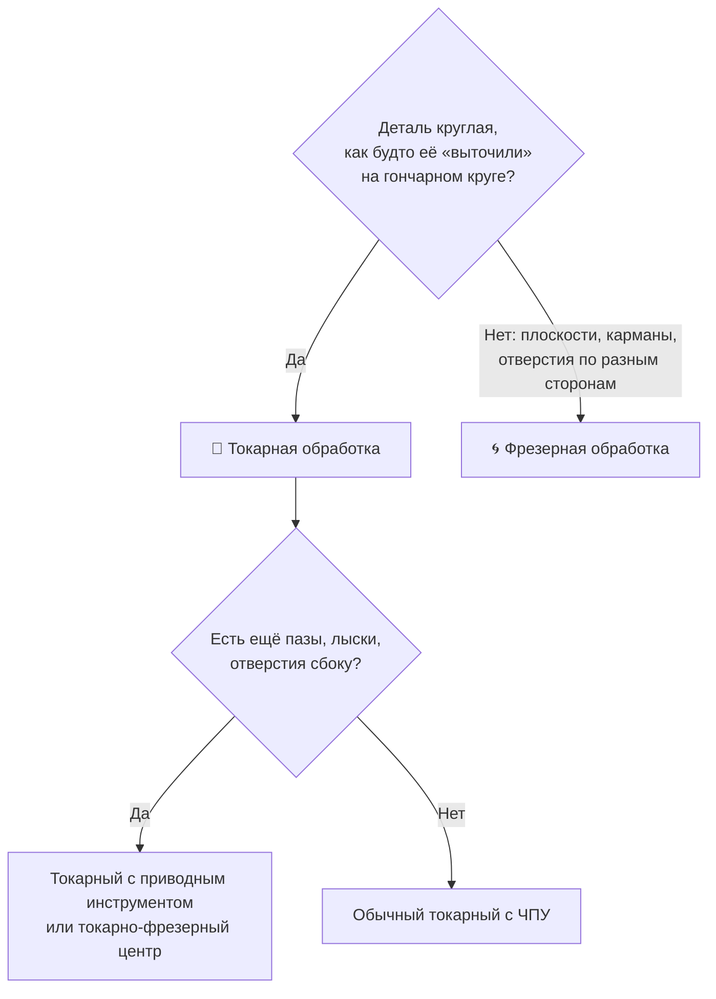

# 🏗️ Урок 2. Виды станков с ЧПУ

> [!abstract] О чём урок
> - какие бывают станки с ЧПУ и чем они отличаются;
> - что такое **обрабатывающий центр**;
> - что значит **3, 4 и 5 осей**;
> - токарные станки: с наклонной станиной, с приводным инструментом, с контршпинделем, «швейцарцы»;
> - какие марки станков и стоек вы встретите в вакансиях.
>
> ⏱ ~30 минут

---

## 1. Главное разделение: что вращается?

Все станки для обработки резанием делятся по одному простому признаку — **что крутится: деталь или инструмент**.

| | 🔄 **Токарный станок** | 🌀 **Фрезерный станок** |
|---|---|---|
| **Что вращается** | **Деталь** (зажата в патроне) | **Инструмент** (фреза, сверло) |
| **Инструмент** | Резец — неподвижен, только перемещается | Фреза — вращается и перемещается |
| **Какие детали** | **Тела вращения**: валы, втулки, фланцы, кольца, штуцеры | **Корпусные и плоские**: плиты, корпуса, кронштейны, пресс-формы |
| **Основные оси** | **2 оси**: X (диаметр) и Z (длина) | **3 оси**: X, Y, Z |
| **Пример детали** | Вал редуктора, болт, гильза | Корпус насоса, крышка, шестигранная гайка |

> [!tip] 💬 Скажи на собеседовании
> «На токарном станке вращается **заготовка**, а резец только перемещается — так делают тела вращения. На фрезерном вращается **инструмент**, а деталь неподвижно закреплена на столе — так делают корпусные детали».

---

## 2. Фрезерные станки и обрабатывающие центры

### 2.1. Что такое обрабатывающий центр

**Обрабатывающий центр** (англ. *machining center*) — это фрезерный станок с ЧПУ, у которого есть **автоматическая смена инструмента** (магазин). Он может за одну установку детали фрезеровать, сверлить, нарезать резьбу, растачивать — меняя инструменты сам.

> [!info] В разговоре
> Фрезерный обрабатывающий центр часто называют просто **«фрезерный центр»**, **«вертикалка»**, а по-английски — **VMC** (*Vertical Machining Center*) или **HMC** (*Horizontal Machining Center*).

### 2.2. Вертикальный и горизонтальный

| | **Вертикальный (VMC)** | **Горизонтальный (HMC)** |
|---|---|---|
| Положение шпинделя | Смотрит **вниз** | Смотрит **вбок** |
| Как ставят деталь | На стол, в тиски, сверху хорошо видно | На **паллету**, часто на поворотный стол |
| Стружка | Скапливается в деталях и на столе | Сама падает вниз — меньше проблем |
| Сколько сторон за установку | Обычно 1 | До 4 (стол поворачивается) |
| Цена и сложность | Дешевле, проще — **самые распространённые** | Дороже, для серийного производства |
| Где встретите | Почти в любом цеху | На заводах с большими сериями |

![[cnc-mill-axes.svg]]

> [!info] Сменщик паллет (APC)
> У горизонтальных центров часто есть **две и более паллеты**: пока на одной идёт обработка, оператор снаружи снимает готовую деталь и ставит новую на другую. Потом станок сам меняет паллеты местами. Станок практически не простаивает.

### 2.3. Другие компоновки фрезерных станков

- **Консольно-фрезерные с ЧПУ** (как 6Р13Ф3) — стол на «консоли», которая ездит вверх-вниз. Старая компоновка.
- **Портальные** — шпиндель на «мосту» над большим столом. Для крупных деталей: плиты, рамы, пресс-формы.
- **Фрезерно-гравировальные** — лёгкие, высокооборотные, для пластика, дерева, алюминия, гравировки.
- **Сверлильно-фрезерные «малыши»** — например **Fanuc Robodrill**, Brother Speedio: очень быстрые, для мелких серийных деталей.

---

## 3. Количество осей: 3, 3+2, 4, 5

Это **один из самых частых вопросов** на собеседовании. Ось — это направление, по которому станок умеет управляемо двигаться или поворачиваться.

| Конфигурация | Оси | Что умеет | Пример детали |
|---|---|---|---|
| **3-осевой** | X, Y, Z | Обрабатывает деталь **с одной стороны** (сверху). Чтобы обработать другую сторону — деталь переставляют вручную | Плита с карманами и отверстиями |
| **4-осевой** | X, Y, Z + **A** (поворот) | На столе стоит **поворотная ось** (делительная головка). Деталь можно повернуть и обработать с нескольких сторон | Вал с пазами по окружности, деталь с отверстиями с 4 сторон |
| **3+2** (позиционная 5-осевая) | X, Y, Z + 2 поворотных | Деталь **поворачивается под углом и фиксируется**, затем обработка идёт по 3 осям | Корпус с наклонными отверстиями |
| **5-осевой** (непрерывный) | X, Y, Z + 2 поворотных **одновременно** | Все 5 осей двигаются **одновременно** — инструмент «обтекает» сложную поверхность | Лопатки турбин, крыльчатки, импеллеры, медицинские импланты |

> [!example] Как представить разницу
> - **3 оси** — вы красите коробку кисточкой, но коробку двигать нельзя: покрасили верх — надо остановиться и перевернуть руками.
> - **4 оси** — коробку можно вертеть вокруг одной оси, как курицу на гриле.
> - **5 осей** — коробку можно наклонять и вертеть как угодно, прямо во время покраски.

> [!info] Как устроены 5 осей
> Две дополнительные поворотные оси могут быть:
> - **в столе** («стол-стол», поворотный стол на люльке — *trunnion*) — самый распространённый вариант для небольших деталей;
> - **в голове** («голова-голова») — для больших и тяжёлых деталей, которые трудно вращать;
> - **смешанно** («голова-стол»).

> [!tip] 💬 Скажи на собеседовании
> «Чем больше осей — тем меньше переустановок детали. А каждая переустановка — это потеря времени и риск погрешности. Поэтому 4- и 5-осевые станки позволяют сделать сложную деталь **за одну-две установки**».

---

## 4. Токарные станки с ЧПУ

### 4.1. Компоновки станины

| Тип | Особенность | Где встречается |
|---|---|---|
| **С горизонтальной станиной** | Как у универсального токарного станка. Простой, дешёвый | Модернизированные 16К20Ф3, бюджетные станки, обучение |
| **С наклонной станиной** (*slant bed*) | Станина наклонена под 30–60°. **Стружка сама падает** вниз на транспортёр, конструкция жёстче, оператору удобно подходить | **Большинство современных** токарных центров (Haas ST, DN Solutions Lynx/Puma, Mazak QT) |
| **Карусельный** (вертикальный) | Деталь лежит на горизонтальной планшайбе, шпиндель вертикальный | Крупные, тяжёлые, «плоские» детали: колёса, фланцы диаметром 1–5 м |

### 4.2. Токарные обрабатывающие центры

Современные токарные станки умеют не только точить:

| Опция | Буква на станке | Что даёт |
|---|---|---|
| **Приводной инструмент** (*live tooling*) | часто добавляют **M** (напр. Lynx 2100L**M**) | В револьверной головке — вращающиеся фрезы и свёрла: можно сделать лыску, паз, поперечное отверстие **без перестановки на фрезерный** |
| **Ось C** | — | Шпиндель с деталью поворачивается на точный угол (как делительная головка). Нужна для фрезерования приводным инструментом |
| **Ось Y** | **Y** (напр. Lynx 2100**LY**) | Револьвер двигается ещё и вверх-вниз — можно фрезеровать плоскости и отверстия «не по центру» |
| **Контршпиндель** (второй шпиндель) | **S** (напр. Puma 2100**SY**) | Второй шпиндель напротив первого «перехватывает» деталь и обрабатывает её с обратной стороны. Деталь выходит **полностью готовой** |
| **Задняя бабка** | — | Поддерживает длинные детали |
| **Прутковый податчик** | — | Подаёт пруток автоматически — станок работает без оператора часами |

> [!info] Буквы в моделях — не стандарт
> Обозначения выше — частые, но **у каждого производителя свои**. Если видите в вакансии незнакомую модель — просто найдите её описание у производителя: там всегда указаны оси и опции.

### 4.3. Автоматы продольного точения («швейцарцы»)

Особый вид токарных станков — **автоматы продольного точения швейцарского типа** (*Swiss-type*). Пруток проходит через **направляющую втулку**, и резец работает всегда рядом с ней — поэтому можно точить **очень тонкие и длинные детали** без прогиба. Делают винтики, оси для часов, медицинские винты, контакты разъёмов. Производители: Citizen, Star, Tsugami, Tornos.

### 4.4. Токарно-фрезерные центры (mill-turn)

**Токарно-фрезерный обрабатывающий центр** — гибрид: токарный шпиндель + полноценный фрезерный шпиндель с поворотом (ось B) и магазином. Делает почти любую деталь за одну установку. Примеры: Mazak **Integrex**, DMG MORI **NTX**, Okuma **Multus**. Это уровень опытного наладчика — но знать, что такие бывают, полезно.

---

## 5. Другие станки с ЧПУ (знать для кругозора)

| Станок | Как режет | Для чего |
|---|---|---|
| **Электроэрозионный проволочный** | Тонкая проволока режет металл электрическими искрами в воде | Штампы, пресс-формы, точные контуры из закалённой стали |
| **Электроэрозионный прошивной** | Электрод нужной формы «выжигает» полость | Глубокие полости в пресс-формах |
| **Лазерный** | Луч лазера плавит металл | Раскрой листа |
| **Плазменный** | Плазменная дуга | Раскрой толстого листа, дешевле лазера |
| **Гидроабразивный** | Струя воды с песком под давлением ~4000 бар | Любые материалы: камень, стекло, металл, композиты |
| **Шлифовальный с ЧПУ** | Абразивный круг | Финишная обработка с точностью до микрон |
| **Листогибочный пресс с ЧПУ** | Гибка | Гнутые детали из листа |

---

## 6. Марки станков и стоек, которые встречаются в вакансиях

> [!info] Не нужно знать всё — нужно узнавать названия
> Если в вакансии написано «опыт работы на Haas / DMG / Fanuc» — это обычно про конкретный станок или стойку, которые стоят у них в цеху.

| Страна | Производители станков (примеры) |
|---|---|
| 🇯🇵 Япония | **Mazak**, **Okuma**, DMG MORI (японо-немецкий), **Fanuc** (Robodrill), Brother, Citizen, Star |
| 🇩🇪 Германия | **DMG MORI**, Hermle, Index, Spinner, Chiron |
| 🇺🇸 США | **Haas** — очень распространены, удобны для обучения; Hurco |
| 🇰🇷 Корея | **DN Solutions** (бывший **Doosan**), **Hyundai WIA**, Smec |
| 🇹🇼 Тайвань | Victor, Leadwell, Hartford, Feeler, Takisawa |
| 🇨🇳 Китай | Много марок, в последние годы — значительная часть новых станков в России |
| 🇷🇺 Россия / СССР | Классика: **16К20Ф3**, **6Р13Ф3**, обрабатывающие центры **ИР500МФ4**, **2204ВМФ4**. Современные: группа «СТАН», Савёловский машиностроительный завод и др. |

Про стойки (Fanuc, Siemens, Heidenhain и т. д.) — подробно в [[06. Система ЧПУ и пульт оператора]].

> [!example] Как расшифровать советскую модель
> **16К20Ф3**:
> - **1** — группа: токарные станки;
> - **6** — тип: токарно-винторезный;
> - **К** — поколение / модификация;
> - **20** — размер (высота центров около 200 мм, т. е. над станиной можно точить диаметр до 400 мм);
> - **Ф3** — контурная система ЧПУ.
>
> **6Р13Ф3**: **6** — фрезерная группа, **Р** — модификация, **1** — вертикально-фрезерный консольный, **3** — типоразмер стола, **Ф3** — контурная ЧПУ.

---

## 7. Итоги урока

> [!summary] Запомни
> 1. **Токарный** — вращается деталь (тела вращения). **Фрезерный** — вращается инструмент (корпусные детали).
> 2. **Обрабатывающий центр** = станок с ЧПУ + **автоматическая смена инструмента**.
> 3. **VMC** — вертикальный (шпиндель вниз, самый распространённый), **HMC** — горизонтальный (шпиндель вбок, паллеты).
> 4. **3 оси** — XYZ; **4 оси** — плюс поворотная A; **5 осей** — две поворотные, одновременно. Больше осей → меньше переустановок.
> 5. Современный токарный центр часто имеет **приводной инструмент, ось C, ось Y, контршпиндель**.

---

## ❓ Проверь себя

> [!question]- 1. Чем токарная обработка отличается от фрезерной?
> На токарном станке вращается деталь, а резец перемещается. На фрезерном вращается инструмент, а деталь закреплена на столе и (или) перемещается вместе с ним.

> [!question]- 2. Что такое обрабатывающий центр?
> Станок с ЧПУ с автоматической сменой инструмента из магазина — может выполнять разные операции (фрезерование, сверление, резьба, расточка) за одну установку.

> [!question]- 3. Почему у современных токарных станков наклонная станина?
> Стружка сама падает вниз на транспортёр, конструкция жёстче, оператору удобнее подходить к зоне обработки.

> [!question]- 4. Чем отличается 3+2 от полноценной 5-осевой обработки?
> В 3+2 поворотные оси сначала поворачивают деталь на нужный угол и фиксируются, затем обработка идёт по трём линейным осям. В непрерывной 5-осевой все пять осей двигаются одновременно.

> [!question]- 5. Для чего токарному станку приводной инструмент и ось C?
> Чтобы фрезеровать лыски и пазы и сверлить поперечные отверстия прямо на токарном станке, без переноса детали на фрезерный. Ось C поворачивает деталь на точный угол.

> [!question]- 6. Что такое контршпиндель?
> Второй шпиндель напротив главного. Он перехватывает деталь, чтобы обработать её с обратной стороны — деталь выходит со станка полностью готовой.

---

⬅️ [[01. Что такое ЧПУ]] | [[00. Оглавление|Оглавление]] | ➡️ [[03. Оси и системы координат]]
