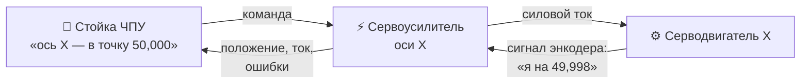
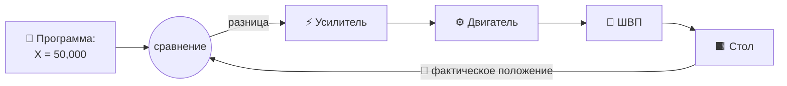

# ⚡ Урок 5. Приводы и обратная связь

> [!abstract] О чём урок
> - **главный привод** и **приводы подач** — в чём разница;
> - **серводвигатели**, **шаговые** и **линейные** двигатели;
> - что такое **сервоусилитель**;
> - как станок «чувствует» своё положение: **энкодеры** и **оптические линейки**;
> - **открытый, полузамкнутый и замкнутый** контур управления;
> - почему у энкодеров бывает **батарейка** и что будет, если она сядет;
> - типичные аварии приводов.
>
> ⏱ ~30 минут

---

## 1. Два вида приводов

Привод — это двигатель плюс всё, что им управляет. В станке их два типа:

| | **Главный привод** (привод шпинделя) | **Приводы подач** (приводы осей) |
|---|---|---|
| Что делает | **Вращает** шпиндель (инструмент или деталь) | **Перемещает** оси X, Y, Z (и поворотные) |
| Важно | Мощность, крутящий момент, обороты | Точность положения, плавность |
| Чем управляется в программе | **S** (обороты), **M03/M04/M05** | **X, Y, Z…** (координаты) и **F** (подача) |
| Пример | Шпиндель 12 000 об/мин, 15 кВт | Ось X: ход 760 мм, скорость до 36 м/мин |

> [!info] Подача
> **Подача (F)** — скорость, с которой инструмент движется при резании. На фрезерных обычно в **мм/мин** (код G94), на токарных — в **мм/об** (код G95, сколько миллиметров проходит резец за один оборот детали).

---

## 2. Типы двигателей

### 2.1. Серводвигатель — стандарт промышленных станков

**Серводвигатель** (*servo motor*) — электродвигатель, который работает в паре с **датчиком положения** и **сервоусилителем**. Он не просто вращается, а может точно повернуться на нужный угол, держать положение под нагрузкой и мгновенно менять скорость.

На современных станках это **синхронные двигатели переменного тока с постоянными магнитами**. Сзади на корпусе — **энкодер** (датчик угла поворота).

### 2.2. Сравнение двигателей подач

| | **Шаговый двигатель** | **Серводвигатель** | **Линейный двигатель** |
|---|---|---|---|
| Как работает | Поворачивается «шагами» по команде, обычно **без датчика** | С датчиком положения, постоянно корректируется | Двигает стол напрямую, без винта |
| Обратная связь | Обычно нет («открытый контур») | Есть | Есть |
| Если перегрузить | **Пропускает шаги** — станок не знает, что сбился | Сообщает об ошибке, встаёт в аварию | Сообщает об ошибке |
| Скорость, мощность | Низкие | Высокие | Очень высокие |
| Где | Хоббийные станки, гравёры, 3D-принтеры | ⭐ **Промышленные станки с ЧПУ** | Высокоскоростные и высокоточные станки |

> [!tip] 💬 Скажи на собеседовании
> «На промышленных станках оси приводятся **серводвигателями** с энкодерами. В отличие от шаговых, они работают в замкнутом контуре: если ось не может дойти до точки, стойка это видит и останавливает станок с ошибкой, а не продолжает работать "вслепую"».

### 2.3. Двигатель шпинделя

- Обычно — **асинхронный двигатель** или синхронный, управляемый **шпиндельным усилителем** (по сути — мощным частотным преобразователем).
- Передаёт вращение на шпиндель **ремнём**, **через редуктор**, **напрямую** через муфту — или двигатель встроен прямо в шпиндель (**мотор-шпиндель**). Подробно — в [[07. Шпиндель и инструментальная система]].
- Тоже имеет датчик — чтобы стойка знала обороты и угол. Это нужно для:
  - **ориентации шпинделя** (код **M19**) — остановить шпиндель в строго определённом угле, например для смены инструмента;
  - **жёсткого нарезания резьбы** метчиком — подача должна точно совпадать с оборотами;
  - **нарезания резьбы резцом** на токарном — каждый проход должен попадать в ту же канавку.

---

## 3. Сервоусилитель (сервопривод)

Стойка ЧПУ — это «мозг», он выдаёт слабые управляющие сигналы. Двигателю нужны **мощные токи**. Посередине стоит **сервоусилитель** (*servo amplifier, drive*).



Сервоусилители стоят в **электрошкафу** станка. Обычно по одному на каждую ось (или многоосевой блок) плюс отдельный — для шпинделя. На их дисплеях или светодиодах отображаются коды состояния и ошибок — это смотрит электрик или наладчик.

> [!danger] Электрошкаф — не зона оператора
> В шкафу — **сотни вольт**, конденсаторы остаются заряженными **несколько минут** после выключения. Оператор шкаф не открывает. Максимум — сообщить, что не работает вентилятор шкафа или он забит пылью.

---

## 4. Обратная связь — как станок знает, где он

**Обратная связь** — это информация от датчиков о **фактическом** положении. Стойка постоянно сравнивает:

> **заданное положение** (где должна быть ось по программе)
> −
> **фактическое положение** (где ось реально находится по датчику)
> =
> **ошибка рассогласования** → её тут же исправляют

Это происходит **тысячи раз в секунду**.



> [!example] Аналогия
> Вы несёте полный стакан воды и **смотрите** на него. Чуть наклонился — глаза заметили, рука тут же поправила. Это **замкнутый контур**.
> Теперь закройте глаза — вы не узнаете, что вода льётся, пока не станет поздно. Это **открытый контур** (как у шагового двигателя).

### 4.1. Три схемы управления

| Схема | Где датчик | Что он «видит» | Плюсы / минусы |
|---|---|---|---|
| **Открытый контур** | Датчика нет | Ничего | Дёшево. Если двигатель пропустил шаг — ошибка накапливается незаметно |
| **Полузамкнутый контур** ⭐ | **Энкодер на двигателе** | Угол поворота двигателя | Стандарт для большинства станков. Не видит люфт и удлинение винта от нагрева |
| **Замкнутый контур** | **Оптическая линейка** на столе | **Реальное положение стола** | Самый точный: учитывает люфт, износ, нагрев ШВП. Дороже |

> [!tip] 💬 Скажи на собеседовании
> «Если датчик стоит на двигателе — это полузамкнутая система: станок знает угол поворота мотора, но не видит люфт и нагрев винта. Если стоит линейка на столе — это замкнутая система, она меряет реальное положение стола и даёт максимальную точность».

---

## 5. Датчики положения

### 5.1. Энкодер (датчик угла поворота)

**Энкодер** — датчик, который сидит на валу двигателя и считает, на какой угол тот повернулся.

Как устроен оптический энкодер (упрощённо): на валу — стеклянный **диск с тысячами тонких штрихов**. С одной стороны светит светодиод, с другой стоит фотоприёмник. При вращении штрихи перекрывают свет — получаются **импульсы**. Посчитали импульсы — узнали угол.

```
   светодиод →  ║ ║ ║ ║ ║ ║ ║ ║ ║  → фотоприёмник
                 диск со штрихами
   импульсы:   ┌┐ ┌┐ ┌┐ ┌┐ ┌┐ ┌┐
              ─┘└─┘└─┘└─┘└─┘└─┘└─
```

### 5.2. Инкрементный и абсолютный энкодер

| | **Инкрементный** | **Абсолютный** |
|---|---|---|
| Что знает | Только **сколько импульсов прошло** с момента включения | **Точное положение** в любой момент |
| После включения станка | Положение неизвестно → нужен **выход в референтную точку** | Положение известно сразу → можно работать без выхода в ноль |
| Пример | Старые станки, многие бюджетные | Большинство современных станков (Fanuc, Siemens) |

> [!warning] Батарейки абсолютных энкодеров
> У многих станков (особенно **Fanuc**) положение абсолютных энкодеров при выключенном станке хранится благодаря **батарейкам** (обычно отсек с 4 батарейками типа D на сервоусилителе или в шкафу).
> Когда батарейки садятся, на экране появляется предупреждение (у Fanuc — **APC battery low** / сообщение о низком напряжении батареи).
> - Батарейки меняют **при включённом станке** (в режиме аварийного стопа), иначе положение осей будет **потеряно**.
> - Если положение потеряно — станок требует заново выставить референтную точку. Это работа наладчика/сервиса.
>
> Оператору важно: **увидел предупреждение о батарее — сразу сообщить наладчику**, не откладывать.

### 5.3. Оптическая линейка

**Оптическая линейка** (*linear scale*) — длинный датчик вдоль оси со стеклянной или стальной шкалой. По шкале едет считывающая головка, закреплённая на подвижной части. Самые известные производители — Heidenhain, Renishaw, Fagor.

- Меряет **реальное положение** стола, а не мотора.
- Защищена корпусом с резиновыми губками и часто **продувается чистым воздухом** изнутри — чтобы не попала СОЖ.

> [!info] Не путайте с УЦИ
> На универсальных станках тоже ставят линейки — вместе с **устройством цифровой индикации (УЦИ)**. Там они только **показывают** размер рабочему, а станком управляет человек. На ЧПУ линейки **участвуют в управлении**.

---

## 6. Вертикальная ось: тормоз и уравновешивание

Шпиндельная бабка на оси Z весит сотни килограммов. Что будет, если выключить питание? Она **упадёт** вниз под своим весом. Чтобы этого не было:

- **Тормоз в двигателе оси Z** — автоматически зажимается при отключении питания или аварийном стопе;
- **Уравновешивание** — противовес, гидро- или пневмоцилиндр, который компенсирует вес бабки.

> [!warning] Признак проблемы
> Если после нажатия аварийного стопа ось Z **«проседает»** хотя бы немного — это неисправность тормоза. Немедленно сообщить наладчику, не работать под шпинделем.

---

## 7. Типичные аварии приводов (что можно увидеть на экране)

Оператору не нужно ремонтировать приводы, но полезно понимать, **что означает** сообщение.

| Что на экране (смысл) | Что это значит | Что делать оператору |
|---|---|---|
| **Превышение ошибки рассогласования** (*excess error, following error*) | Ось не успевает за командой: столкновение, заклинивание, сильная перегрузка | Аварийный стоп, осмотреть зону, вызвать наладчика |
| **Перегрузка двигателя / усилителя** (*overload, overcurrent*) | Слишком большая нагрузка: тупой инструмент, большой съём, механическая проблема | Остановить, сообщить; не перезапускать «на авось» |
| **Перегрев** (*overheat*) | Двигатель или шкаф перегрелись — забит фильтр, не работает вентилятор | Сообщить наладчику, проверить вентиляторы шкафа |
| **Выход за программный предел** (*overtravel*) | Ось пытается уехать за допустимую границу хода | Проверить программу и привязку; в ручном режиме отъехать обратно |
| **Батарея энкодера** (*battery low*) | Садятся батарейки абсолютных энкодеров | Срочно сообщить наладчику |

> [!tip] Правило оператора
> Любую аварию **записать**: номер, текст, что делал станок в этот момент, какой кадр программы. Это экономит время наладчику и показывает вас как ответственного специалиста.

---

## 8. Итоги урока

> [!summary] Запомни
> 1. **Главный привод** вращает шпиндель (S, M03/M04), **приводы подач** двигают оси (X, Y, Z, F).
> 2. На промышленных станках — **серводвигатели** с **энкодерами**, управляемые **сервоусилителями**.
> 3. **Обратная связь**: стойка постоянно сравнивает заданное и фактическое положение и исправляет ошибку.
> 4. **Полузамкнутый контур** — энкодер на моторе; **замкнутый** — линейка на столе (точнее).
> 5. **Абсолютные энкодеры** помнят положение; на многих станках им нужна **батарейка** — менять при включённом станке.
> 6. Ось Z удерживается **тормозом** и **уравновешиванием**.

---

## ❓ Проверь себя

> [!question]- 1. Чем главный привод отличается от приводов подач?
> Главный привод вращает шпиндель (задаёт скорость резания), приводы подач перемещают оси и обеспечивают точное положение.

> [!question]- 2. Почему на промышленных станках серводвигатели, а не шаговые?
> Серводвигатели работают с обратной связью: стойка видит, где ось, и исправляет отклонения. Они мощнее и быстрее. Шаговый двигатель при перегрузке может пропустить шаги незаметно для системы.

> [!question]- 3. Что такое сервоусилитель?
> Устройство, которое получает слабый управляющий сигнал от стойки и подаёт на двигатель мощный ток, следя за сигналом энкодера.

> [!question]- 4. Чем отличается полузамкнутая система от замкнутой?
> В полузамкнутой датчик (энкодер) стоит на двигателе и меряет его угол. В замкнутой — оптическая линейка меряет реальное положение стола, учитывая люфт и нагрев винта.

> [!question]- 5. Зачем выходить в ноль на станке с инкрементными энкодерами и можно ли не выходить с абсолютными?
> Инкрементный энкодер не знает положение после включения, поэтому нужен выход в референтную точку. Абсолютный знает положение сразу — выход в ноль обычно не нужен.

> [!question]- 6. На экране появилось сообщение о разряде батареи энкодеров. Что делать?
> Сразу сообщить наладчику. Батарейки меняют при включённом станке, иначе собьётся положение осей.

> [!question]- 7. Что такое ориентация шпинделя (M19) и зачем она нужна?
> Остановка шпинделя в строго определённом угловом положении. Нужна для автоматической смены инструмента (пазы оправки должны совпасть со шпонками шпинделя), а также для некоторых операций расточки.

---

⬅️ [[04. Механика станка]] | [[00. Оглавление|Оглавление]] | ➡️ [[06. Система ЧПУ и пульт оператора]]
