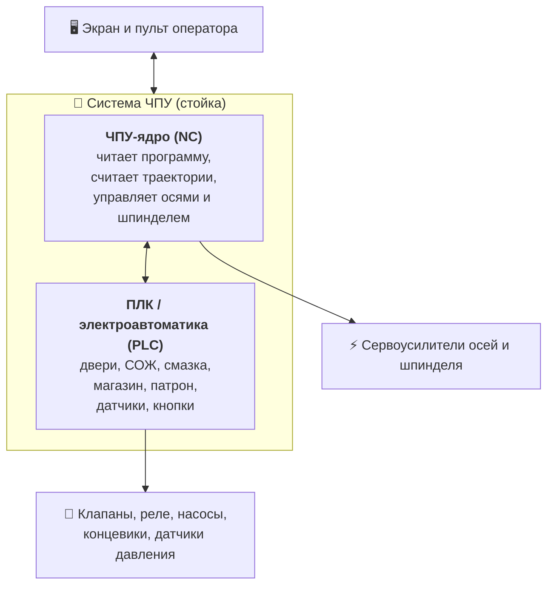
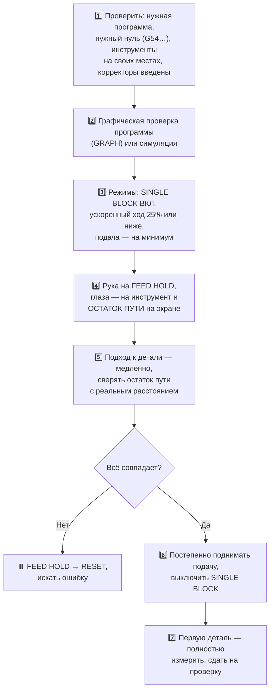

# 🧠 Урок 6. Система ЧПУ (стойка) и пульт оператора

> [!abstract] О чём урок
> - из чего состоит система ЧПУ: **ЧПУ-ядро** и **ПЛК (электроавтоматика)**;
> - что такое **интерполяция**;
> - популярные стойки: **Fanuc, Siemens, Heidenhain, Mitsubishi, Haas, Mazatrol** и отечественные;
> - **пульт оператора** — каждая кнопка и переключатель;
> - **режимы работы** станка;
> - **экраны** стойки;
> - ⭐ **безопасный первый запуск программы** — то, что точно стоит рассказать на собеседовании.
>
> ⏱ ~45 минут

---

## 1. Из чего состоит система ЧПУ

Система ЧПУ (стойка) — это специализированный промышленный компьютер. Внутри два основных «отдела»:



| Часть | Чем занимается | Пример |
|---|---|---|
| **ЧПУ-ядро (NC)** | **Движение**: интерполяция, ускорения, коррекции инструмента, системы координат | `G01 X50. Y20. F300` |
| **ПЛК (PLC)** — программируемый логический контроллер | **Всё остальное**: включить насос, проверить, закрыта ли дверь, повернуть магазин, зажать патрон | `M08` — включить СОЖ; `M06` — сменить инструмент |
| **Интерфейс (HMI)** | Экран, клавиатура, пульт | Вы видите координаты и нажимаете кнопки |

> [!info] Почему это знание полезно
> Если станок «не едет» — это может быть не ошибка программы, а **условие ПЛК не выполнено**: дверь не закрыта, нет давления воздуха, патрон не зажат, не хватает смазки. На экране обычно появляется сообщение (*message* / *alarm*). Оператор, который понимает это, быстрее находит причину.

---

## 2. Интерполяция — как стойка рисует траекторию

Чтобы фреза прошла по **наклонной прямой** или **дуге**, нужно одновременно и согласованно двигать **несколько осей**, причём с разной скоростью. Расчёт этих согласованных движений называется **интерполяцией**.

```
  Линейная интерполяция (G01)        Круговая интерполяция (G02/G03)
  Y                                   Y
  │            ● конец                │      ●───╮
  │         ╱                         │           ╲  дуга
  │      ╱    X и Y двигаются         │            │
  │   ╱       одновременно            │            ●
  │●  начало                          │
  └──────────── X                     └──────────── X
```

На самом деле стойка разбивает траекторию на **тысячи очень маленьких отрезков** и каждую тысячную долю секунды выдаёт осям новые команды. Отрезки настолько малы, что движение получается плавным.

| Код | Тип движения |
|---|---|
| **G00** | Ускоренное перемещение (не резание!) — максимально быстро, траектория может быть не прямой |
| **G01** | Линейная интерполяция — по прямой с подачей F |
| **G02** | Круговая интерполяция **по часовой** стрелке |
| **G03** | Круговая интерполяция **против часовой** стрелки |

> [!warning] G00 — опасное движение
> На ускоренном ходу оси разгоняются до 20–60 м/мин. Если в программе ошибка или неправильная привязка — удар происходит **за доли секунды**. Поэтому при первом запуске ускоренный ход ограничивают корректором (см. ниже).

---

## 3. Популярные системы ЧПУ

> [!info] Важно для собеседования
> В вакансиях часто пишут: «опыт работы на стойке **Fanuc** / **Siemens** / **Heidenhain**». Базовые принципы у всех одинаковые: оси, нули, корректоры, режимы. Разница — в интерфейсе, кнопках и некоторых кодах. Переучиться с одной стойки на другую можно за несколько дней-недель.

| Стойка | Страна | Особенности | Где встречается |
|---|---|---|---|
| **Fanuc** (0i-TF/MF, 30i и др.) | 🇯🇵 Япония | **Самая распространённая в мире**. Классический G-код ISO. Надёжная. Буква **T** — токарная (0i-**T**F), **M** — фрезерная (0i-**M**F) | DN Solutions (Doosan), Hyundai WIA, многие тайваньские и японские станки, Robodrill, модернизации советских станков |
| **Siemens Sinumerik** (808D, 828D, 840D sl, ONE) | 🇩🇪 Германия | Мощные циклы, удобная графика **ShopMill** (фрезерный) / **ShopTurn** (токарный) — программирование диалогом. Свои дополнения к G-коду | DMG MORI, европейские станки, много в России |
| **Heidenhain** (TNC 620, TNC 640) | 🇩🇪 Германия | Собственный язык **Klartext** (диалоговый, «открытым текстом»: `L X+50 Y+20 F300`), также умеет G-код. Любимица фрезеровщиков-инструментальщиков | Фрезерные и 5-осевые: Hermle, DMG MORI, Spinner |
| **Mitsubishi** (M70, M80, M800) | 🇯🇵 Япония | Близка к Fanuc по кодам | Японские и тайваньские станки |
| **Haas NGC** | 🇺🇸 США | Собственная стойка Haas, коды как у Fanuc, очень дружелюбный интерфейс | Станки Haas |
| **Mazak Mazatrol** | 🇯🇵 Япония | Диалоговое программирование прямо на станке (заполняешь таблицы — стойка сама генерирует обработку). Умеет и G-код | Станки Mazak |
| **Okuma OSP** | 🇯🇵 Япония | Своя система, свои особенности | Станки Okuma |
| **Балт-Систем** (NC-110, NC-210, NC-310 и др.) | 🇷🇺 Россия | Отечественная стойка, коды по ISO, похожи на Fanuc | Модернизация советских станков, отечественные станки |
| **АксиОМА Контрол** | 🇷🇺 Россия | Отечественная система (разработка МГТУ «СТАНКИН») | Отечественные станки |

> [!tip] 💬 Скажи на собеседовании
> «Я изучал принципы работы на стойке Fanuc — она самая распространённая. Знаю, что у Siemens и Heidenhain другой интерфейс и свои циклы, но базовые вещи — системы координат, корректоры, режимы работы — везде одинаковые, поэтому переучиться несложно».

---

## 4. Пульт оператора

![[cnc-operator-panel.svg]]

Пульт состоит из **двух частей**:
1. **Панель ЧПУ** — экран и клавиатура (одинаковые для всех станков с этой стойкой).
2. **Станочная панель** (*machine operator panel*) — кнопки, переключатели, корректоры (её делает производитель станка, поэтому она может отличаться).

### 4.1. Органы управления

| № | Элемент | Для чего | Как пользоваться |
|---|---|---|---|
| ① | **Экран** | Координаты, программа, корректоры, аварии | Переключение экранов кнопками POS, PROG, OFFSET и т. д. |
| ② | **Клавиатура (MDI)** | Ввод программ, значений корректоров, команд | Буквы адресов (G, M, X…), цифры, INPUT, RESET |
| ③ | **Переключатель режимов** | Выбор режима работы (см. ниже) | Перед каждым действием проверяйте режим |
| ④ | **Корректор подачи** (*feed override*) | Изменяет подачу F в % от программной, обычно **0–150%** | На 0% оси остановятся. Используют при первом запуске и для подбора режимов |
| ⑤ | **Корректор оборотов шпинделя** (*spindle override*) | Изменяет обороты S, обычно **50–120%** | Подбор режимов, борьба с вибрацией |
| — | **Корректор ускоренного хода** (*rapid override*) | Ограничивает скорость G00: обычно **F0 (очень медленно), 25%, 50%, 100%** | ⭐ При первом запуске — **25% или меньше** |
| ⑥ | **CYCLE START** (зелёная) | Пуск программы / продолжение после паузы | Только когда уверены, что всё готово |
| ⑦ | **FEED HOLD** (жёлтая) | Остановка подачи — оси **замирают**, шпиндель обычно продолжает вращаться | Первое, что нажимают при сомнениях. Продолжить — CYCLE START |
| ⑧ | **АВАРИЙНЫЙ СТОП** (*E-STOP*, красный «грибок») | Мгновенно останавливает **всё**: оси, шпиндель, насосы | При реальной опасности. После — разблокировать поворотом и нажать RESET |
| ⑨ | **Кнопки осей (JOG)** | Ручное перемещение выбранной оси в + или − | Удерживаете кнопку — ось едет |
| ⑩ | **Электронный маховик** (*MPG, handwheel*, «пульт на шнуре») | Плавное ручное перемещение: выбираете ось и шаг (×1 = 0,001 мм, ×10 = 0,01 мм, ×100 = 0,1 мм на щелчок) | Для привязки и аккуратного подвода. **Всегда начинайте с ×100 вдали от детали и переключайте на ×10 / ×1 вблизи** |
| — | **RESET** | Сброс: остановка программы, сброс аварий (если причина устранена), возврат курсора в начало программы | Прерывает выполнение — продолжить с того же места просто так нельзя |
| — | **SINGLE BLOCK** (покадровый режим) | Программа выполняется **по одной строке**: каждая следующая — только после нового нажатия CYCLE START | ⭐ Для первого запуска |
| — | **OPTIONAL STOP** (M01) | Если включено — программа останавливается на кодах **M01** | Технолог ставит M01 там, где оператору удобно проверить деталь или инструмент |
| — | **BLOCK DELETE / BLOCK SKIP** (/) | Если включено — кадры, начинающиеся с «/», пропускаются | Например, пропустить черновой проход, если заготовка уже обработана |
| — | **DRY RUN** (пробный прогон) | Все перемещения идут на одной скорости, задаваемой корректором, а не по F из программы | Для проверки программы **без детали** (вместе с отводом по Z) |
| — | **MACHINE LOCK** | Оси стоят, а программа «выполняется» — координаты на экране меняются | Проверка программы на ошибки синтаксиса и пределы |
| — | Кнопки шпинделя, СОЖ, транспортёра, двери, освещения | Ручное включение функций | — |

> [!warning] FEED HOLD ≠ аварийный стоп
> **FEED HOLD** — мягкая пауза: оси встают, но шпиндель крутится, СОЖ льётся. Программу можно продолжить с того же места.
> **E-STOP** — жёсткая остановка всего. Программа прерывается. Используется, когда есть реальная опасность для человека или станка.
> В обычной ситуации («что-то не нравится») сначала **FEED HOLD**.

---

## 5. Режимы работы станка

Режим выбирается переключателем (или кнопками) на станочной панели. Названия — на примере Fanuc; на других стойках смысл тот же.

| Режим (Fanuc) | Название | Что можно делать |
|---|---|---|
| **EDIT** | Редактирование | Создавать, редактировать, выбирать, удалять программы в памяти |
| **MEM / AUTO** | Автоматический | **Выполнять программу** из памяти — основной рабочий режим оператора |
| **MDI** | Ручной ввод данных | Набрать одну или несколько строк и выполнить. Пример: `M06 T05` — поставить инструмент 5; `S500 M03` — включить шпиндель |
| **JOG** | Ручное перемещение | Двигать оси кнопками с постоянной скоростью |
| **INC** | Шаговое перемещение | Каждое нажатие кнопки — перемещение на фиксированный шаг |
| **HANDLE / HND** | Маховик | Двигать оси электронным маховиком |
| **REF / ZRN** | Возврат в референтную точку | «Выход в ноль» после включения |
| **DNC / RMT** | Работа «на лету» | Выполнение длинной программы прямо с компьютера/флешки, без загрузки в память (для огромных 3D-программ) |

> [!example] Типичный рабочий цикл оператора на налаженной детали
> 1. Режим **AUTO**, нужная программа выбрана.
> 2. Открыть дверь, снять готовую деталь, обдуть приспособление, установить и зажать новую заготовку.
> 3. Закрыть дверь, нажать **CYCLE START**.
> 4. Следить за обработкой, слушать станок.
> 5. Пока станок работает — мерить предыдущую деталь, заполнять журнал, снимать заусенцы.
> 6. При отклонении размера — внести коррекцию на износ инструмента (см. [[07. Шпиндель и инструментальная система]]).

---

## 6. Экраны стойки (на примере Fanuc)

| Кнопка | Экран | Что там |
|---|---|---|
| **POS** | Позиции | Координаты: абсолютные, относительные, машинные, остаток пути |
| **PROG** | Программа | Текст текущей программы, список программ |
| **OFFSET / SETTING** | Корректоры и настройки | **Корректоры инструмента** (длина, радиус, износ), **рабочие системы координат G54–G59** |
| **SYSTEM** | Система | Параметры станка, диагностика — для наладчиков и сервиса |
| **MESSAGE** | Сообщения | **Аварии** (alarm) и предупреждения, история аварий |
| **GRAPH** | Графика | Прорисовка траектории программы — удобно для проверки |

> [!info] Как передают программы на станок
> - **USB-флешка** или карта памяти (CF / SD) — самый частый способ;
> - **сеть (Ethernet)** — из папки на сервере;
> - **RS-232** (COM-порт) — на старых станках;
> - вручную с клавиатуры — для коротких программ.
>
> ⚠️ У стоек ограничена память под программы — длинные 3D-программы запускают в режиме **DNC** или с карты памяти.

---

## 7. ⭐ Безопасный первый запуск программы

Это **самая ценная тема урока** для собеседования. Даже если первую деталь обычно отлаживает наладчик, работодателю очень важно услышать, что вы понимаете, **как не разбить станок**.



> [!tip] 💬 Скажи на собеседовании
> «Новую или изменённую программу я запускаю в **покадровом режиме**, с ускоренным ходом **на 25%** и подачей на минимуме. Держу руку на **Feed Hold** и слежу за **остатком пути**: если по экрану до детали ещё 50 мм, а в реальности фреза уже в 5 мм — сразу стоп. Первую деталь полностью меряю, и только после этого работаю в автомате».

> [!warning] Самые частые причины аварий при запуске
> - не та программа или не та версия программы;
> - привязка записана не в ту систему координат (G54 вместо G55);
> - не введена или неправильно введена **длина инструмента**;
> - инструмент стоит **не в той ячейке** магазина / позиции револьвера;
> - заготовка больше, чем предполагает программа;
> - забыли убрать ключ, щуп, индикатор из рабочей зоны.

---

## 8. Итоги урока

> [!summary] Запомни
> 1. Система ЧПУ = **ЧПУ-ядро** (движение) + **ПЛК** (двери, СОЖ, магазин, патрон) + **интерфейс**.
> 2. **Интерполяция** — расчёт согласованного движения нескольких осей (G01 прямая, G02/G03 дуга).
> 3. Самые распространённые стойки — **Fanuc**, **Siemens**, **Heidenhain**; принципы у всех одинаковые.
> 4. Главные кнопки: **CYCLE START**, **FEED HOLD**, **E-STOP**, **RESET**, корректоры подачи/шпинделя/ускоренного хода, **SINGLE BLOCK**.
> 5. Режимы: **EDIT, AUTO, MDI, JOG, HANDLE, REF**.
> 6. Первый запуск: покадрово, 25% ускоренного, рука на Feed Hold, глаза на остаток пути.

---

## ❓ Проверь себя

> [!question]- 1. Что делает ПЛК в системе ЧПУ?
> Управляет всей электроавтоматикой: двери, СОЖ, смазка, магазин инструментов, патрон, проверка датчиков. Выполняет M-коды.

> [!question]- 2. Что такое интерполяция?
> Расчёт согласованного движения нескольких осей, чтобы инструмент прошёл по заданной траектории (прямой, дуге).

> [!question]- 3. Чем FEED HOLD отличается от E-STOP?
> Feed Hold останавливает только подачу, программу можно продолжить. E-Stop мгновенно останавливает всё, программа прерывается — используется при реальной опасности.

> [!question]- 4. Для чего режим MDI?
> Для ввода и выполнения отдельных команд вручную, например смены инструмента или включения шпинделя.

> [!question]- 5. Что такое SINGLE BLOCK и когда его включают?
> Покадровый режим: программа выполняется по одной строке. Включают при первом запуске новой или изменённой программы.

> [!question]- 6. Что значит OPTIONAL STOP?
> При включённой кнопке программа останавливается на кодах M01 — удобно для проверки детали или инструмента в процессе.

> [!question]- 7. Перечисли, на что ты обратишь внимание при первом запуске программы.
> Правильная программа, система координат и привязка, инструмент на своих местах и корректоры введены, графическая проверка; затем покадровый режим, ускоренный ход 25%, рука на Feed Hold, контроль остатка пути; полный замер первой детали.

> [!question]- 8. Назови 3 популярные стойки ЧПУ.
> Fanuc, Siemens Sinumerik, Heidenhain (также Mitsubishi, Haas, Mazatrol, отечественные Балт-Систем).

---

⬅️ [[05. Приводы и обратная связь]] | [[00. Оглавление|Оглавление]] | ➡️ [[07. Шпиндель и инструментальная система]]
