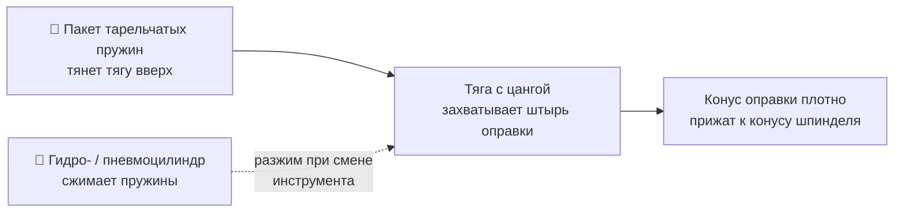
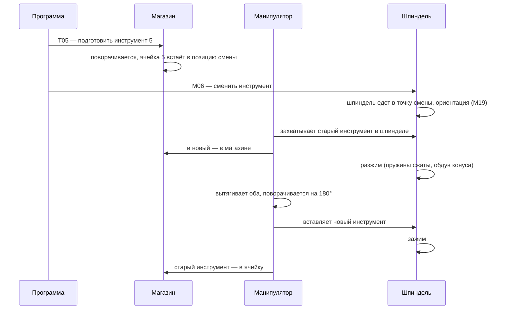

# 🌀 Урок 7. Шпиндель и инструментальная система

> [!abstract] О чём урок
> - как устроен **шпиндель** и какие бывают типы привода шпинделя;
> - как инструмент **зажимается** в шпинделе;
> - **инструментальные конусы и оправки**: BT, SK, CAT, HSK, Capto;
> - **патроны** для инструмента: цанговые, термо, гидро, Weldon;
> - **магазины** и **автоматическая смена инструмента**;
> - **револьверная головка** токарного станка;
> - ⭐ **корректоры инструмента**: длина, радиус, износ — с примерами из реальной работы.
>
> ⏱ ~45 минут

---

## 1. Шпиндель

**Шпиндель** — вращающийся вал, который на фрезерном станке держит и крутит **инструмент**, а на токарном — **патрон с деталью**. Это «сердце» станка и один из самых дорогих узлов (ремонт шпинделя может стоить как хороший автомобиль).

Шпиндель вращается в **высокоточных подшипниках**. Его биение (насколько «виляет» при вращении) — единицы микрон.

### 1.1. Типы привода шпинделя

| Тип | Как устроен | Обороты (типично) | Плюсы / минусы |
|---|---|---|---|
| **Ременной** | Двигатель рядом, вращение передаётся ремнём | до 8 000–10 000 об/мин | Простой, недорогой, ремень гасит удары |
| **С редуктором (коробкой скоростей)** | Шестерни, есть низкая и высокая ступень | до 4 000–6 000 об/мин | ⭐ Огромный **крутящий момент** на низких оборотах — для тяжёлой обработки стали, крупного сверления |
| **Прямой привод** (*direct drive*) | Двигатель соединён со шпинделем муфтой | до 12 000–15 000 об/мин | Нет ремня, меньше вибраций |
| **Мотор-шпиндель** (электрошпиндель) | Двигатель **встроен** внутрь шпинделя | 15 000–40 000+ об/мин | Высокие обороты, точность. Дорогой, чувствителен к ударам и перегреву |

> [!warning] Шпиндель боится
> - **Столкновений** — даже лёгкий удар может повредить подшипники; после любого удара шпиндель проверяют на биение;
> - **Работы без прогрева** на высоких оборотах;
> - **Грязи на конусе** — стружка между конусом шпинделя и оправкой даёт биение и портит конус;
> - **Перегрузки** — нельзя «давить» тупым инструментом.

> [!tip] 💬 Скажи на собеседовании
> «Перед установкой оправки в шпиндель конус надо протереть — даже маленькая стружка даст биение инструмента, а со временем испортит конус шпинделя. А после любого удара шпиндель нужно проверить на биение».

### 1.2. Как инструмент держится в шпинделе

На фрезерном станке инструмент в оправке **затягивается** внутрь шпинделя:



- **Зажим — пружинами.** Если пропадёт воздух или электричество, инструмент не выпадет.
- **Разжим — цилиндром** (пневматическим или гидравлическим). В момент разжима в шпиндель часто подаётся **обдув воздухом**, чтобы очистить конус.
- На шпиндельной бабке обычно есть **кнопка разжима** (*tool release*) — для ручной установки инструмента.

> [!danger] Ручная смена инструмента
> Нажимая кнопку разжима, **держите оправку рукой** — тяжёлая оправка с фрезой выпадет и может повредить руку, деталь или стол. Ставьте инструмент, только убедившись, что шпиндель остановлен.

---

## 2. Инструментальная оправка

**Оправка** (*tool holder*) — переходник между шпинделем и режущим инструментом. Все инструменты в магазине стоят в оправках с одинаковым хвостовиком.

![[cnc-tool-holder.svg]]

### 2.1. Хвостовики (конусы) оправок

| Тип | Конусность | Особенности | Где |
|---|---|---|---|
| **SK** (DIN 69871) | 7:24 | Европейский стандарт | Европейские станки |
| **BT** (MAS 403) | 7:24 | Японский стандарт, очень распространён. Симметричный фланец | Японские, корейские, тайваньские станки, **очень часто в России** |
| **CAT** (ANSI) | 7:24 | Американский стандарт, дюймовая резьба штыря | Станки из США (Haas может быть с CAT или BT) |
| **HSK** | 1:10, полый | Короткий **полый** конус с прижатием **по торцу и конусу**. Высокая точность и жёсткость на высоких оборотах. Без штыря — зажимается изнутри | Высокоскоростные и 5-осевые станки |
| **Capto** (Sandvik), **KM** | полигональный | Сменные головки, быстрая смена | Токарные центры, токарно-фрезерные |

**Цифра после буквы** — размер конуса: **30** (маленькие станки), **40** (самый распространённый для «вертикалок»), **50** (большие станки для тяжёлой обработки). Например, **BT40**, **SK40**, **HSK-A63**.

> [!warning] Оправки разных стандартов не взаимозаменяемы!
> BT40, SK40 и CAT40 — все с конусом 7:24 и «сороковые», но у них **разные фланцы и штыри**. Поставить оправку не того стандарта нельзя — манипулятор её не возьмёт, а шпиндель не зажмёт правильно. Также **штыри (pull stud)** бывают разных типов даже для одного стандарта — подходят только те, что указал производитель станка.

### 2.2. Патроны — чем держат инструмент в оправке

| Тип | Как держит | Точность / жёсткость | Применение |
|---|---|---|---|
| **Цанговый патрон** (ER, реже — мощный) | Разрезная **цанга** сжимается гайкой | Хорошая, универсальный | ⭐ Свёрла, концевые фрезы, метчики — самый распространённый |
| **Патрон Weldon** | Хвостовик с лыской, зажат **боковым винтом** | Очень надёжно, не проворачивается | Черновые фрезы, сверла с лыской |
| **Термопатрон** (термоусадочный) | Патрон **нагревают** индукционным прибором, он расширяется, вставляют инструмент — при остывании сжимает намертво | ⭐ Минимальное биение, высокая жёсткость | Чистовая и высокоскоростная обработка |
| **Гидравлический / гидропластовый** | Давление жидкости внутри патрона сжимает гильзу | Минимальное биение, гасит вибрации | Чистовая обработка, развёртки |
| **Оправка для насадных фрез** | Фреза с отверстием надевается на оправку и крепится винтом | — | Торцевые фрезы большого диаметра |
| **Сверлильный патрон** | Кулачки, как у дрели | Невысокая | Сверла небольших диаметров |
| **Резьбонарезной патрон** | С компенсацией по длине или жёсткий | — | Метчики |

> [!info] Вылет инструмента
> **Вылет** — насколько инструмент торчит из патрона. Чем **длиннее вылет — тем сильнее вибрации** и прогиб. Правило: зажимать инструмент так, чтобы вылет был минимально достаточным для обработки. Если в карте наладки указан вылет — соблюдать его.

---

## 3. Магазин и автоматическая смена инструмента (АСИ)

**Магазин инструментов** — хранилище оправок с инструментами. **Автоматическая смена инструмента (АСИ)**, англ. **ATC** (*Automatic Tool Changer*) — механизм, который ставит нужный инструмент в шпиндель.

### 3.1. Типы магазинов

| Тип | Как выглядит | Ёмкость | Смена |
|---|---|---|---|
| **Карусельный (зонтичный)** | Диск с инструментами сбоку от шпинделя. Магазин сам подъезжает к шпинделю | 10–30 | Медленнее (5–10 с), без манипулятора |
| **Дисковый с манипулятором** (*arm type*) | Диск или барабан + **двуплечий манипулятор** («рука»), который одним движением меняет старый инструмент на новый | 20–40 | ⭐ Быстро: 1–3 с «инструмент-инструмент» |
| **Цепной** | Инструменты на длинной цепи | 40–120+ | С манипулятором |
| **Стеллажный / матричный** | Шкаф с сотнями ячеек, робот-перекладчик | 100–500+ | Для автоматизированного производства |

### 3.2. Как происходит смена (дисковый магазин с манипулятором)



> [!info] Время «от стружки до стружки»
> Производители указывают время смены **tool-to-tool** (только сама замена, 1–3 с) и **chip-to-chip** («от стружки до стружки» — с отводом, остановкой и разгоном шпинделя, 3–8 с). Для серийного производства это важный показатель.

### 3.3. Фиксированные и случайные ячейки

> [!warning] Важно: инструмент может вернуться не в свою ячейку!
> - **Фиксированные ячейки**: инструмент T5 всегда живёт в ячейке 5.
> - **Случайные ячейки** (*random*): на быстрых магазинах с манипулятором снятый из шпинделя инструмент кладётся в **ту ячейку, откуда взяли новый**. Стойка ведёт **таблицу**: какой инструмент в какой ячейке.
>
> Поэтому **нельзя просто вытащить оправку из ячейки руками и поставить другую** — стойка будет думать, что там старый инструмент. Ручные замены делают через шпиндель или через таблицу инструментов на стойке — так, как принято на вашем станке.

> [!danger] У магазина не стоять
> Магазин и манипулятор могут прийти в движение **в любой момент** работы программы. Не суйте руки в магазин, когда станок не в аварийном стопе или не в режиме обслуживания с открытой дверцей магазина.

---

## 4. Токарный станок: револьверная головка

На токарных станках инструменты чаще всего стоят в **револьверной головке** (*turret*) — поворотном диске с позициями (обычно **8, 10, 12, 16, 24**).

```
           ┌─────┐
        ╱  │ T01 │  ╲          T01 — проходной резец
   ┌─────┐ └─────┘ ┌─────┐     T02 — подрезной
   │ T08 │    ●    │ T02 │     T03 — сверло
   └─────┘  центр  └─────┘     T04 — расточной резец
        ╲  ┌─────┐  ╱          T05 — канавочный
           │ T05 │            ...
           └─────┘
     (вид с торца, упрощённо — 8 позиций)
```

- Смена инструмента = **поворот головки** на нужную позицию (доли секунды).
- Код на Fanuc: **T0101** — первые две цифры — **номер позиции** в револьвере, последние две — **номер корректора**. `T0303` — инструмент в позиции 3 с корректором 3.
- Крепления инструмента в револьвере: пазы под **державки** (прямоугольный хвостовик резца), посадки **VDI** (цилиндрический хвостовик с зубчатой рейкой), **BMT** (фланцевое крепление, жёстче — часто для приводного инструмента).
- **Приводной инструмент** (фрезы, сверла с вращением) — ставится в специальные блоки, которые вращает отдельный мотор револьвера.

> [!info] Гребенчатое расположение
> На небольших токарных станках и автоматах встречается **гребенчатое** (*gang*) расположение: инструменты стоят в ряд на поперечном суппорте, «смена» — просто сдвиг суппорта. Очень быстро.

> [!warning] Столкновения на токарном
> На токарном станке очень много инструментов рядом с патроном. Типичная авария — **длинное сверло или расточная оправка задевает кулачки** или деталь при повороте револьвера. Перед поворотом револьвер должен отъехать в безопасную точку — это прописано в программе, но при ручном повороте об этом думает оператор.

### Сменные пластины

Большинство токарных резцов (и многие фрезы) — **со сменными твёрдосплавными пластинами**. Пластина затупилась → её **поворачивают на новую режущую кромку** или меняют. Державка остаётся та же.

> [!tip] 💬 Скажи на собеседовании
> «После замены пластины на том же резце размеры почти не меняются, но всё равно первую деталь после замены надо промерить — пластины немного отличаются, и иногда нужно подправить корректор».

(Подробно о пластинах, их обозначениях и режимах резания — в отдельном модуле про режущий инструмент.)

---

## 5. ⭐ Корректоры инструмента

**Корректоры** (*offsets*) — это таблица в стойке, где для каждого инструмента записаны его **размеры** (длина, радиус) и **поправки на износ**. Работа с корректорами — **главная ежедневная обязанность оператора**, после установки заготовок.

### 5.1. Зачем нужны корректоры

Программа пишется **для идеального инструмента**: «кончик фрезы должен пройти вот здесь». Но реальные инструменты разной длины, разного диаметра, и они **изнашиваются**. Корректоры сообщают стойке реальные размеры — и станок сам смещает траекторию.

### 5.2. Корректоры фрезерного станка

| Корректор | Код в программе | Что хранит | Как определяют |
|---|---|---|---|
| **Длина (H)** | **G43 H01** | Расстояние от базового торца шпинделя до кончика инструмента (см. схему оправки выше) | Касанием детали/эталона, датчиком длины на столе, на **приборе предварительной настройки** (*presetter*) вне станка |
| **Радиус (D)** | **G41 D01** (слева) / **G42 D01** (справа) | Радиус фрезы | По паспорту инструмента или замер |
| **Износ длины / радиуса** (*wear*) | — (суммируется с основным) | Небольшие поправки, которые вносит оператор по результатам замеров | Замер детали |

> [!example] Пример: наружный размер получился больше
> Фреза Ø10 обрабатывает наружный контур детали с коррекцией на радиус. Должно быть **50,00 мм**, микрометр показывает **50,04 мм** — деталь больше на 0,04 мм, т. е. **на 0,02 мм с каждой стороны**.
> → В **износ радиуса** этой фрезы вводим **−0.02**. Станок «думает», что фреза чуть меньше, и подведёт её ближе к детали на 0,02 с каждой стороны.
> Следующая деталь — **50,00**. ✅

> [!example] Пример: глубина паза получилась меньше
> По чертежу глубина **5,00**, получилось **4,95** (недорезали 0,05 мм).
> → В **износ длины** этой фрезы вводим **−0.05**. Станок «думает», что фреза короче, и опустит её ниже на 0,05.

### 5.3. Корректоры токарного станка

| Корректор | Что хранит |
|---|---|
| **Геометрия X** (*geometry*) | Положение вершины резца по X относительно базовой точки револьвера |
| **Геометрия Z** | Положение вершины резца по Z |
| **R** — радиус при вершине | Радиус закругления вершины пластины (0,4; 0,8; 1,2 мм…) — для коррекции на радиус при точении конусов и радиусов |
| **T** — код положения вершины (квадрант, 0–9) | В какую сторону «смотрит» вершина резца |
| **Износ X / Z** (*wear*) | Поправки оператора по замерам |

> [!example] Пример: диаметр вышел больше
> Нужно **Ø30 h7** (от 29,979 до 30,000), получилось **Ø30,05**.
> - Цель — середина допуска ≈ **29,99**.
> - Разница: 29,99 − 30,05 = **−0,06**.
> - В **износ X** резца вводим **−0.06** (X — в диаметре, помните? [[03. Оси и системы координат]]).

> [!example] Пример: длина вышла больше
> Уступ должен быть на **Z −20,00** от торца, а получился на **−19,96** (уступ короче на 0,04).
> → В **износ Z** вводим **−0.04** — резец пойдёт на 0,04 мм дальше к патрону.

### 5.4. Правила работы с корректорами

> [!warning] Правила, которые спасают детали и станки
> 1. **Изменения вводить в износ**, а не в геометрию. Геометрию задаёт наладчик при настройке.
> 2. **Знак!** Перепутали «+» и «−» — и вместо исправления ошибка удвоится. Всегда проговаривайте: «мне нужно меньше → минус».
> 3. Вводить **в корректор того инструмента, который делал этот размер** (смотреть по программе/карте наладки).
> 4. Стремиться к **середине допуска**, а не к краю — инструмент изнашивается, и размер постепенно «уходит».
> 5. Вносить коррекцию **небольшими шагами** и проверять следующую деталь.
> 6. Помнить разницу «**ввод**» и «**+ввод**»: на Fanuc `INPUT` **заменяет** значение, а `+INPUT` **прибавляет** к текущему. Пример: в износе уже −0,10, нужно ещё −0,02. `+INPUT −0.02` даст **−0,12** ✅, а `INPUT −0.02` запишет **−0,02** ❌ — прежняя поправка пропадёт, и деталь уйдёт в брак.
> 7. Записывать изменения в журнал, если так принято на предприятии.

> [!tip] 💬 Скажи на собеседовании
> «Если деталь начинает уходить по размеру, я не трогаю программу, а вношу поправку в **износ** того инструмента, который делает этот размер. Целюсь в середину допуска, вношу небольшими шагами и проверяю следующую деталь. На токарном помню, что по X поправка — в диаметре».

---

## 6. Итоги урока

> [!summary] Запомни
> 1. Шпиндель бывает **ременной, с редуктором, с прямым приводом, мотор-шпиндель**. Боится ударов, грязи на конусе, работы без прогрева.
> 2. Инструмент **зажимается пружинами**, **разжимается цилиндром**.
> 3. Конусы: **BT, SK, CAT** (7:24), **HSK** (полый 1:10). Размеры: 30/40/50. Не взаимозаменяемы.
> 4. Патроны: **цанговые** (основные), **Weldon**, **термо**, **гидро**.
> 5. Магазин бывает **карусельный** и **с манипулятором**; при случайных ячейках инструмент может вернуться в другую ячейку.
> 6. На токарном — **револьверная головка**, код **T0101** (позиция + корректор).
> 7. **Корректоры**: длина (H, G43), радиус (D, G41/G42), на токарном — X, Z, R, T. Поправки по замерам — **в износ**, следить за **знаком**.

---

## ❓ Проверь себя

> [!question]- 1. Какие типы привода шпинделя бывают?
> Ременной, с редуктором (коробкой скоростей), прямой (через муфту), мотор-шпиндель (двигатель встроен в шпиндель).

> [!question]- 2. Почему инструмент в шпинделе зажимается пружинами, а не цилиндром?
> Для безопасности: при пропадании воздуха или питания пружины продолжают держать инструмент, и он не выпадет.

> [!question]- 3. Что означает BT40?
> Японский стандарт инструментальной оправки с конусом 7:24 размера 40.

> [!question]- 4. Чем HSK отличается от BT?
> HSK — короткий полый конус 1:10, прижимается и по конусу, и по торцу, зажимается изнутри. Лучше держит точность и жёсткость на высоких оборотах.

> [!question]- 5. Что такое случайные ячейки магазина и чем они опасны?
> Снятый инструмент кладётся в ячейку, из которой взяли новый, стойка ведёт таблицу. Если вручную переставить оправки в магазине, таблица перестанет соответствовать реальности — станок возьмёт не тот инструмент.

> [!question]- 6. Что означает T0505 на токарном станке Fanuc?
> Инструмент в позиции 5 револьверной головки с корректором номер 5.

> [!question]- 7. Вал должен быть Ø25,00, получилось Ø25,04. Что вводите в износ X?
> −0,04 (на токарном X в диаметре). Если допуск позволяет — целимся в середину допуска.

> [!question]- 8. Глубина кармана по чертежу 10,00, получилось 10,03. Что делать?
> Фреза ушла глубже на 0,03 — в износ длины этой фрезы ввести +0,03, чтобы она опускалась на 0,03 мм меньше.

> [!question]- 9. Почему коррекции вводят в износ, а не в геометрию?
> Геометрия — базовые размеры инструмента, заданные при наладке. Износ — небольшие поправки по ходу работы. Так всегда видно, на сколько «уехал» инструмент, и при замене пластины износ можно просто обнулить.

---

⬅️ [[06. Система ЧПУ и пульт оператора]] | [[00. Оглавление|Оглавление]] | ➡️ [[08. Закрепление заготовок]]
