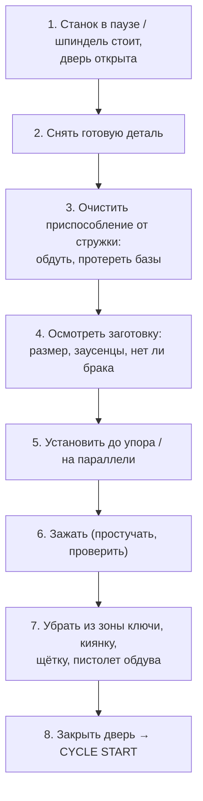

# 🗜️ Урок 8. Закрепление заготовок

> [!abstract] О чём урок
> - зачем деталь нужно **базировать** и что такое «6 степеней свободы» (просто);
> - оснастка **фрезерного** станка: тиски, губки, параллели, прихваты, поворотные столы, системы нулевого базирования;
> - оснастка **токарного** станка: патроны, кулачки (твёрдые и сырые), цанги, задняя бабка, люнет;
> - типичные ошибки при установке заготовки.
>
> ⏱ ~30 минут

---

## 1. Зачем это важно

Установка заготовки — то, что оператор делает **десятки и сотни раз за смену**. Плохо закреплённая деталь:
- **вырвется** из тисков или патрона — сломается инструмент, пострадает станок и, возможно, человек;
- **сдвинется** при резании — брак;
- **деформируется** от слишком сильного зажима — после разжима «отпружинит», размеры уйдут;
- **будет вибрировать** — плохая поверхность, сколы инструмента.

### Базирование — простыми словами

Любое тело в пространстве может двигаться **6 способами**: сдвигаться вдоль X, Y, Z и поворачиваться вокруг X, Y, Z. Это **6 степеней свободы**. Задача приспособления — **отнять все шесть**, причём так, чтобы каждая следующая деталь вставала **в то же самое место**.

> [!example] Аналогия
> Положите книгу на стол — она уже не упадёт вниз (лишили 3 степеней: сдвиг вниз и наклоны). Придвиньте её к стене — не уедет назад и не повернётся (ещё 2). Уприте торцом в книжный упор — больше не сдвинется вбок (ещё 1). Книга «забазирована»: каждая следующая книга встанет точно так же.
> В тисках роль стола играют **параллели**, роль стены — **неподвижная губка**, роль упора — **упор (стопор)** сбоку.

> [!tip] 💬 Скажи на собеседовании
> «Для серии важно, чтобы каждая заготовка вставала одинаково — поэтому используют упоры и одни и те же базовые поверхности. Тогда нуль детали не меняется, и не надо привязываться заново».

---

## 2. Оснастка фрезерного станка

### 2.1. Станочные тиски — главный инструмент оператора

```
   Вид сбоку на тиски:
                       заготовка
   неподвижная      ┌───────────┐      подвижная
     губка ──►  ▐███│           │███▌ ◄── губка ◄── винт
                ▐███│           │███▌
                ▐███├─┬───────┬─┤███▌
                ▐███│ │ парал-│ │███▌
                ▐███│ │ лели  │ │███▌
            ════╧═══╧═╧═══════╧═╧═══╧════ корпус тисков
```

| Элемент | Назначение |
|---|---|
| **Неподвижная губка** | **База**: от неё отсчитываются размеры. Её выставляют параллельно оси X |
| **Подвижная губка** | Прижимает заготовку к неподвижной |
| **Параллели (подкладки)** | Точные стальные пластины под заготовку — поднимают её над губками на нужную высоту и задают базу по Z |
| **Упор** | Фиксирует положение заготовки вдоль губок — чтобы каждая деталь вставала в одно место |

**Виды тисков:**
- **Механические** (тип «Kurt» и аналоги) — затягиваются рукояткой; часто с **усилителем** (механическим или гидравлическим): лёгкое усилие руки → большое усилие зажима.
- **Гидравлические / пневматические** — зажим от гидростанции или воздуха, одинаковое усилие каждый раз.
- **Самоцентрирующие** — обе губки сходятся к центру одновременно. Удобно, когда нуль детали — в её центре.
- **Двойные / многоместные** — несколько заготовок за одну установку.

**Губки:**
- **Твёрдые (закалённые)** — с гладкой или рифлёной поверхностью;
- **Мягкие / фрезеруемые** (сталь, алюминий) — в них **фрезеруют выемку** точно под форму детали. Держат сложные и уже обработанные детали, не портя поверхность.

> [!warning] Ошибки при установке в тиски
> 1. **Стружка** на параллелях или губках — деталь встанет криво. Перед установкой всё **обдуть и протереть**.
> 2. Деталь **не прижата к параллелям** — при затяжке её «подбрасывает» вверх. После затяжки **простучать** деталь сверху киянкой (резиновым или пластиковым молотком) и проверить, что параллели не болтаются.
> 3. **Слишком малое зацепление** в губках (деталь зажата на 2–3 мм) — может вырвать.
> 4. **Слишком сильный зажим** тонкостенной детали — деформация.
> 5. Фреза при обработке задевает **губки или параллели** — следить, чтобы их не было на траектории.
> 6. Затяжка тисков удлинителем-трубой — так ломают тиски. Использовать только штатную рукоятку.

> [!info] Выставка тисков
> Тиски ставят на стол и **выставляют индикатором**: индикатор в шпинделе, ведём стол по X вдоль неподвижной губки — стрелка должна отклоняться не больше чем на **0,01 мм** по всей длине. Затем тиски прижимают к столу болтами в Т-пазах. Обычно это делает наладчик, но знать стоит.

### 2.2. Прихваты (крепление на столе)

Крупные заготовки, которые не входят в тиски, крепят **прямо к столу**:
- **Т-образные болты и гайки** входят в Т-пазы стола;
- **прихваты** (планки) прижимают деталь;
- **ступенчатые опоры** поддерживают задний конец прихвата.

```
            болт
     прихват  │
   ═══════════╪═══════════
   │заготовка│ │    │ опора │
   └─────────┘ │    └───────┘
   ═══════════╧═══════════════  стол (Т-паз)
```

> [!tip] Правило прихвата
> Болт ставят **ближе к детали**, чем к опоре, а прихват держат **горизонтально** (опора — на высоте детали или чуть выше). Тогда почти всё усилие идёт на деталь.

### 2.3. Другие приспособления

| Приспособление | Для чего |
|---|---|
| **Угольники, призмы** | Установка под углом, круглые заготовки на фрезерном |
| **Поворотный стол / делительная головка** (4-я ось) | Обработка с нескольких сторон за одну установку (см. [[02. Виды станков с ЧПУ]]) |
| **Специальные приспособления** (кондукторы) | Изготовлены под конкретную деталь для серии — с пальцами, упорами, гидрозажимами |
| **Системы нулевого базирования** (*zero-point*: Schunk VERO-S, Lang, Erowa и др.) | На столе — зажимные модули, на приспособлении — штыри. Приспособление ставится за **секунды** и **всегда в одно место** — не нужно заново выставлять и привязываться |
| **Вакуумные столы** | Тонкие листовые заготовки, пластик, алюминиевый лист |
| **Магнитные плиты** | Стальные заготовки (чаще на шлифовальных) |
| **Паллеты** | Заготовка закреплена на паллете вне станка, пока станок работает (горизонтальные центры) |

---

## 3. Оснастка токарного станка

### 3.1. Трёхкулачковый патрон

![[cnc-chuck.svg]]

- **Самоцентрирующий**: три кулачка сходятся одновременно, круглая (или шестигранная) заготовка сама встаёт по центру.
- На ЧПУ — обычно **гидравлический** патрон: зажим и разжим **педалью**, усилие зажима задаётся **давлением** гидравлики (регулятор с манометром).
- **Наружный зажим** — кулачки сжимают заготовку снаружи; **внутренний** — разжимают её изнутри (кольца, втулки).

### 3.2. Кулачки: твёрдые и сырые

| | **Твёрдые (закалённые)** | **Сырые (мягкие, незакалённые)** |
|---|---|---|
| Поверхность | Рифлёная или ступенчатая | Гладкая, растачивается под деталь |
| Точность центрирования | Средняя (~0,03–0,05 мм) | ⭐ Высокая (~0,01 мм и лучше) |
| Следы на детали | Оставляют насечку | Почти не оставляют |
| Применение | Черновые операции, заготовки из проката | Чистовые операции, повторная установка обработанной детали, тонкостенные детали |

> [!info] Расточка сырых кулачков
> Сырые кулачки **растачивают на самом станке** резцом под нужный диаметр детали. Делают это **в зажатом состоянии** (обычно зажимают специальное кольцо или диск между кулачками), чтобы кулачки были в рабочем положении. Тогда деталь будет вставать точно по центру шпинделя. Это задача наладчика, но оператор должен знать, что это такое.

### 3.3. Другие способы закрепления на токарном

| Оснастка | Для чего |
|---|---|
| **Четырёхкулачковый патрон** (независимый) | Каждый кулачок двигается отдельно — для несимметричных деталей или точной выверки «в ноль» индикатором |
| **Цанговый патрон** | Пруток малого диаметра; точнее и быстрее патрона, меньше следов. Часто на станках с прутковым податчиком |
| **Задняя бабка с вращающимся центром** | Поддержка правого конца **длинной детали** — чтобы не прогибалась и не вибрировала |
| **Люнет** (неподвижный/подвижный) | Опора посередине очень длинного вала |
| **Поводковый патрон / планшайба** | Обработка в центрах; крупные детали неправильной формы |
| **Прутковый податчик + уловитель деталей** | Автоматическая подача прутка и сбор готовых деталей — работа без оператора |

> [!tip] Правило вылета детали
> Если заготовка торчит из патрона больше чем примерно на **3 диаметра** (для жёстких материалов — даже меньше), её нужно **поддерживать задней бабкой**. Иначе деталь будет прогибаться от резца («отжим»), получится конус и вибрация, а в худшем случае — вырвет из патрона.
> Пример: пруток Ø20 → без поддержки вылет до ~60 мм.

### 3.4. Давление зажима

> [!warning] Слишком мало и слишком много — одинаково плохо
> - **Мало давления** — при высоких оборотах **центробежная сила** раскрывает кулачки, деталь проворачивается или **вылетает**. Вылетевшая из патрона на 3000 об/мин деталь — это снаряд.
> - **Много давления** — тонкостенная втулка сожмётся в «треугольник»: внутри станка размер будет хорошим, а после разжима деталь «отпружинит» и станет некруглой.
>
> Давление задаёт наладчик по карте наладки. Оператор следит, чтобы его **не меняли** без причины, и проверяет показания манометра в начале смены.

> [!danger] Ключ от патрона
> На токарных станках с ручным патроном главное правило: **ключ из патрона вынимать сразу**. Оставленный ключ при включении шпинделя вылетает со страшной силой. На станках с ЧПУ ключ используется для замены кулачков — правило то же.

---

## 4. Порядок установки заготовки (общий чек-лист)



---

## 5. Итоги урока

> [!summary] Запомни
> 1. Задача приспособления — **лишить деталь 6 степеней свободы** и ставить каждую деталь **в одно место**.
> 2. На фрезерном главное — **тиски** (неподвижная губка — база, параллели, упор), прихваты, поворотные столы, нулевое базирование.
> 3. Перед установкой — **очистить от стружки**; после зажима — **простучать** и проверить параллели.
> 4. На токарном — **гидравлический трёхкулачковый патрон**; **сырые кулачки** растачивают под деталь для точности.
> 5. Длинную деталь (вылет > ~3D) поддерживают **задней бабкой** или **люнетом**.
> 6. **Давление зажима** — не слишком мало (вылетит) и не слишком много (деформирует).

---

## ❓ Проверь себя

> [!question]- 1. Что такое 6 степеней свободы и зачем их лишать?
> Три перемещения вдоль осей и три поворота вокруг них. Приспособление должно лишить деталь всех шести, чтобы она не сдвинулась при обработке и каждая деталь вставала одинаково.

> [!question]- 2. Какая губка тисков является базой?
> Неподвижная. Её выставляют параллельно оси станка.

> [!question]- 3. Зачем простукивать деталь после зажатия в тиски?
> При затяжке деталь может приподняться с параллелей. Простукивание прижимает её к параллелям; потом проверяют, что параллели зажаты и не двигаются.

> [!question]- 4. Чем сырые кулачки лучше твёрдых?
> Их растачивают под конкретную деталь — получается высокая точность центрирования, деталь не портится насечкой, удобно для тонкостенных и уже обработанных деталей.

> [!question]- 5. Когда нужна задняя бабка?
> Когда деталь длинная: вылет из патрона больше примерно трёх диаметров. Иначе деталь прогибается, вибрирует, может вылететь.

> [!question]- 6. Что будет, если давление в патроне слишком маленькое? Слишком большое?
> Маленькое — деталь провернётся или вылетит, особенно на высоких оборотах. Большое — тонкостенная деталь деформируется и после разжима станет некруглой.

> [!question]- 7. Что такое система нулевого базирования?
> Система зажимных модулей на столе и штырей на приспособлении: приспособление ставится за секунды всегда в одно и то же место, без выставки и повторной привязки.

---

⬅️ [[07. Шпиндель и инструментальная система]] | [[00. Оглавление|Оглавление]] | ➡️ [[09. Вспомогательные системы]]
