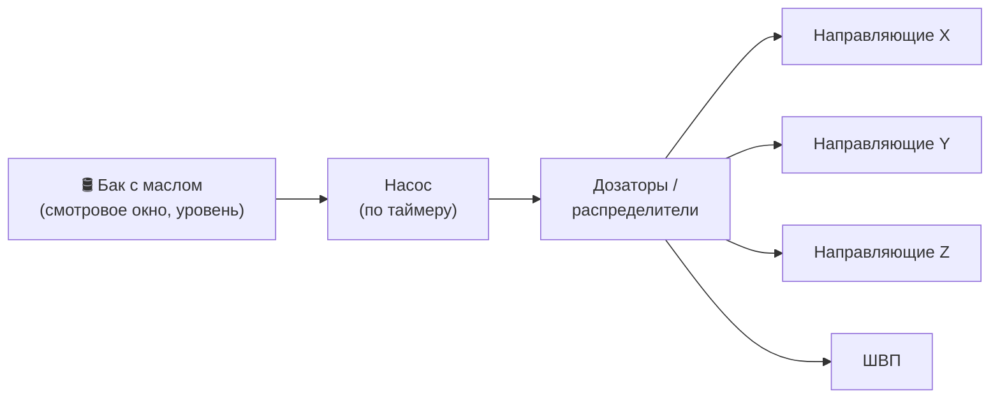

# 💧 Урок 9. Вспомогательные системы станка

> [!abstract] О чём урок
> Всё, без чего станок не работает, хотя это и не оси со шпинделем:
> - **СОЖ** — виды, способы подачи, контроль концентрации;
> - **централизованная смазка** направляющих и ШВП;
> - **пневмосистема** и **гидросистема**;
> - **удаление стружки**: транспортёры, фильтры;
> - **ограждения, блокировки, сигнальная колонна**;
> - **измерительные щупы и датчики инструмента**;
> - **автоматизация**: прутковые податчики, роботы, паллеты.
>
> ⏱ ~30 минут

> [!info] Почему это важно оператору
> Именно эти системы оператор **обслуживает каждый день**: доливает, сливает, чистит, проверяет. Многие «аварии» на экране связаны не с программой, а с ними: «низкий уровень смазки», «нет давления воздуха», «перегрузка транспортёра».

---

## 1. СОЖ — смазочно-охлаждающая жидкость

### 1.1. Зачем нужна СОЖ

| Функция | Зачем |
|---|---|
| ❄️ **Охлаждение** | Отводит тепло из зоны резания — инструмент дольше служит, деталь не «растёт» от нагрева |
| 🛢️ **Смазка** | Уменьшает трение между инструментом и стружкой — лучше поверхность, меньше налипания |
| 🚿 **Вымывание стружки** | Уносит стружку из зоны резания, из глубоких отверстий и карманов |
| 🛡️ **Защита от коррозии** | Детали и станок не ржавеют |

### 1.2. Виды СОЖ

| Вид | Что это | Плюсы / минусы | Применение |
|---|---|---|---|
| **Водосмешиваемая (эмульсия)** | Концентрат смешивают с водой, обычно **3–10%**. Выглядит как молоко (эмульсия) или полупрозрачная (полусинтетика / синтетика) | Хорошо охлаждает, дешёвая. Может портиться (бактерии, запах), нужен контроль концентрации | ⭐ **Большинство станков** |
| **Масло (чистое, без воды)** | Специальное масло для резания | Отличная смазка, лучше поверхность; хуже охлаждает, пожароопасно (масляный туман) | Шлифование, автоматы продольного точения, нарезание резьбы, зубообработка |
| **Минимальная смазка (MQL, «туман»)** | Капли масла в потоке воздуха | Почти сухая стружка, экологично | Алюминий, высокоскоростная обработка |
| **Без СОЖ (сухая обработка) + обдув воздухом** | — | — | Чугун, некоторые режимы с твердосплавным инструментом с покрытием, графит |

### 1.3. Способы подачи

| Способ | Код (типично Fanuc) | Описание |
|---|---|---|
| **Полив через сопла** | **M08** вкл / **M09** выкл | Гибкие сопла направлены в зону резания. Оператор направляет их на инструмент |
| **Через шпиндель / через инструмент** (*TSC — Through Spindle Coolant*) | часто **M88**/**M89** или другой код (зависит от станка) | СОЖ под давлением **20–70 бар** подаётся через шпиндель и каналы внутри инструмента прямо к режущей кромке. Незаменимо для **глубокого сверления** |
| **Туман** | часто **M07** | Масляный туман |
| **Обдув воздухом** | зависит от станка | Сдувает стружку, охлаждает при сухой обработке |

> [!warning] Подача через шпиндель — только для инструмента с каналами!
> Если включить СОЖ через шпиндель с инструментом **без внутренних каналов**, жидкость под давлением может пойти туда, куда не надо (через уплотнения), а у некоторых станков — повредить узлы. Также нужен специальный **штырь оправки со сквозным отверстием**.

> [!tip] Сопла
> Сопла полива должны быть направлены **точно в зону резания**. После смены инструмента другой длины струя может бить мимо — оператор подправляет сопла. Некоторые станки имеют программируемые сопла, которые подстраиваются сами.

### 1.4. Контроль СОЖ — обязанность оператора

> [!example] Рефрактометр
> Концентрацию эмульсии проверяют **рефрактометром** — маленьким оптическим прибором. Капля СОЖ на стекло → смотрим в окуляр → видим значение по шкале (по шкале Брикса), умножаем на **коэффициент** концентрата (указан производителем) → получаем концентрацию в %.
>
> - **Мало концентрата** → ржавчина на деталях и станке, бактерии, хуже стойкость инструмента;
> - **Много** → пена, раздражение кожи, перерасход.
>
> Доливают **не воду и не концентрат по отдельности**, а **готовую смесь** нужной концентрации (или по инструкции предприятия).

**Признаки, что СОЖ испортилась:**
- **неприятный запах** («тухлые яйца») — размножились бактерии, особенно после выходных, когда жидкость стояла без циркуляции;
- расслоение, масляная плёнка сверху (посторонние масла из системы смазки);
- пена;
- раздражение кожи у работников.

> [!danger] СОЖ и здоровье
> Длительный контакт с СОЖ может вызывать **дерматит**. При работе с СОЖ (чистка бака, промывка) используйте **нитриловые перчатки** и защитный крем; не вдыхайте туман — закрывайте дверь станка, включайте вытяжку (если есть). Но **никаких перчаток рядом с вращающимся шпинделем** — см. [[10. Обслуживание и безопасность]].

---

## 2. Централизованная смазка

Направляющие и ШВП должны постоянно смазываться. На станках с ЧПУ это делает **автоматическая станция смазки**: насос с баком через заданные интервалы подаёт **порцию масла** по трубкам к каждой точке смазки.

| Что проверять | Почему |
|---|---|
| **Уровень масла** в баке — ежедневно | При низком уровне станок выдаст аварию / предупреждение и может остановиться |
| **Тип масла** — только указанный производителем (специальное масло для направляющих, например ISO VG 68) | Масло для направляющих имеет присадки, чтобы держаться на вертикальных поверхностях и не смешиваться с СОЖ. Чужое масло может повредить покрытие направляющих |
| Расход — не слишком ли быстро уходит | Может быть утечка или порвана трубка |

> [!info] Смазка шпинделя
> Подшипники шпинделя смазываются по-разному: **пластичной смазкой** «на весь срок» (ничего делать не надо), **масло-воздух** (отдельный бачок — следить за уровнем) или масляным туманом. На станке с редуктором — масло в редукторе.

---

## 3. Пневмосистема (сжатый воздух)

Сжатый воздух приходит от **заводского компрессора** по трубам. Давление обычно **5–6 бар** (0,5–0,6 МПа).

**Что работает от воздуха:**
- разжим инструмента в шпинделе и **обдув конуса**;
- механизм смены инструмента (на некоторых станках);
- продувка **оптических линеек** и датчиков;
- пневмозажимы, двери с пневмоприводом;
- пистолет обдува для оператора.

**Блок подготовки воздуха** на станке: фильтр + **влагоотделитель** + регулятор давления с манометром + (иногда) лубрикатор.

> [!warning] Конденсат
> В сжатом воздухе есть влага — она собирается в **стакане влагоотделителя**. Если стакан полон, вода пойдёт в станок: ржавчина, отказ клапанов, вода в шпинделе. **Сливать конденсат** — часть ежедневного обслуживания (если нет автоматического слива).

> [!warning] Нет воздуха — нет работы
> При падении давления ниже нормы станок выдаёт аварию (*air pressure low*) и **не даст** сменить инструмент или запустить программу. Первым делом смотрите на **манометр**.

---

## 4. Гидросистема

**Гидростанция** — насос, бак с гидравлическим маслом, клапаны. Создаёт давление масла (десятки бар).

**Что работает от гидравлики:**
- **зажим патрона** на токарном станке;
- **задняя бабка** (выдвижение пиноли);
- **зажим револьверной головки**, иногда — поворот;
- **уравновешивание** оси Z;
- **гидрозажимы** приспособлений, гидравлические тиски;
- зажим инструмента / поворотных столов на некоторых станках.

> [!info] Что проверяет оператор
> - **Уровень масла** в баке гидростанции;
> - **давление** по манометру — соответствует ли норме (особенно давление патрона — см. [[08. Закрепление заготовок]]);
> - **утечки** — лужи масла под станком, мокрые шланги;
> - **температуру** — перегретая гидравлика пахнет и шумит.

---

## 5. Удаление стружки

Станок за смену может наделать **сотни килограммов стружки**. Если её не убирать — она забивает рабочую зону, рвёт кожухи, мешает СОЖ стекать, наматывается на инструмент.

### 5.1. Внутри станка

- **Шнеки** (винтовые конвейеры) в поддоне — гонят стружку к транспортёру;
- **промывка** — СОЖ под давлением смывает стружку со стенок;
- **наклонные стенки** и наклонная станина — стружка сама скатывается.

### 5.2. Стружкотранспортёр

| Тип | Для какой стружки |
|---|---|
| **Шарнирно-пластинчатый (ленточный)** | Крупная, длинная, вьющаяся стальная стружка |
| **Скребковый** | Мелкая стружка, чугунная крошка, алюминий |
| **Магнитный** | Мелкая стальная/чугунная стружка (шлифование) |
| **С барабанным фильтром** | Мелкая стружка + очистка СОЖ |

Транспортёр выносит стружку в **тележку (стружкосборник)**, а СОЖ стекает обратно в бак.

> [!warning] Типичные проблемы со стружкой
> - **Длинная вьющаяся стружка («мочалка»)** на токарном — наматывается на деталь и резец, рвёт поверхность, клинит транспортёр. Решение — правильная **стружколомающая геометрия пластины** и режимы. Сообщайте наладчику/технологу.
> - **Переполнена тележка** — стружка возвращается в станок, транспортёр встаёт в аварию по перегрузке.
> - **Забиты сетки/фильтры бака** — СОЖ перестаёт поступать, насос работает «на сухую».
> - **Стружку из станка руками не берут** — она острая как бритва и горячая. Только **крючок, щётка, скребок**.

> [!info] Фильтрация СОЖ
> СОЖ проходит через **сетки**, **бумажные фильтры** (лента меняется автоматически), **центрифуги**, **магнитные сепараторы**. Для подачи через шпиндель под высоким давлением нужна особенно тонкая фильтрация — иначе забьются каналы в инструменте.

---

## 6. Ограждения, блокировки, сигнальная колонна

- **Ограждение рабочей зоны** (кабинетная защита) — защищает от стружки, СОЖ, вылетевших пластин и деталей.
- **Смотровое окно** — из **поликарбоната** (часто многослойное с защитным стеклом). Поликарбонат стареет от СОЖ и УФ — со временем теряет прочность и подлежит замене по сроку.
- **Блокировка двери** — в автоматическом режиме программа **не запустится** при открытой двери, а при открытии двери во время работы станок остановится. В наладочном режиме при открытой двери скорости ограничены.
- **Освещение рабочей зоны**.
- **Сигнальная колонна** («светофор»):

| Цвет | Значение (типично) |
|---|---|
| 🟢 Зелёный | Программа выполняется, всё в порядке |
| 🟡 Жёлтый | Программа закончилась / пауза / ожидание оператора / предупреждение |
| 🔴 Красный | Авария |

> [!danger] Никогда не обходите блокировку двери
> Нельзя заклеивать, перемыкать или как-либо обманывать датчик двери. Работа при открытой двери в автомате — одна из главных причин тяжёлых травм у станочников.

---

## 7. Измерительные системы в станке

| Датчик | Где | Для чего |
|---|---|---|
| **Измерительный щуп** (*touch probe*, напр. Renishaw OMP40, OMP60) | Ставится в шпиндель как инструмент. Сигнал передаётся по радио или инфракрасному каналу | **Автоматическая привязка** детали (запись в G54), измерение детали прямо на станке, проверка положения заготовки |
| **Датчик длины инструмента** (*tool setter*: контактный или лазерный) | На столе фрезерного станка | Автоматическое измерение **длины и диаметра** инструмента, контроль **поломки** инструмента в процессе |
| **Рычаг настройки инструмента** (*tool eye*, «рука») | На токарном станке, откидывается в рабочую зону | Касание вершиной резца — стойка сама записывает геометрию X и Z |
| **Прибор предварительной настройки** (*presetter*) | Отдельный прибор вне станка | Измерение инструмента в оправке, пока станок работает. Данные вводят в корректоры (вручную или по сети) |

> [!tip] 💬 Скажи на собеседовании
> «Измерительный щуп в шпинделе позволяет автоматически привязаться к детали и даже проверить размеры прямо на станке. А датчик инструмента на столе может проверять, не сломалось ли сверло, перед следующей операцией — это особенно важно при работе без оператора».

> [!warning] Щуп — дорогой и хрупкий
> Щуп стоит дорого. Его **нельзя вращать** на оборотах (кроме специальных циклов), **нельзя подводить на ускоренном ходу** к детали и **нельзя включать СОЖ через шпиндель**, когда он стоит в шпинделе. Удар щупом о деталь = сломанный стержень или весь датчик.

---

## 8. Автоматизация

| Система | Что делает |
|---|---|
| **Прутковый податчик** (*bar feeder*) | Автоматически подаёт пруток длиной 3–6 м в шпиндель токарного станка. Станок делает сотни деталей без участия человека |
| **Уловитель деталей** (*parts catcher*) | Ловит отрезанную деталь и выводит из рабочей зоны |
| **Робот-загрузчик** | Берёт заготовку со стеллажа, ставит в станок, снимает готовую деталь |
| **Сменщик паллет** (*APC*) | Пока обрабатывается одна паллета, оператор готовит другую |
| **Автоматические двери** | Нужны для работы с роботом |

> [!info] Что это значит для оператора
> При автоматизации один оператор может обслуживать **несколько станков** одновременно. На собеседовании могут спросить: «готовы ли работать на двух-трёх станках?» — это нормальная практика для серийного производства.

---

## 9. Итоги урока

> [!summary] Запомни
> 1. **СОЖ** охлаждает, смазывает, вымывает стружку, защищает от коррозии. Чаще всего — **эмульсия 3–10%**, концентрацию проверяют **рефрактометром**.
> 2. **M08 / M09** — включить / выключить СОЖ. Подача через шпиндель — только с инструментом с каналами.
> 3. **Централизованная смазка** — проверять уровень, лить только указанное масло.
> 4. **Воздух** 5–6 бар: разжим инструмента, обдув; **сливать конденсат**.
> 5. **Гидравлика**: патрон, задняя бабка, уравновешивание; следить за давлением и утечками.
> 6. **Стружка**: транспортёр, тележка, фильтры; руками не брать.
> 7. **Блокировку двери не обходить никогда**.
> 8. **Щупы и датчики** — для привязки, измерения детали и контроля инструмента.

---

## ❓ Проверь себя

> [!question]- 1. Назовите четыре функции СОЖ.
> Охлаждение, смазка, вымывание стружки, защита от коррозии.

> [!question]- 2. Как проверить концентрацию эмульсии?
> Рефрактометром: капля на призму, значение по шкале умножить на коэффициент концентрата.

> [!question]- 3. Что будет, если концентрация СОЖ слишком низкая?
> Коррозия деталей и станка, размножение бактерий (запах), хуже смазка и ниже стойкость инструмента.

> [!question]- 4. Зачем нужна подача СОЖ через шпиндель?
> Подаёт СОЖ под высоким давлением прямо к кромке через каналы в инструменте — для глубокого сверления и эффективного удаления стружки из отверстий.

> [!question]- 5. Что работает от сжатого воздуха на фрезерном станке?
> Разжим инструмента в шпинделе и обдув конуса, механизмы смены инструмента, продувка линеек и датчиков, пневмозажимы, пистолет обдува.

> [!question]- 6. Что работает от гидравлики на токарном станке?
> Зажим патрона, задняя бабка, зажим револьверной головки, иногда уравновешивание и другие зажимы.

> [!question]- 7. Что означают цвета сигнальной колонны?
> Зелёный — работа, жёлтый — пауза/конец программы/ожидание, красный — авария.

> [!question]- 8. Для чего нужен измерительный щуп в шпинделе?
> Для автоматической привязки детали (запись в G54), измерения детали на станке, проверки положения заготовки.

---

⬅️ [[08. Закрепление заготовок]] | [[00. Оглавление|Оглавление]] | ➡️ [[10. Обслуживание и безопасность]]
