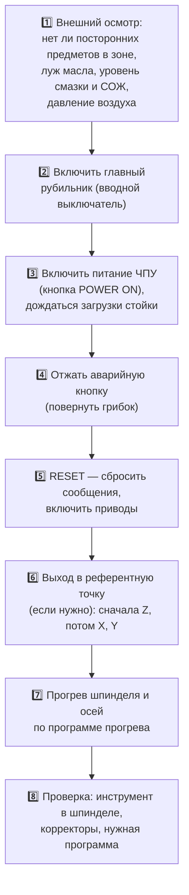

# 🛡️ Урок 10. Обслуживание станка и техника безопасности

> [!abstract] О чём урок
> - правильный **порядок включения и выключения** станка;
> - **ежедневное, еженедельное и ежемесячное** обслуживание — что делает оператор;
> - **техника безопасности** оператора станка с ЧПУ;
> - **столкновения (аварии)**: почему происходят и что делать;
> - как правильно реагировать на **сообщения об ошибках**.
>
> ⏱ ~30 минут

> [!info] Почему работодатели любят эту тему
> Станок стоит от нескольких миллионов до десятков миллионов рублей. Один удар шпинделем — ремонт на сотни тысяч и простой на недели. Поэтому работодателю часто важнее не то, насколько быстро вы работаете, а то, что вы **аккуратны, внимательны и не разобьёте станок**.

---

## 1. Включение станка

> [!warning] Почему сначала Z
> На фрезерном станке при выходе в ноль **сначала поднимают ось Z**. Если сначала поехать по X или Y, а инструмент стоит низко — можно зацепить тиски или деталь. На токарном сначала отводят **X** (от детали), потом **Z**.

## 2. Выключение станка

1. Дождаться окончания цикла; **убрать инструмент от детали** в безопасное положение (например, вернуть оси в «домашнюю» позицию).
2. Выключить шпиндель, СОЖ.
3. **Убрать стружку** из рабочей зоны, протереть стол, приспособление, окно.
4. При длительной остановке — снять деталь, смазать открытые поверхности от коррозии.
5. Нажать **аварийную кнопку** (на многих предприятиях так принято перед выключением).
6. Выключить питание ЧПУ (**POWER OFF**).
7. Выключить **главный рубильник**.

> [!info] Почему ЧПУ выключают до рубильника
> Стойка — компьютер. Резкое отключение главным рубильником во время записи данных может повредить память. Сначала — «правильное» выключение стойки, потом — силовое питание.

---

## 3. Обслуживание станка — что делает оператор

### 3.1. Ежедневно (каждую смену)

| ✅ | Что проверить / сделать |
|---|---|
| ☐ | **Уровень масла** централизованной смазки (долить при необходимости — только указанное масло) |
| ☐ | **Уровень и концентрация СОЖ** (рефрактометр), запах |
| ☐ | **Давление воздуха** по манометру, **слив конденсата** из влагоотделителя |
| ☐ | **Давление гидравлики** (особенно давление патрона на токарном), уровень масла в гидростанции |
| ☐ | **Чистота конуса шпинделя** — протереть, обдуть |
| ☐ | **Работа аварийной кнопки** и блокировки двери |
| ☐ | **Состояние окна** (нет трещин), освещение |
| ☐ | **Прогрев** шпинделя |
| ☐ | В конце смены — **уборка стружки** из рабочей зоны, опорожнение тележки транспортёра |
| ☐ | Заметили необычный **шум, вибрацию, запах, утечку** — записать и сообщить |

### 3.2. Еженедельно (или по графику предприятия)

- чистка **сеток и фильтров** бака СОЖ;
- чистка **фильтров электрошкафа** (снаружи, решётки вентиляторов) и теплообменника/кондиционера шкафа;
- очистка **стружкотранспортёра**;
- осмотр и очистка **кожухов, скребков** направляющих;
- проверка **оправок**: чистота конусов, состояние штырей.

### 3.3. Ежемесячно / по регламенту (обычно — наладчик или ремонтная служба)

- замена / полная чистка **СОЖ** и бака;
- проверка **геометрической точности**, биения шпинделя;
- проверка **люфтов**;
- замена масла в гидростанции, редукторе;
- замена **батарей** энкодеров и памяти стойки (раз в год или по сообщению).

> [!tip] 💬 Скажи на собеседовании
> «В начале смены я проверяю уровень смазки и СОЖ, давление воздуха и гидравлики, сливаю конденсат, протираю конус шпинделя и прогреваю станок. В конце — убираю стружку. Если слышу посторонний шум или вижу утечку — сразу говорю наладчику, а не жду, пока сломается».

---

## 4. Техника безопасности

> [!danger] Главные правила оператора станка с ЧПУ
> 1. **Никаких перчаток (особенно тканевых и вязаных) у вращающихся частей.** Перчатку затягивает во вращающийся шпиндель, патрон, сверло — вместе с рукой. Перчатки надевают только при работе с остановленным станком (перенос заготовок, чистка от стружки, работа с СОЖ).
> 2. **Одежда без свисающих частей**: застёгнутые рукава, никаких шарфов, галстуков, украшений, браслетов. **Длинные волосы — под головным убором.**
> 3. **Защитные очки** — всегда, когда открыта дверь или работаете со стружкой и сжатым воздухом.
> 4. **Защитная обувь** — с металлическим подноском (заготовки и оснастка тяжёлые).
> 5. **Не обходить блокировку двери**, не работать в автомате с открытой дверью.
> 6. **Не трогать и не измерять деталь, пока шпиндель вращается.**
> 7. **Стружку — только крючком и щёткой**, не руками и не сжатым воздухом в лицо/на людей.
> 8. **Не оставлять ключи, инструменты, щупы** в рабочей зоне. Ключ от патрона — сразу вынимать.
> 9. Перед тем как положить руки в рабочую зону (смена кулачков, инструмента) — **аварийный стоп** или режим, исключающий запуск.
> 10. **Тяжёлые** приспособления и заготовки (больше ~16–20 кг — смотрите нормы предприятия) поднимать **краном / тельфером** с правильными стропами.
> 11. Не открывать **электрошкаф**.
> 12. Не работать в состоянии усталости, болезни, опьянения; не отвлекаться на телефон во время наладки и запуска.

> [!warning] Сжатый воздух
> Обдувом не чистят **одежду и тело** — воздух под давлением может попасть под кожу. Не направляют струю на людей. При обдуве стружка летит во все стороны — очки обязательны.

### Опасности при работе на станке с ЧПУ

| Опасность | Источник | Защита |
|---|---|---|
| Захват, наматывание | Вращающийся шпиндель, патрон, деталь, инструмент | Без перчаток и свободной одежды у вращения, закрытая дверь |
| Порезы | Стружка, кромки деталей, режущий инструмент | Крючок, щётка; перчатки — только при остановленном станке; брать фрезы аккуратно, держать в коробках |
| Ожоги | Горячая стружка, деталь после обработки | Не брать руками сразу после обработки |
| Вылет деталей / пластин | Слабый зажим, поломка инструмента | Окно из поликарбоната, закрытая дверь, правильный зажим |
| Травмы глаз | Стружка, брызги СОЖ | Очки |
| Падение грузов | Заготовки, тиски, патроны | Защитная обувь, подъёмные механизмы |
| Кожные заболевания | СОЖ, масла | Нитриловые перчатки при работе с СОЖ, крем, мыть руки |
| Поражение током | Электрошкаф, кабели | Не открывать шкаф, сообщать о повреждённых кабелях |
| Шум | Резание, транспортёр, компрессор | Беруши / наушники при необходимости |

---

## 5. Столкновения (аварии): почему и что делать

**Столкновение** (*crash*, в цеху — «удар», «въехал», «врезался») — когда инструмент, шпиндель или револьвер ударяется о деталь, приспособление или части станка не во время резания.

### 5.1. Типичные причины

| Причина | Как предотвратить |
|---|---|
| Неправильная **привязка** (G54) или запись не в ту систему координат | Проверять, в какой системе работает программа; сверять машинные координаты |
| Не введена или неправильная **длина инструмента** | Проверять корректоры после замены инструмента |
| Инструмент **не в той ячейке** / позиции | Сверять таблицу инструментов с картой наладки |
| **Не та программа** / старая версия | Сверять номер и название программы с заданием |
| Заготовка **больше** ожидаемой | Проверять размер заготовки перед установкой |
| Ошибка при **ручном перемещении** (перепутали ось, направление или шаг маховика) | Смотреть на станок, а не только на экран; шаг ×1 / ×10 рядом с деталью |
| **Запуск с середины** программы без правильного входа (без включения шпинделя, корректора) | Запуск с середины — только по процедуре, которой научил наладчик |
| Забытый **предмет** в рабочей зоне | Убирать всё перед закрытием двери |

### 5.2. Что делать, если произошёл удар

> [!danger] Порядок действий
> 1. **Сразу остановить станок**: аварийный стоп (или Feed Hold, если ещё успеваете).
> 2. **Не пытаться** «отъехать и продолжить» самостоятельно.
> 3. **Сообщить наладчику / мастеру немедленно** — даже если кажется, что «ничего страшного».
> 4. Ничего не трогать до прихода ответственного — по положению станка видно, что произошло.
> 5. Записать, что делал станок: программа, кадр, инструмент, режим.
>
> ⚠️ **Никогда не скрывайте удар.** Даже лёгкое столкновение может сбить геометрию станка или повредить подшипники шпинделя — следующие детали могут пойти в брак, а шпиндель — разрушиться позже. Скрытый удар — один из самых серьёзных проступков в цеху; честное признание — норма.

> [!tip] 💬 Скажи на собеседовании
> «Если что-то пошло не так — я сразу останавливаю станок и зову наладчика. Даже если удар кажется лёгким, нужно проверить шпиндель и привязку. Скрывать такие вещи нельзя — это может обойтись гораздо дороже».

---

## 6. Как реагировать на сообщения об ошибках

Сообщения на экране бывают двух видов:
- **Аварии (Alarm)** — станок останавливается и не продолжит работу, пока причину не устранят;
- **Предупреждения / сообщения оператору (Message, Warning)** — станок может работать, но что-то требует внимания (низкий уровень смазки, скоро замена батарей).

> [!example] Порядок действий при аварии
> 1. **Прочитать** сообщение полностью (номер + текст). Нажать MESSAGE / ALARM, если не видно.
> 2. Понять, **простая ли причина**: открыта дверь, нет воздуха, мало смазки, не зажат патрон, конец программы без M30 — такие вещи оператор устраняет сам.
> 3. **Устранить причину** → **RESET**.
> 4. Если причина непонятна или авария повторяется — **записать номер и текст** и позвать наладчика. Не нажимать RESET многократно в надежде, что «само пройдёт».

| Часто встречающиеся простые сообщения (по смыслу) | Что сделать |
|---|---|
| Дверь открыта | Закрыть дверь |
| Низкий уровень смазки | Долить масло для направляющих |
| Низкое давление воздуха | Проверить подачу воздуха, кран, манометр |
| Патрон не зажат / нет давления гидравлики | Зажать деталь, проверить гидростанцию |
| Аварийный стоп | Разблокировать кнопку, RESET |
| Выход за предел хода (*overtravel*) | В ручном режиме отъехать в обратную сторону; разобраться с наладчиком, почему так случилось |
| Перегрузка транспортёра | Выключить, освободить от стружки, проверить тележку |

---

## 7. Итоги урока

> [!summary] Запомни
> 1. **Включение**: осмотр → рубильник → ЧПУ → отжать E-stop → RESET → выход в ноль (**сначала Z**) → прогрев.
> 2. **Выключение**: убрать инструмент от детали → стружка → ЧПУ → рубильник.
> 3. **Ежедневно**: смазка, СОЖ, воздух и конденсат, гидравлика, конус шпинделя, блокировки, уборка стружки.
> 4. **Без перчаток у вращающихся частей**, очки, никакой свисающей одежды, дверь закрыта.
> 5. **Удар → стоп → сообщить → не скрывать.**
> 6. Аварию — **прочитать, устранить простую причину или записать и позвать наладчика**.

---

## ❓ Проверь себя

> [!question]- 1. В каком порядке выходить в ноль на фрезерном станке и почему?
> Сначала Z (поднять шпиндель), затем X и Y — чтобы инструмент не зацепил деталь или тиски при горизонтальном перемещении.

> [!question]- 2. Почему нельзя работать в перчатках у вращающегося шпинделя?
> Перчатку может захватить вращающийся инструмент, патрон или деталь и затянуть руку — это тяжёлая травма.

> [!question]- 3. Что вы проверяете в начале смены?
> Уровень смазки, уровень и концентрацию СОЖ, давление воздуха и гидравлики, сливаю конденсат, протираю конус шпинделя, проверяю аварийную кнопку и блокировку двери, прогреваю станок.

> [!question]- 4. Произошло лёгкое касание инструментом детали на ускоренном ходу. Ваши действия?
> Остановить станок, ничего не двигать, сразу сообщить наладчику/мастеру, записать программу, кадр и инструмент. Не скрывать — нужно проверить шпиндель, инструмент и привязку.

> [!question]- 5. Назови три частые причины столкновений.
> Неправильная привязка или не та система координат; неправильная длина инструмента или инструмент не в той ячейке; не та программа; ошибки при ручном перемещении; забытые в зоне предметы.

> [!question]- 6. Почему стружку нельзя убирать руками?
> Стружка острая как лезвие и может быть горячей — порезы и ожоги. Используют крючок, щётку, скребок.

---

⬅️ [[09. Вспомогательные системы]] | [[00. Оглавление|Оглавление]] | ➡️ [[11. Вопросы для собеседования]]
