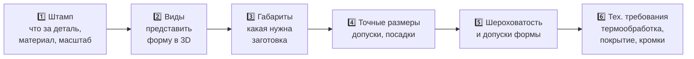

# 📐 Модуль 2. Чтение чертежей

> [!abstract] Для кого этот модуль
> Для будущего оператора станков с ЧПУ, который **никогда не читал чертежи** (или забыл всё со школы). После модуля вы сможете взять в руки рабочий чертёж детали и ответить на главные вопросы оператора:
> - **что** это за деталь и **из чего** она сделана;
> - **какие размеры** важны и **в каких пределах** они должны быть;
> - **какой чистоты** должны быть поверхности;
> - **что проверять** при измерении и где можно ошибиться.
>
> Уровень — как у оператора с **годом опыта**: без конструкторских тонкостей, но уверенно.

---

## 🗺️ Карта модуля

| №   | Урок                                                     | О чём                                                               | Время  |
| --- | -------------------------------------------------------- | ------------------------------------------------------------------- | ------ |
| 01  | [[01. Зачем оператору чертёж]]                           | ЕСКД, форматы, основная надпись, масштаб, иностранные чертежи        | 25 мин |
| 02  | [[02. Линии чертежа]]                                    | Какая линия что означает                                            | 15 мин |
| 03  | [[03. Виды, разрезы и сечения]]                          | Как из плоских картинок собрать объёмную деталь                     | 40 мин |
| 04  | [[04. Размеры]]                                          | Как читать размеры, знаки Ø R □, базы, цепочки                      | 35 мин |
| 05  | [[05. Допуски и посадки]]                                | ⭐ Ø30h7, ±0,1, квалитеты, середина допуска, общие допуски           | 50 мин |
| 06  | [[06. Шероховатость поверхности]]                        | Ra, знаки, какая обработка какую чистоту даёт                       | 30 мин |
| 07  | [[07. Допуски формы и расположения]]                     | Рамки ⊥ ∥ ◎ ↗, базы А, Б                                            | 35 мин |
| 08  | [[08. Резьбы, отверстия и конструктивные элементы]]      | M10×1, 6H, ↧, фаски, канавки, центровые отверстия, пазы             | 40 мин |
| 09  | [[09. Материалы и технические требования]]               | Сталь 45, 40Х, Д16Т, HRC, покрытия, пункты ТТ                       | 30 мин |
| 10  | [[10. Практика — читаем чертёж]]                         | ⭐ Пошаговый разбор чертежа вала и плиты                             | 50 мин |
| 11  | [[11. Вопросы по чертежам]]                        | 45+ вопросов с ответами — тренажёр                                  | 60 мин |
| 12  | [[12. Глоссарий по чертежам]]                                        | Словарь терминов и обозначений                                      | —      |

---

## 🧭 Как читать любой чертёж — короткий алгоритм

Каждый шаг подробно разобран в уроках, а в [[10. Практика — читаем чертёж]] мы пройдём его целиком на двух чертежах.

---

## 📚 Условные обозначения

Те же, что в [[01. Устройство станков ЧПУ/00. Оглавление|модуле 1]]:

> [!info] Справка
> Полезный факт или пояснение.

> [!example] Пример
> Разбор на конкретных цифрах.

> [!tip] 💬 Скажи на собеседовании
> Готовая формулировка для работодателя.

> [!warning] Внимание
> Типичная ошибка новичка.

> [!question]- Проверь себя (нажми, чтобы открыть)
> Ответ спрятан здесь.

---

> [!quote] Главная мысль модуля
> Чертёж — это **договор**: конструктор написал, какой должна быть деталь, а ОТК проверит её строго по чертежу. Оператор, который умеет читать чертёж, понимает, **какие размеры критичны**, а значит — делает меньше брака.

> [!info] Связь с модулем 1
> Здесь часто встречаются ссылки на [[01. Устройство станков ЧПУ/00. Оглавление|«Устройство станков ЧПУ»]]: корректоры, нуль детали, G54. Чертёж и станок — две половины одной работы.

➡️ Начать: [[01. Зачем оператору чертёж]]
