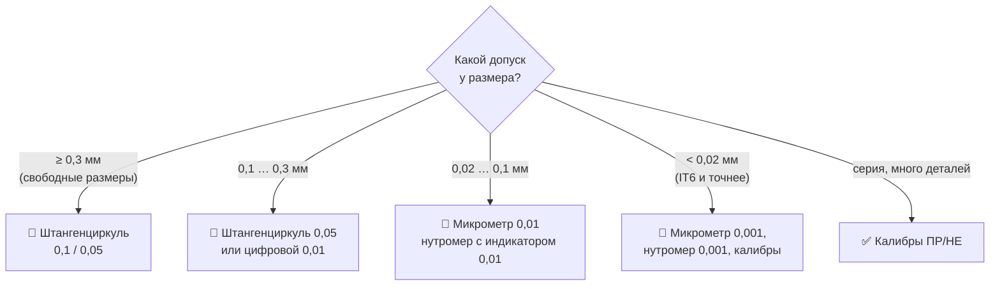

# 📏 Модуль 3. Измерительный инструмент

> [!abstract] Для кого этот модуль
> Оператор станков с ЧПУ **меряет детали каждый день**: первую деталь после наладки, каждую N-ю в партии, после замены пластины. От того, насколько правильно он измеряет, зависит, будет ли партия годной.
> После модуля вы будете знать:
> - какие инструменты бывают и **какой выбрать** под конкретный допуск;
> - как **читать** штангенциркуль, микрометр, индикатор, нутромер;
> - как **правильно** мерить и какие ошибки допускают новички;
> - как устроен **контроль** деталей на производстве.
>
> Уровень — как у оператора с **годом опыта**.

---

## 🗺️ Карта модуля

| №   | Урок                                                   | О чём                                                                  | Время  |
| --- | ------------------------------------------------------ | ---------------------------------------------------------------------- | ------ |
| 01  | [[01. Основы измерений]]                               | Погрешность, цена деления, как выбрать инструмент, 20 °C, поверка, уход | 30 мин |
| 02  | [[02. Штангенциркуль]]                                 | ⭐ Устройство, нониус, приёмы измерения, ошибки                         | 40 мин |
| 03  | [[03. Микрометр]]                                      | ⭐ Устройство, чтение, проверка нуля, виды микрометров                  | 40 мин |
| 04  | [[04. Измерение отверстий]]                            | Нутромеры: индикаторный, микрометрический, трёхточечный                 | 35 мин |
| 05  | [[05. Индикаторы]]                                     | Индикатор часового типа, рычажный; биение, выставка тисков             | 35 мин |
| 06  | [[06. Калибры, шаблоны и концевые меры]]               | ПР/НЕ, резьбовые калибры, щупы, шаблоны, плитки                         | 30 мин |
| 07  | [[07. Глубиномеры, высотомеры и угломеры]]             | Глубина, высота от плиты, углы                                         | 25 мин |
| 08  | [[08. Измерение резьбы, углов и особых размеров]]      | Резьба, конусы, межосевые расстояния, пазы, стенки                     | 35 мин |
| 09  | [[09. Контроль на станке и в ОТК]]                     | План контроля, измерения в станке, тренд размера, КИМ                   | 30 мин |
| 10  | [[10. Практика измерений]]                             | ⭐ Упражнения на чтение шкал и подбор инструмента                       | 45 мин |
| 11  | [[11. Вопросы по измерениям]]                          | 45+ вопросов с ответами — тренажёр                                     | 60 мин |
| 12  | [[12. Глоссарий по измерениям]]                        | Словарь терминов                                                       | —      |

---

## 🧭 Какой инструмент когда — одной схемой

Подробно — в [[01. Основы измерений]].

---

## 📚 Условные обозначения

Те же, что в [[01. Устройство станков ЧПУ/00. Оглавление|модуле 1]] и [[00. Оглавление (чертежи)|модуле 2]]: справка, пример, 💬 «скажи на собеседовании», внимание, опасно, а вопросы для самопроверки спрятаны под заголовком — нажмите, чтобы открыть.

> [!info] Связь с другими модулями
> - Что мерить и в каких пределах — из чертежа: [[05. Допуски и посадки]], [[06. Шероховатость поверхности]], [[07. Допуски формы и расположения]].
> - Что делать с результатом — коррекция на износ: [[07. Шпиндель и инструментальная система]].

---

> [!quote] Главная мысль модуля
> Деталь не лучше, чем её измерение. Если оператор меряет с ошибкой 0,03, а допуск 0,021 — он не знает, годная деталь или нет. Поэтому **инструмент выбирают под допуск**, а **мерить учатся так же серьёзно, как работать на станке**.

➡️ Начать: [[01. Основы измерений]]
