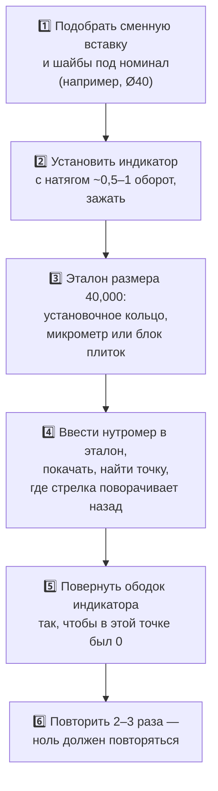

# ⭕ Урок 4. Измерение отверстий

> [!abstract] О чём урок
> Отверстие измерить сложнее, чем вал: туда не заглянешь и не обхватишь скобой.
> - какие инструменты бывают для отверстий и **какой выбрать**;
> - ⭐ **индикаторный нутромер**: настройка на ноль и измерение;
> - **микрометрический**, **трёхточечный** нутромер, **телескопические** щупы;
> - как найти **овальность и конусность** отверстия.
>
> ⏱ ~35 минут

---

## 1. Чем мерить отверстие

| Инструмент | Точность | Когда |
|---|---|---|
| **Штангенциркуль** (внутренние губки) | ±0,05…0,1 | Грубые отверстия, предварительная оценка |
| **Микрометр для внутренних измерений** (с губками) | ~0,01 | Отверстия от 5 мм, пазы |
| **Телескопический (раздвижной) щуп + микрометр** | ~0,01–0,02 | Когда нет нутромера нужного размера; «перенос» размера на микрометр |
| ⭐ **Индикаторный нутромер (НИ)** | 0,01 (с ИЧ) / 0,001–0,002 (с ИГ) | **Основной** инструмент для точных отверстий H7, H8 |
| **Трёхточечный нутромер** (микрометрический) | 0,001–0,005 | Точные отверстия; **сам центрируется**, удобен и для глухих отверстий |
| **Микрометрический нутромер (НМ)** — стержневой | 0,01 | Большие диаметры (от 50 мм до метров) |
| **Калибр-пробка ПР/НЕ** | годен / не годен | Серийный контроль ([[06. Калибры, шаблоны и концевые меры\|урок 6]]) |

---

## 2. ⭐ Индикаторный нутромер

**Индикаторный нутромер** (НИ, ГОСТ 868) — трубка с измерительной головкой на одном конце и индикатором на другом. В головке — **подвижный измерительный стержень** и **неподвижный сменный упор (вставка)**. Перемещение стержня передаётся на индикатор.

Это **сравнительный** прибор: он показывает не весь размер, а **отклонение от настроенного размера**.

![[ms-bore-gauge.svg]]

### 2.1. Настройка на ноль

> [!info] Настройка по микрометру
> Если нет установочного кольца, микрометр выставляют точно на номинал (например, 40,000), фиксируют **стопором**, и нутромер настраивают **между пяткой и микровинтом**, так же покачивая. Это менее точно, чем по кольцу, но широко применяется.

### 2.2. Измерение

1. Ввести нутромер в отверстие (сначала — стороной упора, чтобы не бить стержень).
2. Плавно **покачивать** в плоскости оси отверстия.
3. Найти **точку возврата стрелки** — крайнее положение, после которого стрелка идёт обратно. Это **наименьший размер** = истинный диаметр (перпендикулярно оси).
4. Прочитать **отклонение от нуля** и прибавить к номиналу настройки.

> [!warning] Знак отклонения — «наоборот»
> В нутромере, когда отверстие **меньше** настройки, стержень вдавливается сильнее → стрелка идёт **по часовой** (+). Когда отверстие **больше** — стрелка **против часовой** (−).
> - Стрелка **по часовой** на 8 делений → отверстие **меньше** на 0,008.
> - Стрелка **против часовой** на 12 делений → отверстие **больше** на 0,012.
>
> Перед измерением полезно мысленно (или на кольце большего размера) проверить, в какую сторону идёт стрелка при увеличении размера.

> [!example] Пример
> Отверстие **Ø40H7** (40,000…40,025). Нутромер настроен на **40,000**.
> В отверстии стрелка в точке возврата отклонилась **против часовой на 12 делений** → отверстие **больше** на 0,012 → **40,012**. ✅ Годно, около середины поля.

### 2.3. Овальность и конусность отверстия

Мерить в **трёх сечениях** по глубине (у входа, в середине, у дна) и в каждом — в **двух перпендикулярных направлениях**.

| | Направление 1 | Направление 2 |
|---|---|---|
| Вход | 40,014 | 40,012 |
| Середина | 40,011 | 40,010 |
| Дно | 40,006 | 40,005 |

→ Овальность ≈ 0,002 (хорошо), **конусность** ≈ 0,008 — отверстие **сужается к дну**. Частая причина — **отжим** расточного резца или износ инструмента. Сообщить наладчику, если близко к границам допуска.

---

## 3. Другие инструменты для отверстий

### Трёхточечный нутромер

Три измерительных стержня под 120°, которые выдвигаются при вращении трещотки — прибор **сам центрируется** в отверстии, покачивать не надо. Бывают механические (как микрометр) и цифровые. Очень удобны для **глухих** отверстий и для серий. Минус — каждый прибор на **узкий диапазон** (например, 20–25 мм), нужен набор.

### Микрометрический нутромер (НМ)

Стержень с микрометрической головкой и **удлинителями**. Для больших диаметров (50–600 мм и более). При измерении один конец упирают, другим «качают» и находят **максимум** поперёк и **минимум** вдоль оси.

### Телескопический щуп

Т-образный щуп с подпружиненными стержнями: вводят в отверстие, отпускают — стержни раздвигаются, фиксируют, вынимают и **измеряют микрометром**. Точность зависит от навыка (двойной перенос размера).

---

## 4. Итоги урока

> [!summary] Запомни
> 1. Для точных отверстий — **индикаторный нутромер**, трёхточечный нутромер или **калибр-пробка**. Штангенциркуль — только для грубых.
> 2. Нутромер — **сравнительный** прибор: настраивают на ноль по **кольцу**, микрометру или плиткам.
> 3. При измерении **покачивают** и берут **точку возврата стрелки** — наименьший размер.
> 4. Знак: стрелка **по часовой** — отверстие **меньше** настройки, **против** — **больше**.
> 5. Мерить в **нескольких сечениях и направлениях** → овальность, конусность.

---

## ❓ Проверь себя

> [!question]- 1. Почему индикаторный нутромер называют сравнительным прибором?
> Он показывает не сам размер, а отклонение от размера, на который его настроили по эталону.

> [!question]- 2. Зачем нутромер покачивают в отверстии?
> Чтобы найти положение строго перпендикулярно оси — там размер наименьший и равен истинному диаметру (точка возврата стрелки).

> [!question]- 3. Нутромер настроен на 25,000. В отверстии стрелка отклонилась по часовой на 6 делений (цена 0,01). Размер?
> По часовой — отверстие меньше: 25,000 − 0,06 = 24,94 мм.

> [!question]- 4. Как настроить нутромер, если нет установочного кольца?
> По микрометру, выставленному на номинал и застопоренному, либо по блоку концевых мер с боковиками.

> [!question]- 5. Чем удобен трёхточечный нутромер?
> Самоцентрируется, не нужно покачивать, хорош для глухих отверстий и серий.

> [!question]- 6. Как определить конусность отверстия?
> Измерить диаметр в нескольких сечениях по глубине и сравнить.

---

⬅️ [[03. Микрометр]] | [[00. Оглавление (измерения)|Оглавление]] | ➡️ [[05. Индикаторы]]
