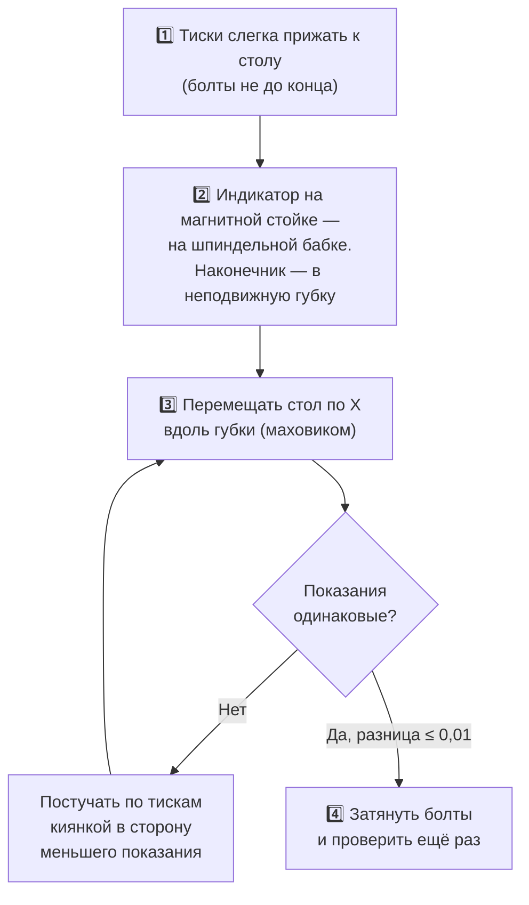

# ⏱️ Урок 5. Индикаторы

> [!abstract] О чём урок
> Индикатор — «правая рука» наладчика и очень полезный инструмент оператора.
> - **индикатор часового типа (ИЧ)**, **рычажный (ИРБ)**, **многооборотный (ИГ/МИГ)**, цифровой;
> - устройство и **чтение**;
> - **стойки** и **магнитные штативы**;
> - ⭐ применения: **биение**, **выставка тисков**, **выверка детали в патроне**, параллельность, измерение сравнением;
> - правила установки и **ошибка рычажного индикатора**.
>
> ⏱ ~35 минут

---

## 1. Виды индикаторов

| Тип | Цена деления | Ход | Особенности |
|---|---|---|---|
| **ИЧ** — индикатор часового типа (ГОСТ 577) | 0,01 | 0–2, 0–5, **0–10** мм | ⭐ Самый распространённый. Стержень двигается **вдоль своей оси** |
| **ИРБ** — рычажно-зубчатый (ГОСТ 5584) | 0,01 (бывают 0,002) | ±0,4…0,8 мм | Наконечник на **качающемся рычаге**: залезает в отверстия, мерит сбоку и снизу. Любимец наладчиков при выверке |
| **ИГ / МИГ** — многооборотные головки | 0,001 / 0,002 | 1–2 мм | Высокая точность, для нутромеров и сравнения |
| **Цифровые индикаторы** | 0,01 / 0,001 | до 12,5–25 мм | Удобный отсчёт, функция ±, запоминание макс/мин |

---

## 2. Устройство и чтение

![[ms-dial-indicator.svg]]

- **Большая стрелка:** 1 деление = **0,01 мм**, полный оборот = **1 мм** (100 делений).
- **Малая стрелка:** считает **полные обороты** — 1 деление = 1 мм.
- **Ободок** с шкалой можно поворачивать — так «ставят ноль» в любом положении стрелки.
- **Указатели допуска** — подвижные метки на ободке: выставили границы поля допуска — и сразу видно, «в допуске» стрелка или нет.

> [!example] Читаем
> Малая стрелка — между 2 и 3, большая — на 15 → **2,15 мм** перемещения стержня (если начинали с нуля).
> На практике чаще смотрят **отклонение от нуля**: «стрелка ушла на +3 деления» = **+0,03 мм**.

> [!info] Направление
> Стержень **вдавливается** → стрелка идёт **по часовой** (+). Стержень **выходит** → **против часовой** (−).

---

## 3. Стойки и штативы

| Держатель | Для чего |
|---|---|
| **Магнитная стойка (штатив)** | Включаемый магнит: крепится к столу станка, станине, плите. Шарнирные или гибкие штанги. ⭐ Самый частый в цеху |
| **Стойка с плитой (С-III и аналоги)** | Индикатор над точной плитой — для **сравнительных** измерений высоты/толщины по концевым мерам |
| **Державка в шпинделе / резцедержателе** | Индикатор закреплён на станке: выставка тисков, проверка биения детали в патроне |

---

## 4. Правила установки индикатора

> [!tip] Как поставить правильно
> 1. **ИЧ**: стержень — **перпендикулярно** проверяемой поверхности (для цилиндра — направлен **на ось**).
> 2. **Натяг** (предварительное поджатие) **0,5–1 мм** (полоборота–оборот стрелки) — чтобы стержень мог отслеживать и выступы, и впадины.
> 3. Штатив — **короткие** штанги, всё затянуто: длинный «журавль» вибрирует и прогибается.
> 4. Наконечник — **чистый**, без забоин.
> 5. После установки покачать деталь/стол туда-обратно — показания должны **повторяться**.

> [!warning] Рычажный индикатор: угол рычага
> Рычаг ИРБ должен быть **почти параллелен** проверяемой поверхности (угол до ~15°). При большом угле показания **занижаются** (косинусная ошибка): при 30° ошибка ≈ 13 %, при 45° ≈ 30 %.
> Для **выверки «в ноль»** это не страшно (мы добиваемся одинаковых показаний), а для **измерения величины** — важно.

---

## 5. ⭐ Применения индикатора

### 5.1. Радиальное и торцевое биение

См. схему выше. Деталь вращают вокруг базовой оси (в **центрах**, на **призмах** или **в патроне станка**), индикатор упирают:
- в **цилиндрическую поверхность** — **радиальное** биение;
- в **торец** (на заданном радиусе) — **торцевое** биение.

**Биение = максимальное − минимальное показание** за полный оборот.

> [!example] Пример
> За оборот стрелка ходила от **−0,01** до **+0,015** → биение **0,025**. Допуск по чертежу `↗ 0,02 А` → **не годна** ([[07. Допуски формы и расположения|допуски расположения]]).

### 5.2. Выставка тисков на фрезерном станке

> [!tip] Хитрость
> Простукивать ту сторону тисков, где показания **больше**, на **половину** разницы — и сразу перепроверять. После затяжки болтов тиски часто немного «уводит» — поэтому проверка после затяжки обязательна.

### 5.3. Выверка детали в четырёхкулачковом патроне

Индикатор на суппорте, деталь вращают рукой (шпиндель в нейтрали). Где показания **больше** — тот кулачок **отпускают**, противоположный — **поджимают**. Добиваются, чтобы биение было в пределах допуска (часто ≤ 0,01–0,02).

То же делают в трёхкулачковом патроне при **перезажиме** точной детали — контролируют, какое биение получилось.

### 5.4. Параллельность, плоскостность, проверка установки

- Деталь на плите, индикатор на стойке, ведём деталь (или индикатор) — разница показаний = **непараллельность** верха к низу.
- Проверка, что заготовка в тисках «легла» на параллели ровно.
- Проверка **люфта**: упереть индикатор в стол, подвигать ось маховиком туда-сюда.

### 5.5. Сравнительное измерение

Индикатор на стойке с плитой ставят на ноль по **блоку концевых мер** нужного размера, затем подставляют деталь — отклонение стрелки = отклонение размера. Точно и быстро для серий.

---

## 6. Итоги урока

> [!summary] Запомни
> 1. ИЧ: большая стрелка — **0,01 мм**, малая — **1 мм**; ободок поворачивается для установки нуля.
> 2. Стержень вдавливается — стрелка **по часовой**.
> 3. Установка: **перпендикулярно**, **натяг 0,5–1 мм**, жёсткий штатив.
> 4. Рычажный индикатор — рычаг почти **параллельно** поверхности.
> 5. **Биение = макс − мин** за оборот.
> 6. Выставка тисков: неподвижная губка вдоль X, разница **≤ 0,01**, проверка после затяжки.

---

## ❓ Проверь себя

> [!question]- 1. Чему равно одно деление большой стрелки ИЧ и одно деление малой?
> Большой — 0,01 мм, малой — 1 мм.

> [!question]- 2. Зачем индикатору натяг?
> Чтобы стержень мог отслеживать отклонения в обе стороны — и выступы, и впадины.

> [!question]- 3. Как измерить радиальное биение?
> Вращать деталь вокруг базовой оси, индикатор упереть в цилиндр перпендикулярно; биение = разность максимального и минимального показаний за оборот.

> [!question]- 4. Как выставить тиски на столе?
> Индикатор на шпинделе, наконечник в неподвижную губку, двигать стол по X, простукивать тиски до разницы показаний ≤ 0,01 мм, затянуть болты и перепроверить.

> [!question]- 5. Почему рычаг рычажного индикатора держат почти параллельно поверхности?
> При большом угле появляется косинусная ошибка — показания занижаются.

> [!question]- 6. За оборот стрелка ходила от −0,005 до +0,012. Каково биение?
> 0,017 мм.

---

⬅️ [[04. Измерение отверстий]] | [[00. Оглавление (измерения)|Оглавление]] | ➡️ [[06. Калибры, шаблоны и концевые меры]]
