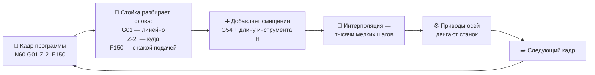

# 💻 Модуль 4. G-код и программирование

> [!abstract] Для кого этот модуль
> Оператору не обязательно писать программы с нуля — их делает технолог-программист (обычно в CAM). Но оператор должен уметь:
> - **читать** программу и понимать, что станок сделает в каждой строке;
> - **находить** опасные места и ошибки до того, как станок их «найдёт»;
> - делать **простые правки**: подача, обороты, номер корректора, перезапуск с середины;
> - написать **несложную программу** вручную — в MDI или для простой детали.
>
> Уровень — оператор с **годом опыта**, который «уже не боится кода». Основа — стойка **Fanuc** (и совместимые: Haas, Mitsubishi, Балт-Систем); отличия Siemens и Heidenhain — в [[10. Подпрограммы, другие стойки и правка программ|уроке 10]].

---

## 🗺️ Карта модуля

| №   | Урок                                                     | О чём                                                               | Время  |
| --- | -------------------------------------------------------- | ------------------------------------------------------------------- | ------ |
| 01  | [[01. Что такое управляющая программа]]                  | Кадры, слова, комментарии, откуда берутся программы                  | 25 мин |
| 02  | [[02. Адреса, модальность и формат чисел]]               | Буквы-адреса, модальные коды, ⚠️ десятичная точка, G90/G91           | 30 мин |
| 03  | [[03. Перемещения G00, G01, G02, G03]]                   | Ускоренный ход, прямая, дуги (R и I, J, K), плоскости               | 40 мин |
| 04  | [[04. Шпиндель, подача, инструмент и M-коды]]            | S, F, T, M03/M06/M08/M30, расчёт оборотов и подачи                  | 40 мин |
| 05  | [[05. Системы координат и коррекции в программе]]        | G54, G28, G53, G43 H, G41/G42 D, коррекция радиуса вершины          | 40 мин |
| 06  | [[06. Программа для фрезерного станка]]                  | ⭐ Полная программа: центровка, сверление, резьба, карман            | 50 мин |
| 07  | [[07. Циклы сверления]]                                  | G81, G82, G83, G73, G84, G85, G76, G98/G99                          | 35 мин |
| 08  | [[08. Программа для токарного станка]]                   | ⭐ Полная программа вала: торец, G71/G70, резьба                     | 50 мин |
| 09  | [[09. Токарные циклы]]                                   | G71, G72, G73, G70, G74, G75, G76, G92, G90 (токарный!)             | 40 мин |
| 10  | [[10. Подпрограммы, другие стойки и правка программ]]    | M98/M99, переменные, Siemens/Heidenhain, что можно менять оператору | 40 мин |
| 11  | [[11. Практика — читаем и ищем ошибки]]                  | ⭐ Задачи: найди ошибку, напиши программу                            | 60 мин |
| 12  | [[12. Вопросы по G-коду]]                                | 45+ вопросов с ответами                                             | 60 мин |
| 13  | [[13. Справочник G- и M-кодов]]                          | Шпаргалка кодов + глоссарий                                         | —      |

---

## 🧭 Как станок выполняет программу

---

## 📚 Условные обозначения

Те же, что в предыдущих модулях. Программы показаны в блоках кода — их удобно копировать. Комментарии в скобках `( )` внутри программ — на латинице, как принято на большинстве стоек (многие стойки не понимают кириллицу).

> [!info] Связь с другими модулями
> - Оси, нуль детали, корректоры, пульт — [[01. Устройство станков ЧПУ/00. Оглавление|модуль 1]].
> - Детали для примеров (вал и плита) — из [[10. Практика — читаем чертёж|модуля 2]].
> - Проверка результата — [[00. Оглавление (измерения)|модуль 3]].

---

> [!quote] Главная мысль модуля
> G-код — это не программирование в «компьютерном» смысле, а **очень подробная инструкция**: «включи шпиндель, поедь сюда, теперь туда с такой скоростью». Если вы можете проговорить каждую строку словами — вы умеете читать G-код.

➡️ Начать: [[01. Что такое управляющая программа]]
