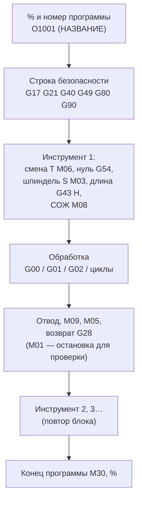

# 📄 Урок 1. Что такое управляющая программа

> [!abstract] О чём урок
> - что такое **УП** и **G-код**, откуда он взялся;
> - из чего состоит программа: **кадры**, **слова**, **адреса**;
> - **номер программы**, **номера кадров**, **комментарии**;
> - типичная **структура** программы от начала до конца;
> - кто и как пишет программы: **вручную**, **в CAM**, **диалогом на стойке**.
>
> ⏱ ~25 минут

---

## 1. G-код — язык станка

**Управляющая программа (УП)** — текстовый файл с командами для станка. Язык этих команд называют **G-кодом** (по самой частой букве), официально — **ISO 6983** (в России — ГОСТ 20999 «коды ISO 7bit»).

> [!info] Почему «G-код», если там много букв
> Буквой **G** обозначаются основные команды — «как двигаться» (`G00`, `G01`, `G02`…). Но в программе есть и M, S, F, T, X, Y, Z. Название просто прижилось.

G-код придумали в 1950–60-х для перфолент, поэтому он **короткий и сухой**: никаких слов, только буквы и числа. Зато его понимает почти любой станок с ЧПУ в мире — с небольшими «диалектами» у разных производителей.

---

## 2. Из чего состоит программа

![[gc-program-structure.svg]]

### 2.1. Кадр (строка)

**Кадр** (*block*) — одна строка программы. Стойка выполняет программу **кадр за кадром**, сверху вниз.

```gcode
N60 G01 Z-2. F150
```

### 2.2. Слово = адрес + число

Каждый кадр состоит из **слов**. Слово — это **буква-адрес** и **число** за ней:

| Слово | Адрес | Число | Смысл |
|---|---|---|---|
| `N60` | N | 60 | номер кадра 60 |
| `G01` | G | 01 | линейное перемещение с подачей |
| `Z-2.` | Z | −2,0 | по оси Z в точку −2 мм |
| `F150` | F | 150 | подача 150 мм/мин |

> [!tip] Читаем вслух
> `N60 G01 Z-2. F150` = «Кадр 60: двигаться **по прямой** вниз до **Z минус 2** со скоростью **150 мм в минуту**».
> Попробуйте проговаривать так каждую строку — это лучший способ научиться.

### 2.3. Номер программы

`O1001` — номер программы в памяти стойки (у Fanuc — буква **O** и 4 цифры, на новых стойках может быть до 8). Рядом в скобках пишут название: `O1001 (PLATE OP10)`.

### 2.4. Номера кадров N

`N10`, `N20`, `N30`… — **необязательны**: станок выполняет кадры по порядку, а не по номерам. Номера нужны **человеку**: найти место в программе, перезапустить с нужного кадра, сослаться на кадр в цикле (G71 P120 Q220). Нумеруют обычно через 5 или 10 — чтобы можно было вставить кадр между.

### 2.5. Комментарии

Всё в **круглых скобках** `( )` — комментарий: станок его игнорирует. У Siemens и Haas комментарий может начинаться с **точки с запятой** `;`.

```gcode
N20 T01 M06 (SPOT DRILL D10)
```

> [!warning] Кириллица в комментариях
> Большинство стоек Fanuc **не понимают русские буквы** — программа может не загрузиться или выдать ошибку. Поэтому комментарии пишут латиницей: `(CENTROVKA)`, `(SPOT DRILL)`.

### 2.6. Символы начала и конца

`%` в первой и последней строке — маркер начала и конца файла при передаче (наследие перфолент). На многих стойках обязателен.

---

## 3. Типичная структура программы



Подробно с полными примерами — в [[06. Программа для фрезерного станка]] и [[08. Программа для токарного станка]].

---

## 4. Кто и как пишет программы

| Способ | Как | Когда |
|---|---|---|
| **Вручную** | Технолог (или наладчик) пишет код в текстовом редакторе или прямо на стойке | Простые детали: отверстия, пазы, токарка ступенчатых валов, правки |
| ⭐ **В CAM-системе** | Программист строит траектории на **3D-модели** в программе (NX, Mastercam, SprutCAM, PowerMill, Fusion 360, ESPRIT, Компас + модуль ЧПУ…). **Постпроцессор** переводит траектории в G-код конкретного станка | Почти всё на современных производствах, особенно 3D и 5 осей |
| **Диалоговое программирование** на стойке | Заполняешь таблицы/экраны: «отверстие такое-то, карман такой-то» — стойка сама генерирует обработку: Siemens **ShopMill/ShopTurn**, Mazak **Mazatrol**, Heidenhain **Klartext**, Haas **VPS** | Простые и средние детали прямо у станка |

> [!info] Программа из CAM бывает огромной
> Для 3D-поверхности (пресс-форма, лопатка) программа может содержать **миллионы** строк `G01 X… Y… Z…`. Читать такую построчно бессмысленно — её проверяют **симуляцией** в CAM и на стойке. А вот **начало** каждого инструмента (смена, обороты, корректоры, подвод) оператор должен проверять всегда.

> [!tip] 💬 Скажи на собеседовании
> «Программы обычно приходят из CAM, но я умею читать G-код: понимаю, что делает каждая строка, где смена инструмента, какие обороты и подачи, какие корректоры. Могу проверить начало каждого перехода и написать простую программу в MDI».

---

## 5. Итоги урока

> [!summary] Запомни
> 1. **УП** — текстовый файл с командами; язык — **G-код** (ISO 6983).
> 2. Программа = **кадры**, кадр = **слова**, слово = **адрес + число**.
> 3. `O` — номер программы, `N` — номер кадра (не обязателен), `( )` — комментарий.
> 4. Структура: начало → строка безопасности → блоки инструментов → `M30`.
> 5. Программы пишут **вручную**, в **CAM** (через постпроцессор) или **диалогом** на стойке.

---

## ❓ Проверь себя

> [!question]- 1. Что такое кадр и из чего он состоит?
> Одна строка программы. Состоит из слов: буква-адрес + число.

> [!question]- 2. Обязательны ли номера кадров N?
> Нет. Станок выполняет кадры по порядку. Номера нужны человеку и для ссылок в циклах.

> [!question]- 3. Как написать комментарий в программе Fanuc?
> В круглых скобках, латиницей: `(ROUGHING)`.

> [!question]- 4. Прочитайте вслух: `N40 S2500 M03`.
> Кадр 40: включить шпиндель по часовой стрелке, 2500 оборотов в минуту.

> [!question]- 5. Что такое постпроцессор?
> Программа, которая переводит траектории из CAM-системы в G-код для конкретного станка и стойки.

---

⬅️ [[00. Оглавление (G-код)|Оглавление]] | ➡️ [[02. Адреса, модальность и формат чисел]]
