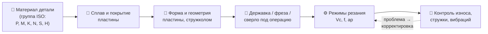

# 🔪 Модуль 5. Режущий инструмент

> [!abstract] Для кого этот модуль
> Оператор работает с режущим инструментом каждый час: меняет пластины, следит за износом, слушает станок, замечает вибрацию и плохую стружку. После модуля вы будете:
> - понимать, **как режет** инструмент и что такое передний и задний углы;
> - знать **инструментальные материалы** и группы ISO (P, M, K, N, S, H);
> - **расшифровывать** обозначения пластин и державок (CNMG 120408, PCLNR 2525M12);
> - различать **резцы, фрезы, свёрла, метчики** и знать, для чего каждый;
> - понимать **режимы резания**;
> - **распознавать износ** и решать типичные проблемы (вибрация, стружка, нарост);
> - правильно **менять пластины** и обращаться с инструментом.
>
> Уровень — оператор с **годом опыта**.

---

## 🗺️ Карта модуля

| №   | Урок                                                    | О чём                                                             | Время  |
| --- | ------------------------------------------------------- | ----------------------------------------------------------------- | ------ |
| 01  | [[01. Основы резания]]                                  | Как образуется стружка, углы клина, Vc, f, ap, тепло и силы       | 30 мин |
| 02  | [[02. Инструментальные материалы]]                      | Быстрорез, твёрдый сплав, покрытия, керамика, CBN, PCD; группы ISO | 30 мин |
| 03  | [[03. Сменные пластины]]                                | ⭐ Расшифровка CNMG 120408, формы, стружколомы, сплавы             | 40 мин |
| 04  | [[04. Токарный инструмент]]                             | Резцы, державки PCLNR, расточные, канавочные, резьбовые           | 40 мин |
| 05  | [[05. Фрезы]]                                           | Концевые, торцевые, попутное/встречное, число зубьев              | 35 мин |
| 06  | [[06. Свёрла, метчики и осевой инструмент]]             | Свёрла, развёртки, зенковки, метчики, резьбовые фрезы             | 35 мин |
| 07  | [[07. Режимы резания]]                                  | Как выбрать скорость, подачу, глубину; каталоги; стойкость         | 35 мин |
| 08  | [[08. Износ и стойкость инструмента]]                   | ⭐ Виды износа, причины, когда менять                              | 35 мин |
| 09  | [[09. Проблемы при резании]]                            | Вибрация, стружка, нарост, плохая поверхность — что делать        | 35 мин |
| 10  | [[10. Замена пластин, сборка и хранение]]               | Как правильно менять пластину, собирать и хранить инструмент       | 25 мин |
| 11  | [[11. Практика по режущему инструменту]]                | Расшифровки, подбор, разбор ситуаций                              | 45 мин |
| 12  | [[12. Вопросы по режущему инструменту]]                 | 45+ вопросов для собеседования                                    | 60 мин |
| 13  | [[13. Глоссарий по режущему инструменту]]               | Словарь и шпаргалки                                               | —      |

---

## 🧭 Путь от материала детали к инструменту

---

## 📚 Условные обозначения

Те же, что в предыдущих модулях: справка, пример, 💬 «скажи на собеседовании», внимание, опасно, вопросы для самопроверки спрятаны под заголовком.

> [!info] Связь с другими модулями
> - Оправки, магазины, корректоры — [[07. Шпиндель и инструментальная система]].
> - Формулы оборотов и подачи в программе — [[04. Шпиндель, подача, инструмент и M-коды]].
> - Шероховатость и подача — [[06. Шероховатость поверхности]].
> - Материалы деталей — [[09. Материалы и технические требования]].

---

> [!quote] Главная мысль модуля
> Хороший оператор **слышит и видит**, как работает инструмент: по звуку, стружке, цвету и поверхности он понимает, что пора менять пластину, — **до** того, как она сломается и испортит деталь.

➡️ Начать: [[01. Основы резания]]
