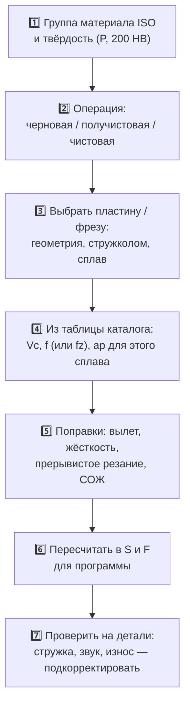

# 📊 Урок 7. Режимы резания

> [!abstract] О чём урок
> - **формулы** — повторение и новые: обороты, подача, съём металла;
> - как выбрать режимы **по каталогу**;
> - **ориентировочные** значения для разных материалов;
> - как режимы влияют на **стойкость** (закон Тейлора);
> - **черновая и чистовая** — разная логика;
> - что может менять **оператор** и как.
>
> ⏱ ~35 минут

---

## 1. Формулы

| Что | Формула | Пример |
|---|---|---|
| **Обороты** | n = 1000 · Vc / (π · D) | Vc 200, Ø50 → **1273 об/мин** |
| **Скорость из оборотов** | Vc = π · D · n / 1000 | Ø10, 3000 об/мин → **94 м/мин** |
| **Минутная подача (токарка, сверление)** | vf = f · n | 0,2 мм/об × 1273 → **255 мм/мин** |
| **Минутная подача фрезы** | vf = fz · z · n | 0,05 × 4 × 3183 → **637 мм/мин** |
| **Подача метчика** | vf = n · P | 500 × 1,25 → **625 мм/мин** |
| **Съём при точении** | Q = Vc · ap · f (см³/мин) | 200 × 2 × 0,3 → **120 см³/мин** |
| **Съём при фрезеровании** | Q = ap · ae · vf / 1000 (см³/мин) | 10 × 3 × 1000 / 1000 → **30 см³/мин** |

> [!info] Диаметр для скорости
> - **Токарка:** D — диаметр **детали** в месте резания (поэтому нужен G96).
> - **Фрезерование, сверление:** D — диаметр **инструмента**.

---

## 2. Как выбрать режимы по каталогу

> [!tip] Начинать со середины
> Каталог даёт **диапазон** (например, Vc 180–280 м/мин). Начинают с **середины** и корректируют по факту: стружка, звук, износ, поверхность. Сайты и приложения производителей (калькуляторы режимов) делают это за вас.

---

## 3. Ориентировочные режимы (твёрдый сплав с покрытием)

### Точение

| Материал | Vc, м/мин | f черновая, мм/об | f чистовая, мм/об | ap черновая, мм |
|---|---|---|---|---|
| Сталь 45 (P) | 180–280 | 0,25–0,5 | 0,08–0,2 | 2–5 |
| Нержавейка (M) | 120–200 | 0,2–0,4 | 0,08–0,15 | 1,5–4 |
| Чугун (K) | 180–300 | 0,25–0,5 | 0,1–0,25 | 2–6 |
| Алюминий (N) | 300–1500 | 0,2–0,5 | 0,05–0,2 | 2–6 |
| Титан (S) | 40–80 | 0,1–0,25 | 0,05–0,15 | 0,5–3 |

### Фрезерование (монолитная твердосплавная фреза Ø10)

| Материал | Vc, м/мин | fz, мм/зуб |
|---|---|---|
| Сталь 45 | 100–180 | 0,04–0,08 |
| Нержавейка | 70–120 | 0,03–0,06 |
| Алюминий | 300–800 | 0,05–0,12 |
| Чугун | 100–200 | 0,05–0,1 |

> [!warning] Это ориентиры, а не рецепт
> Реальные режимы зависят от инструмента, станка, вылета, закрепления. Всегда смотрите **каталог конкретного инструмента** и рекомендации технолога.

---

## 4. Стойкость инструмента и закон Тейлора

**Стойкость** — время работы кромки до износа (обычно 10–20 минут для пластин на типичных режимах).

Закон Тейлора: **Vc · T^n = C** — для твёрдого сплава n ≈ 0,2–0,3. На практике:

> [!example] Насколько скорость «съедает» стойкость
> Увеличение скорости резания на **20 %** сокращает стойкость примерно **вдвое**.
> Увеличение подачи на 20 % — стойкость падает гораздо меньше (примерно на 10–20 %).
> Глубина влияет меньше всего.

| Хочу | Что делать |
|---|---|
| **Больше деталей с кромки** | Снизить **скорость** |
| **Быстрее обработать** | Поднять **глубину** и **подачу** (в пределах стружколома и мощности), скорость — последней |
| **Лучше поверхность** | Меньше **подача**, больше **радиус**, острая геометрия, чуть выше скорость (против нароста) |

---

## 5. Черновая и чистовая обработка

| | **Черновая** | **Чистовая** |
|---|---|---|
| Цель | Снять максимум металла | Точный размер и поверхность |
| ap | Большая | Малая (0,2–1 мм) |
| f | Большая | Малая |
| Vc | Ниже | Выше |
| Пластина | Прочная (P30–P40), R-стружколом, r 0,8–1,6 | Износостойкая (P10–P15), F-стружколом, r 0,4–0,8 |
| Припуск на чистовую | Оставить **равномерный** (0,2–0,5 мм на сторону) | — |

> [!info] Почему важен равномерный припуск
> Чистовая пластина рассчитана на малую глубину. Если после черновой осталось где-то 0,2 мм, а где-то 1,5 мм (углы, переходы), чистовой резец будет перегружаться в одних местах и тереть в других — размер «гуляет», кромка ломается.

---

## 6. Что может менять оператор

| Средство | Как |
|---|---|
| **Корректор подачи** (0–150 %) | Временно снизить подачу при вибрации или на врезании, поднять — если стружка тонкая и мелкая |
| **Корректор оборотов** (50–120 %) | Уйти от вибрации (часто помогает ±10 %), снизить скорость при быстром износе |
| **Замена пластины на свежую** | При износе, ухудшении поверхности |
| **Предложение технологу** | Если корректор постоянно стоит не на 100 % — режимы в программе стоит поправить |

> [!tip] 💬 Скажи на собеседовании
> «Режимы выбирают по каталогу инструмента: скорость, подача и глубина для группы материала. Скорость сильнее всего влияет на стойкость — +20 % скорости примерно вдвое сокращают жизнь кромки. Если есть вибрация, я сначала пробую изменить обороты корректором на 10–15 % и подачу, а потом говорю технологу».

---

## 7. Итоги урока

> [!summary] Запомни
> 1. **n = 1000·Vc/(π·D)**, **vf = fz·z·n**, **vf = f·n**, метчик **vf = n·P**.
> 2. Режимы — **по каталогу**: группа материала → операция → инструмент → Vc, f, ap → поправки.
> 3. Скорость: сталь 180–280 (точение), нержавейка ниже, алюминий намного выше, титан — 40–80 м/мин.
> 4. **+20 % скорости ≈ −50 % стойкости**. Для производительности — сначала глубина и подача.
> 5. Черновая — большие ap и f, прочная пластина; чистовая — малые, износостойкая, **равномерный припуск**.

---

## ❓ Проверь себя

> [!question]- 1. Вал Ø40, Vc = 180 м/мин. Обороты?
> n = 1000 × 180 / (3,14 × 40) ≈ 1433 об/мин.

> [!question]- 2. Фреза Ø16, 4 зуба, Vc 150, fz 0,06. Обороты и подача?
> n ≈ 1000 × 150 / (3,14 × 16) ≈ 2985 об/мин; vf = 0,06 × 4 × 2985 ≈ 716 мм/мин.

> [!question]- 3. Что сильнее всего уменьшает стойкость — скорость, подача или глубина?
> Скорость резания.

> [!question]- 4. Почему после черновой обработки нужен равномерный припуск?
> Чистовая пластина рассчитана на малую глубину; неравномерный припуск перегружает её в одних местах и вызывает трение в других — размер нестабилен, кромка ломается.

> [!question]- 5. Корректор подачи на станке постоянно стоит на 70 %. Что делать?
> Сообщить технологу — режимы в программе нужно скорректировать.

---

⬅️ [[06. Свёрла, метчики и осевой инструмент]] | [[00. Оглавление (инструмент)|Оглавление]] | ➡️ [[08. Износ и стойкость инструмента]]
