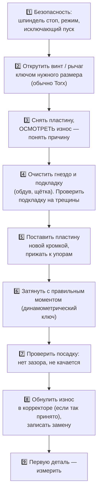

# 🔄 Урок 10. Замена пластин, сборка и хранение инструмента

> [!abstract] О чём урок
> - ⭐ **как правильно** повернуть или заменить пластину;
> - **моменты затяжки** и почему нельзя «от души»;
> - что делать **после** замены;
> - **сборка** инструмента: оправки, вылет, балансировка;
> - **настройка** вне станка — прибор предварительной настройки;
> - **хранение** и учёт инструмента; переточка.
>
> ⏱ ~25 минут

---

## 1. ⭐ Порядок замены пластины

> [!warning] Самые частые ошибки
> 1. **Стружка или грязь в гнезде** — пластина встаёт с перекосом → размер «ушёл», пластина ломается.
> 2. **Поставили ту же кромку** повторно (перепутали стороны). Помогает золотистое покрытие-индикатор и привычка поворачивать в одном направлении.
> 3. **Перетянули** винт — сорвали резьбу в державке или сломали пластину. **Недотянули** — пластина «играет», выкрашивается.
> 4. Не проверили **подкладку** после поломки пластины — следующая пластина тоже сломается.
> 5. Поставили пластину **другого сплава или стружколома** (похожая коробка) — сверяйтесь с картой наладки.

---

## 2. Момент затяжки

На державке или в каталоге указан **момент затяжки** винта, например **3,0 Нм** или **5,0 Нм** (зависит от размера винта и пластины). Используют **динамометрический ключ** (Torx с ограничением момента).

> [!info] Почему не «от души»
> Винты пластин маленькие (M2,5–M6), гнёзда точные. Лишнее усилие деформирует гнездо, срывает резьбу, растрескивает пластину. Если ключа с моментом нет — затягивать **умеренно**, одним уверенным движением, без рычагов-удлинителей.

> [!tip] Смазка винтов
> Производители рекомендуют иногда смазывать резьбу винтов специальной **противозадирной пастой** — винты не «прикипают» от тепла и СОЖ.

---

## 3. После замены

- **Корректоры:** при повороте пластины в той же державке геометрия почти не меняется (отклонение — сотки). Часто **износ** в корректоре **обнуляют** (если коррекции копились из-за износа старой кромки) — так принято на многих производствах. Делайте так, как установлено у вас.
- **Первая деталь** после замены — **измерить**, при необходимости внести небольшую коррекцию.
- **Записать** замену: в журнал, на бирку или обнулить счётчик стойкости.

---

## 4. Сборка инструмента

| Правило | Почему |
|---|---|
| Конус оправки и шпинделя — **чистые** | Грязь → биение → брак и износ шпинделя |
| Цанга — **под диаметр** хвостовика, чистая, гайка затянута по моменту | Плохой зажим → проворачивание, биение |
| **Вылет** — по карте наладки, минимально необходимый | Вибрации, точность |
| Хвостовик зажат на **всю длину** зажима (не «на кончике») | Иначе инструмент вырвет |
| Для высоких оборотов — **сбалансированные** оправки (класс G2,5 на 15–25 тыс. об/мин) | Дисбаланс разрушает подшипники шпинделя |
| После сборки — проверить **биение** (≤ 0,01–0,02 мм для фрез и свёрл) | Каждая сотка биения сокращает стойкость |

---

## 5. Настройка инструмента вне станка

**Прибор предварительной настройки** (*presetter*) — оптический прибор, на котором измеряют **длину и диаметр** собранного инструмента **пока станок работает**. Данные вносят в корректоры H и D (вручную, по сети или по RFID-чипу на оправке). Время простоя станка на наладке резко сокращается.

> [!info] Связь с модулем 1
> Корректоры длины и радиуса — [[07. Шпиндель и инструментальная система]]. Датчики инструмента на станке — [[09. Вспомогательные системы]].

---

## 6. Хранение и учёт

> [!tip] Правила хранения
> 1. Пластины — **в коробках**, подписанных (марка, сплав). Не высыпать в одну кучу — кромки бьются друг о друга, а потом не понять, где какой сплав.
> 2. Отработанные пластины — **отдельно** (их сдают на переработку: твёрдый сплав дорогой).
> 3. Монолитные фрезы и свёрла — в **футлярах/пеналах**, не касаясь друг друга: твёрдый сплав хрупкий, кромки сколются.
> 4. Собранные оправки — в **стеллажах** конусом вниз/в держателях, конус защищён.
> 5. Метки и маркировка — на каждом собранном инструменте (номер T, вылет).
> 6. Инструмент **получают и сдают** через инструментальную кладовую (ИРК) — по ведомости или системе учёта.

### Переточка

- Свёрла, концевые фрезы, развёртки из твёрдого сплава и HSS **перетачивают** на специальных заточных станках (часто — с повторным нанесением покрытия). Переточенный инструмент становится **короче** (и меньше по диаметру у фрез) — его **заново** измеряют и вносят в корректоры.
- **Сменные пластины не перетачивают** — меняют.

---

## 7. Итоги урока

> [!summary] Запомни
> 1. Замена: **стоп → снять → осмотреть износ → очистить гнездо и подкладку → новая кромка → момент затяжки → проверка посадки → корректор/запись → замер первой детали**.
> 2. Затяжка — **по моменту**, без удлинителей.
> 3. Главные ошибки: **грязь в гнезде**, **та же кромка**, **перетяжка**, **треснувшая подкладка**, **не та пластина**.
> 4. Сборка: чистый конус, правильная цанга, вылет по карте, биение ≤ 0,01–0,02.
> 5. Хранение: пластины в подписанных коробках, твёрдый сплав — не навалом.

---

## ❓ Проверь себя

> [!question]- 1. Почему перед установкой пластины нужно очистить гнездо?
> Стружка или грязь не дадут пластине сесть ровно — изменится размер, пластина может сломаться.

> [!question]- 2. Что проверить после поломки пластины?
> Подкладку (опорную пластину), гнездо, винт или рычаг, а также понять причину поломки.

> [!question]- 3. Как затягивать винт пластины?
> С моментом, указанным на державке или в каталоге, лучше динамометрическим ключом; без удлинителей.

> [!question]- 4. Что сделать после замены пластины?
> Обнулить износ (если так принято), записать замену/обнулить счётчик, измерить первую деталь.

> [!question]- 5. Как хранить твердосплавные фрезы?
> В футлярах или пеналах так, чтобы они не касались друг друга — твёрдый сплав хрупкий.

---

⬅️ [[09. Проблемы при резании]] | [[00. Оглавление (инструмент)|Оглавление]] | ➡️ [[11. Практика по режущему инструменту]]
