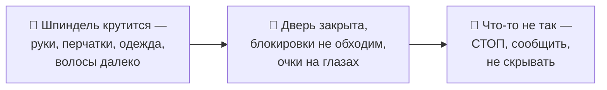

# 🦺 Модуль 6. Охрана труда

> [!abstract] Для кого этот модуль
> На собеседовании оператора почти всегда спрашивают про **технику безопасности**, а на первом рабочем дне вы пройдёте **инструктажи** и подпишетесь в журналах. Этот модуль поможет:
> - понимать **основы охраны труда**: права, обязанности, инструктажи, медосмотры, СИЗ;
> - знать **опасности** на участке ЧПУ и как от них защищаться;
> - работать на станке **безопасно** — до, во время и после работы;
> - безопасно обращаться со **стружкой, СОЖ, грузами, электричеством**;
> - оказать **первую помощь** и правильно действовать при **несчастном случае и пожаре**.

> [!warning] Важно
> Конспект — **учебный**. На каждом предприятии есть свои **инструкции по охране труда** для профессии и для конкретного оборудования — они обязательны и главнее любого конспекта. Нормативные документы периодически обновляются: названия и номера, указанные здесь, актуальны на момент написания — сверяйтесь с действующими редакциями.

---

## 🗺️ Карта модуля

| №   | Урок                                                       | О чём                                                          | Время  |
| --- | ---------------------------------------------------------- | -------------------------------------------------------------- | ------ |
| 01  | [[01. Основы охраны труда]]                                | Законы, права и обязанности работника, ответственность          | 25 мин |
| 02  | [[02. Инструктажи, обучение и медосмотры]]                 | Виды инструктажей, стажировка, медосмотры, СОУТ                 | 25 мин |
| 03  | [[03. Опасные и вредные факторы]]                          | Что может навредить на участке ЧПУ                             | 25 мин |
| 04  | [[04. Средства индивидуальной защиты]]                     | ⭐ Спецодежда, очки, беруши, обувь; перчатки — когда можно       | 25 мин |
| 05  | [[05. Безопасная работа на станке с ЧПУ]]                  | ⭐ До, во время и после работы; запреты; наладка                 | 35 мин |
| 06  | [[06. Стружка, СОЖ и инструмент — безопасно]]              | Порезы, ожоги, дерматит, острый инструмент                      | 25 мин |
| 07  | [[07. Грузы и подъёмные механизмы]]                        | Ручной подъём, кран-балка, стропы                              | 20 мин |
| 08  | [[08. Электро- и пожарная безопасность]]                   | Ток, электрошкаф, огнетушители, эвакуация                       | 25 мин |
| 09  | [[09. Первая помощь]]                                      | ⭐ Кровотечение, ожоги, глаза, электротравма, захват              | 35 мин |
| 10  | [[10. Несчастный случай и аварийные ситуации]]             | Порядок действий, расследование, микротравмы                    | 20 мин |
| 11  | [[11. Культура безопасности и порядок на рабочем месте]]   | 5S, LOTO, эргономика, усталость, «не уверен — не делай»         | 25 мин |
| 12  | [[12. Ситуации и вопросы по охране труда]]                 | ⭐ Ситуационные задачи + вопросы для собеседования               | 60 мин |
| 13  | [[13. Глоссарий по охране труда]]                          | Словарь и шпаргалки                                            | —      |

---

## 🧭 Три главных правила

> [!info] Связь с модулем 1
> Краткие правила безопасности и порядок включения станка уже были в [[10. Обслуживание и безопасность]]. Здесь — подробно и с точки зрения охраны труда.

---

> [!quote] Главная мысль модуля
> Деталь можно переделать, станок — отремонтировать. **Руку и глаз — нельзя.** Работодатель ценит оператора, который работает аккуратно и безопасно, больше, чем того, кто работает быстро.

➡️ Начать: [[01. Основы охраны труда]]
