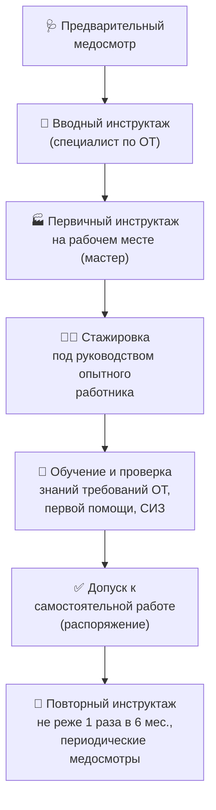

# 📋 Урок 2. Инструктажи, обучение и медосмотры

> [!abstract] О чём урок
> - ⭐ **виды инструктажей**: вводный, первичный, повторный, внеплановый, целевой;
> - **стажировка** и **допуск** к самостоятельной работе;
> - **обучение** и проверка знаний, обучение первой помощи;
> - **медосмотры**;
> - **специальная оценка условий труда (СОУТ)** и классы условий.
>
> ⏱ ~25 минут

---

## 1. Путь новичка до самостоятельной работы

Порядок регулируется **постановлением Правительства РФ № 2464** «О порядке обучения по охране труда и проверки знания требований охраны труда» и локальными документами предприятия.

---

## 2. ⭐ Виды инструктажей

| Инструктаж | Когда | Кто проводит | Что в нём |
|---|---|---|---|
| **Вводный** | При приёме на работу, **до** начала работы | Специалист по охране труда | Общие сведения о предприятии, опасностях, правах и обязанностях, порядке действий при авариях |
| **Первичный на рабочем месте** | До начала самостоятельной работы, при переводе на другое место | Непосредственный руководитель (мастер) | Конкретные опасности **вашего** станка, инструкция по ОТ, безопасные приёмы, СИЗ |
| **Повторный** | Не реже **1 раза в 6 месяцев** | Мастер | Повторение первичного |
| **Внеплановый** | Новые правила, новое оборудование, нарушение требований, несчастный случай, перерыв в работе (обычно больше 60 дней), по требованию надзора | Мастер | По причине проведения |
| **Целевой** | Разовые работы вне обычных обязанностей, работы по наряду-допуску, массовые мероприятия | Руководитель работ | Безопасность конкретной работы |

> [!info] Журнал и подпись
> Проведение инструктажа фиксируется в **журнале регистрации инструктажей** (бумажном или электронном): дата, вид, подписи инструктирующего и инструктируемого. Ваша подпись означает: «**понял и буду выполнять**».

> [!warning] Не подписывать «не глядя»
> Если вам что-то непонятно на инструктаже — спросите. При несчастном случае комиссия первым делом проверяет инструктажи и знание инструкции. Формальная подпись без понимания — плохая защита и для работодателя, и для вас.

---

## 3. Стажировка и допуск

- **Стажировка** — работа под наблюдением опытного работника (наставника) на рабочем месте; продолжительность устанавливает работодатель (обычно от нескольких смен).
- После стажировки и проверки знаний — **допуск к самостоятельной работе** (распоряжением руководителя).
- До допуска самостоятельно работать на станке **нельзя**.

---

## 4. Обучение

На предприятии проводят (по программам работодателя или учебного центра):
- **обучение безопасным методам и приёмам** выполнения работ;
- **обучение оказанию первой помощи** пострадавшим;
- **обучение использованию СИЗ**;
- **проверку знаний** требований охраны труда — с протоколом.

Для отдельных работ нужно **отдельное обучение и удостоверение**: например, **стропальщик** (работа с краном), работы на высоте. Без него эти работы выполнять **нельзя**.

---

## 5. Медосмотры

| Вид | Когда |
|---|---|
| **Предварительный** | При приёме на работу |
| **Периодический** | Регулярно, при наличии вредных/опасных факторов (шум, СОЖ-аэрозоли и т. д.) — периодичность по приказу Минздрава № 29н |
| **Внеочередной** | По медицинским показаниям, жалобам работника |

Медосмотры — **за счёт работодателя**, с сохранением заработка. Уклонение от медосмотра — основание **отстранить** от работы.

> [!info] Алкоголь и запрещённые вещества
> Работник в состоянии алкогольного, наркотического или иного опьянения **отстраняется** от работы (ТК РФ). Это одно из самых строгих правил на любом производстве.

---

## 6. Специальная оценка условий труда (СОУТ)

**СОУТ** (закон № 426-ФЗ) — экспертиза рабочего места: измеряют шум, вибрацию, освещённость, химические вещества (аэрозоли СОЖ), тяжесть труда и др. По результатам рабочему месту присваивается **класс условий труда**.

| Класс | Условия | Последствия |
|---|---|---|
| **1** | Оптимальные | — |
| **2** | Допустимые | — |
| **3.1–3.4** | **Вредные** (четыре подкласса) | Компенсации: доплата, доп. отпуск, сокращённый день, молоко/лечебное питание (в зависимости от подкласса и коллективного договора) |
| **4** | Опасные | Работа допускается только в особых условиях |

Рабочие места станочников часто имеют класс **2** или **3.1–3.2** (шум, аэрозоли). Работник **знакомится** с результатами СОУТ своего рабочего места под подпись.

---

## 7. Итоги урока

> [!summary] Запомни
> 1. Путь новичка: **медосмотр → вводный → первичный → стажировка → проверка знаний → допуск**.
> 2. Инструктажи: **вводный, первичный, повторный (≥ 1 раз в 6 мес.), внеплановый, целевой**.
> 3. Подпись в журнале = «понял и буду выполнять».
> 4. Без допуска (и без удостоверения для кранов, высоты) — **не работать**.
> 5. Медосмотры — предварительный и периодические, за счёт работодателя.
> 6. **СОУТ**: классы 1–2 — норма, **3.1–3.4** — вредные (с компенсациями), 4 — опасные.

---

## ❓ Проверь себя

> [!question]- 1. Какие виды инструктажей бывают?
> Вводный, первичный на рабочем месте, повторный, внеплановый, целевой.

> [!question]- 2. Как часто проводится повторный инструктаж?
> Не реже одного раза в 6 месяцев.

> [!question]- 3. Когда проводится внеплановый инструктаж?
> При введении новых правил, изменении оборудования или технологии, нарушении требований, после несчастного случая, после длительного перерыва в работе, по требованию надзорных органов.

> [!question]- 4. Можно ли пользоваться кран-балкой без удостоверения стропальщика?
> Нет. Для работы с грузоподъёмными механизмами нужно отдельное обучение и допуск.

> [!question]- 5. Что такое СОУТ и какие классы условий труда бывают?
> Специальная оценка условий труда. Классы: 1 — оптимальные, 2 — допустимые, 3.1–3.4 — вредные, 4 — опасные.

---

⬅️ [[01. Основы охраны труда]] | [[00. Оглавление (охрана труда)|Оглавление]] | ➡️ [[03. Опасные и вредные факторы]]
