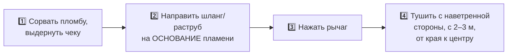

# ⚡🔥 Урок 8. Электро- и пожарная безопасность

> [!abstract] О чём урок
> - чем опасен **ток** и где он на станке;
> - **группа I** по электробезопасности;
> - что оператору **можно и нельзя** с электрооборудованием;
> - **причины пожаров** на участке;
> - ⭐ **огнетушители**: какие и как применять;
> - **действия при пожаре** и эвакуация.
>
> ⏱ ~25 минут

---

## 1. Электробезопасность

Станок с ЧПУ питается напряжением **380 В** (трёхфазная сеть), в электрошкафу — сервоусилители, конденсаторы, которые сохраняют заряд **несколько минут** после отключения.

| Опасность | Где |
|---|---|
| Прямое прикосновение к токоведущим частям | Открытый электрошкаф, повреждённые кабели, разъёмы |
| Косвенное — корпус оказался под напряжением | Повреждение изоляции + неисправное заземление |
| Влага, СОЖ | Снижают сопротивление изоляции и кожи |

### Группа I по электробезопасности

Оператор станка относится к **неэлектротехническому** персоналу. Ему присваивается **группа I** по электробезопасности — после **инструктажа** (обычно ежегодно, с отметкой в журнале). Группа I означает: вы знаете, чем опасен ток, и умеете **освободить** пострадавшего и оказать первую помощь, но **не выполняете** никаких работ в электроустановках.

> [!danger] Оператору запрещено
> - открывать **электрошкаф**, снимать крышки, лезть в клеммные коробки;
> - самостоятельно **ремонтировать** кабели, разъёмы, менять предохранители;
> - работать с **повреждёнными** кабелями, вилками, пультами;
> - трогать электрооборудование **мокрыми руками**, направлять СОЖ и сжатый воздух в шкаф.
>
> Обнаружили повреждённый кабель, искрение, запах горелой изоляции, «бьётся током» корпус → **остановить** станок, **сообщить** мастеру/электрику, не пользоваться до ремонта.

---

## 2. Пожарная безопасность

### Причины пожаров на участке ЧПУ

| Причина | Профилактика |
|---|---|
| Возгорание **масляной СОЖ** или масляного тумана (искры, перегрев) | Исправная вытяжка, контроль СОЖ, не работать масляной СОЖ без присмотра там, где это запрещено |
| **Промасленная ветошь** — самовозгорание | ⭐ Ветошь — в **металлический ящик с крышкой**, ежедневный вынос |
| **Магниевая, титановая** стружка и пыль | Отдельная тара, своевременная уборка, специальные средства тушения |
| Электрооборудование — короткое замыкание, перегрев | Исправность, чистота шкафов (обслуживает электрик) |
| Курение, открытый огонь | Только в отведённых местах |
| Загромождение | Свободные проходы и доступ к огнетушителям |

### ⭐ Огнетушители

| Тип | Маркировка | Чем тушить | Ограничения |
|---|---|---|---|
| **Порошковый** | **ОП** | ⭐ Универсальный: твёрдые материалы, жидкости, газы, **электроустановки** под напряжением (до 1000 В) | Пыль, ухудшает видимость, порошок портит оборудование |
| **Углекислотный** | **ОУ** | **Электрооборудование**, жидкости; не оставляет следов | ❌ **Не держать за раструб** — обморожение (−70 °C); в маленьком помещении — опасен для дыхания |
| **Воздушно-пенный / водный** | ОВП, ОВ | Твёрдые материалы, жидкости | ❌ **Нельзя** тушить электрооборудование под напряжением |

> [!warning] Горящие металлы (магний, титан)
> Магниевую и титановую стружку **нельзя тушить водой и обычными огнетушителями** — вода разлагается, возможен взрыв и усиление горения. Нужны **специальные порошки** (класс D) или **сухой песок**. Если на участке обрабатывают такие материалы — это обязательно указано в инструкции.

### Как применять огнетушитель

---

## 3. Действия при пожаре

> [!danger] Порядок
> 1. **Аварийный стоп** станка (если безопасно), отключить СОЖ.
> 2. Сообщить: громко предупредить людей, вызвать пожарных — **101** (или **112**), сообщить мастеру.
> 3. Если пожар **маленький** и это безопасно — тушить **огнетушителем** (электрооборудование — ОП или ОУ).
> 4. Если не удаётся потушить за несколько секунд, много дыма — **эвакуироваться** по плану эвакуации, закрывая за собой двери (не на ключ).
> 5. Не пользоваться **лифтами**, не возвращаться за вещами.
> 6. В дыму — двигаться **пригнувшись**, закрыв нос и рот тканью.

> [!info] Знать заранее
> Где ближайший **огнетушитель**, **пожарный кран**, **выходы**, **план эвакуации**, **место сбора**. Это спрашивают на вводном инструктаже и при проверке знаний.

---

## 4. Итоги урока

> [!summary] Запомни
> 1. Оператор — **группа I**: знает опасность тока, **не лезет** в электрошкаф и не ремонтирует.
> 2. Повреждённый кабель, искры, запах гари — **стоп и сообщить**.
> 3. Ветошь — в **металлический ящик с крышкой**; масляный туман и магниевая стружка — пожароопасны.
> 4. Электрооборудование под напряжением — **ОП** или **ОУ**; ОУ не держать за раструб; водой и пеной — нельзя.
> 5. Пожар: **E-STOP → 101/112 → тушить, если маленький и безопасно → иначе эвакуация**.

---

## ❓ Проверь себя

> [!question]- 1. Какая группа по электробезопасности у оператора станка и что она означает?
> Группа I — неэлектротехнический персонал: знает об опасности тока и правилах первой помощи, но не работает в электроустановках.

> [!question]- 2. Можно ли тушить горящий электрошкаф водой?
> Нет. Порошковым (ОП) или углекислотным (ОУ) огнетушителем.

> [!question]- 3. Почему нельзя держать углекислотный огнетушитель за раструб?
> При выходе углекислота сильно охлаждает раструб — обморожение рук.

> [!question]- 4. Почему промасленную ветошь хранят в металлическом ящике с крышкой?
> Она может самовозгореться; металлический ящик с крышкой ограничивает доступ воздуха и распространение огня.

> [!question]- 5. Чем тушат горящую магниевую стружку?
> Специальным порошком для металлов (класс D) или сухим песком; не водой.

---

⬅️ [[07. Грузы и подъёмные механизмы]] | [[00. Оглавление (охрана труда)|Оглавление]] | ➡️ [[09. Первая помощь]]
