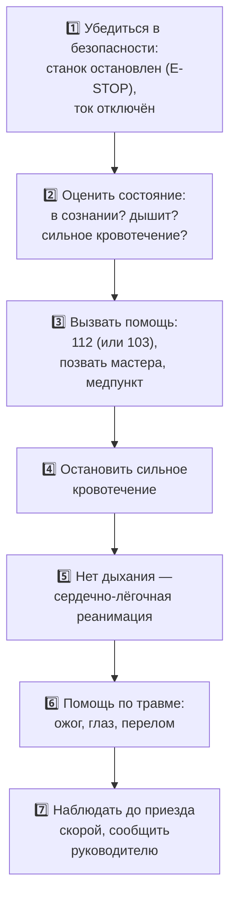

# 🩹 Урок 9. Первая помощь

> [!abstract] О чём урок
> - ⭐ **общий порядок** действий;
> - **кровотечения** — главное на металлообработке;
> - **порезы** стружкой, **ампутация** пальца;
> - **ожоги**;
> - **глаза**: стружка, СОЖ;
> - **электротравма**;
> - **захват** вращающимися частями, ушибы, переломы;
> - **сердечно-лёгочная реанимация** — кратко.
>
> ⏱ ~35 минут

> [!warning] Важно
> Это **учебный** обзор. Каждый работник на производстве проходит **обучение оказанию первой помощи** с практикой на манекене — только оно даёт реальный навык. Перечень мероприятий первой помощи утверждён приказом Минздрава России (№ 220н). Главное правило: **не навредить** и **вызвать помощь**.

---

## 1. ⭐ Общий порядок действий

> [!info] Номера
> **112** — единый номер экстренных служб (с мобильного — даже без SIM/денег). **103** — скорая помощь. Сообщить: **что** случилось, **где** (адрес, цех, как пройти), **сколько** пострадавших, **состояние**. Не класть трубку первым.

---

## 2. Кровотечения

| Вид | Признаки | Что делать |
|---|---|---|
| **Капиллярное / венозное** (порез стружкой, царапина) | Кровь сочится или течёт ровной струёй, тёмная | Прямое **давление** на рану чистой салфеткой → **давящая повязка** |
| **Сильное (артериальное)** | Кровь алая, бьёт пульсирующей струёй, быстро растекается | 1. **Сильно прижать** рану (или артерию выше раны) пальцами/салфеткой. 2. **Давящая повязка**. 3. Если не помогает и рана на руке или ноге — **жгут** выше раны (на одежду или подложенную ткань) |

> [!danger] Правила жгута
> - Накладывают **выше раны**, как можно ближе к ней, на подкладку (не на голое тело).
> - Затягивают до **прекращения** кровотечения.
> - Под жгут — **записка с временем** наложения.
> - Держат **ограниченное время** (по современным рекомендациям — не более ~60 минут), жгут **не закрывать** одеждой.
> - Жгут — крайняя мера: чаще хватает **давящей повязки**.

### Небольшой порез стружкой

1. Остановить кровотечение давлением.
2. Убедиться, что в ране **нет стружки** (крупные кусочки не выковыривать — к врачу).
3. Края раны обработать **антисептиком** (не лить йод/спирт в саму рану).
4. Наложить **стерильную** повязку или пластырь.
5. **Сообщить мастеру** — даже о небольшой травме (учёт микроповреждений, [[10. Несчастный случай и аварийные ситуации|урок 10]]).

### Отрыв (ампутация) пальца

1. Остановить кровотечение (давящая повязка, при необходимости жгут).
2. Вызвать **112**.
3. Отчленённую часть — **не мыть**, завернуть в чистую ткань/салфетку, положить в **пакет**, пакет — в другой пакет с **холодом** (лёд, холодная вода) — **не** класть прямо на лёд.
4. Передать вместе с пострадавшим врачам — **время** имеет значение.

---

## 3. Ожоги (горячая стружка, деталь)

| ✅ Делать | ❌ Нельзя |
|---|---|
| Охлаждать **прохладной проточной водой** 15–20 минут | Мазать **маслом**, кремом, зубной пастой |
| Снять кольца, часы до отёка (если не прилипли) | **Вскрывать пузыри** |
| Накрыть **чистой** (стерильной) повязкой | Отдирать прилипшую одежду |
| Большой ожог — 112 | Прикладывать лёд прямо к коже |

---

## 4. Глаза

| Ситуация | Что делать |
|---|---|
| **СОЖ, химия** в глазу | ⭐ Сразу **промывать** обильно чистой водой (или из станции промывки глаз) **15–20 минут**, от внутреннего угла глаза к наружному, держа веки открытыми. Затем — к врачу |
| **Мелкая соринка** на поверхности | Не тереть! Промыть водой. Если не вымылась — к врачу |
| **Стружка, осколок** воткнулись в глаз | ❌ **Не извлекать** самостоятельно, не тереть, не промывать с давлением. Накрыть **оба глаза** повязкой (чтобы глаза не двигались), **срочно** к врачу / 112 |

> [!tip] Лучшая первая помощь глазам — очки
> Большинство травм глаз у станочников происходят, когда «на секунду» сняли очки — обдуть деталь, посмотреть поближе.

---

## 5. Электротравма

> [!danger] Сначала — обесточить!
> 1. **Отключить** ток (рубильник, аварийный выключатель). Не трогать пострадавшего голыми руками, пока он под напряжением.
> 2. Если отключить нельзя — **отделить** пострадавшего от источника сухой **непроводящей** вещью (сухая деревянная палка, пластик), стоя на сухом.
> 3. Вызвать **112**.
> 4. Проверить **дыхание**. Нет дыхания — **реанимация**.
> 5. Даже если человек «пришёл в себя» — **обязательно** к врачу: возможны нарушения ритма сердца позже.

---

## 6. Захват, ушибы, переломы

- **Захват вращающимися частями** — сначала **E-STOP**, затем освобождение после полной остановки (часто нужно провернуть шпиндель назад — наладчик/электрик). Не тянуть силой.
- **Ушиб** — **холод** (через ткань) 15–20 минут, покой.
- **Подозрение на перелом** (боль, деформация, невозможность движения) — **не вправлять**, обездвижить (шина, подручные средства), холод, 112.
- **Травма от падения груза на ногу** — не снимать обувь при сильной боли и деформации, обездвижить, 112. (Защитный подносок часто спасает пальцы.)

---

## 7. Нет сознания и дыхания — реанимация (кратко)

1. Проверить **безопасность**, окликнуть, потрясти за плечи.
2. Открыть дыхательные пути (запрокинуть голову, поднять подбородок), **10 секунд** — есть ли нормальное дыхание.
3. Нет дыхания — **112** и сразу **сердечно-лёгочная реанимация**:
   - **30 надавливаний** на центр грудной клетки (глубина 5–6 см, частота 100–120 в минуту), руки прямые;
   - **2 вдоха** (если умеете и готовы), затем снова 30 надавливаний;
   - продолжать до приезда скорой или появления дыхания.
4. Если на предприятии есть **автоматический дефибриллятор (АНД)** — использовать по голосовым подсказкам.
5. Есть дыхание, но нет сознания — **устойчивое боковое положение**, наблюдать.

---

## 8. Аптечка

На каждом участке должна быть **аптечка первой помощи** (состав утверждён приказом Минздрава). Знайте, **где** она, и сообщайте мастеру, если что-то закончилось. **Станция промывки глаз** — при работе с СОЖ и химией — тоже должна быть рядом.

---

## 9. Итоги урока

> [!summary] Запомни
> 1. **Безопасность (E-STOP, ток) → оценка → 112 → кровотечение → дыхание → остальное**.
> 2. Кровотечение: **давление → давящая повязка → жгут** (записка с временем).
> 3. Ожог: **вода 15–20 мин**, не масло, не вскрывать пузыри.
> 4. Глаз: СОЖ — **промыть 15–20 мин**; воткнулась стружка — **не извлекать**, повязка на оба глаза, к врачу.
> 5. Электротравма: **сначала обесточить**, потом помогать; к врачу обязательно.
> 6. Нет дыхания: **30 надавливаний + 2 вдоха**, АНД.

---

## ❓ Проверь себя

> [!question]- 1. С чего начинается первая помощь при травме на станке?
> С обеспечения безопасности: остановить станок (аварийный стоп), отключить ток при электротравме.

> [!question]- 2. Как остановить сильное кровотечение из руки?
> Прижать рану, наложить давящую повязку; если не помогает — жгут выше раны с запиской о времени, вызвать 112.

> [!question]- 3. Что делать при ожоге горячей стружкой?
> Охлаждать прохладной проточной водой 15–20 минут, наложить чистую повязку; не мазать маслом, не вскрывать пузыри.

> [!question]- 4. В глаз попала СОЖ. Ваши действия?
> Немедленно промывать большим количеством чистой воды 15–20 минут, затем к врачу.

> [!question]- 5. Человека ударило током, он лежит у станка. Что делать?
> Обесточить (рубильник), не касаться его до отключения или отделить непроводящим предметом, вызвать 112, проверить дыхание, при отсутствии — реанимация.

> [!question]- 6. Как сохранить отрезанный палец?
> Не мыть, завернуть в чистую ткань, в пакет, пакет — в другой пакет с холодной водой или льдом, передать врачам вместе с пострадавшим.

---

⬅️ [[08. Электро- и пожарная безопасность]] | [[00. Оглавление (охрана труда)|Оглавление]] | ➡️ [[10. Несчастный случай и аварийные ситуации]]
