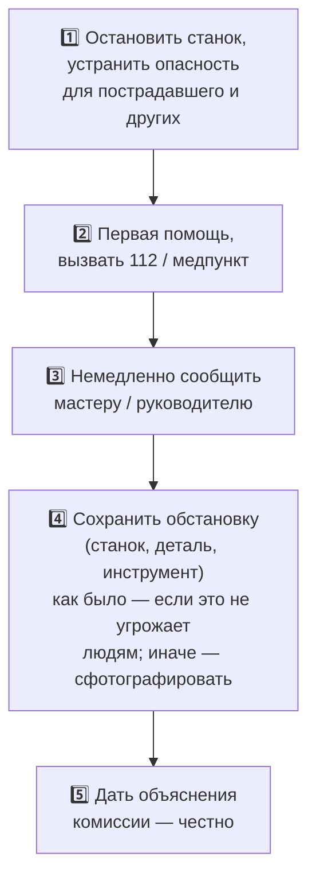

# 🚨 Урок 10. Несчастный случай и аварийные ситуации

> [!abstract] О чём урок
> - ⭐ что делать при **несчастном случае** — по шагам;
> - как идёт **расследование** и зачем сохранять обстановку;
> - **микротравмы** — почему о царапине тоже сообщают;
> - **опасные ситуации без травмы** («чуть не случилось»);
> - **аварийные ситуации** на станке: столкновение, вылет детали, пожар, разлив, отключение питания.
>
> ⏱ ~20 минут

---

## 1. ⭐ Несчастный случай — порядок действий

> [!info] Обязанность сообщить
> Работник **обязан** немедленно сообщить руководителю о каждом несчастном случае с ним или с коллегой (ТК РФ). Если пострадавший сам не может — сообщает **очевидец**.

---

## 2. Расследование

- Расследование проводит **комиссия**, которую создаёт работодатель (специалист по охране труда, представитель работников и др.; при тяжёлых случаях — с участием госинспекции труда).
- Сроки установлены Трудовым кодексом: как правило, **3 дня** — лёгкий несчастный случай, **15 дней** — тяжёлый или смертельный (могут продлеваться).
- Комиссия выясняет **обстоятельства и причины**: инструктажи, СИЗ, исправность станка, соблюдение инструкции.
- Итог — **акт** (форма Н-1 для несчастного случая на производстве); пострадавшему положены выплаты по социальному страхованию.

> [!warning] Почему важно сохранить обстановку
> По положению станка, инструмента, детали, корректоров комиссия понимает, **как** это произошло. «Прибрали, чтобы мастер не ругался» — значит, причину не найдут, и случай может повториться с другим человеком. Изменять обстановку можно, только если это **угрожает** жизни и здоровью других (тогда — сфотографировать, записать).

---

## 3. Микротравмы

**Микроповреждение (микротравма)** — небольшая травма, **не** повлёкшая потерю трудоспособности: царапина, неглубокий порез, ссадина, ушиб, ожог небольшой площади.

С 2022 года работодатели обязаны **учитывать и анализировать** микротравмы (ТК РФ). О каждой нужно **сообщить** мастеру.

> [!tip] Зачем сообщать о царапине
> 1. Микротравма — **сигнал**: где-то острая кромка, неудобная оснастка, неправильный приём. Если устранить — не будет серьёзной травмы.
> 2. Если «царапина» потом воспалится или окажется серьёзнее, — будет зафиксировано, что это **производственная** травма.

> [!info] Пирамида Хайнриха
> Наблюдение из практики охраны труда: на **один** тяжёлый несчастный случай приходятся десятки лёгких травм и **сотни** опасных ситуаций без последствий. Работая с «мелочами», предотвращают тяжёлые случаи.

---

## 4. Опасные ситуации без травмы («чуть не случилось»)

Пример: пластина отлетела и ударила в окно; деталь вырвало из патрона, но никто не пострадал; поскользнулись в луже СОЖ, но удержались. Это тоже нужно **сообщать** — многие предприятия ведут учёт таких событий и разбирают их без наказания, чтобы исправить причину.

---

## 5. Аварийные ситуации на станке

| Ситуация | Действия оператора |
|---|---|
| **Столкновение** (удар инструмента, шпинделя) | **E-STOP** / Feed Hold, ничего не двигать, сообщить наладчику/мастеру, **не скрывать** ([[10. Обслуживание и безопасность\|модуль 1]]) |
| **Вылет детали**, поломка инструмента, треснуло окно | **E-STOP**, не открывать дверь до полной остановки, сообщить; не работать с повреждённым окном |
| **Захват** одежды, волос | **E-STOP**, не вырываться, помощь пострадавшему ([[09. Первая помощь\|урок 9]]) |
| **Возгорание** | E-STOP, огнетушитель (ОП/ОУ), 101/112, эвакуация ([[08. Электро- и пожарная безопасность\|урок 8]]) |
| **Искрение, запах гари, удар током** | Остановить, сообщить электрику, не пользоваться |
| **Утечка** масла, гидравлики, разлив СОЖ | Остановить станок, огородить/предупредить, убрать разлив (опилки, сорбент), сообщить |
| **Отключение электроэнергии** | Перевести органы управления в положение «выключено» (чтобы станок не запустился сам при появлении питания), сообщить мастеру; после подачи — проверить станок, перезапуск по инструкции |
| **Не работает** аварийная кнопка или блокировка | **Не работать**, сообщить — станок к работе не допускается |

> [!tip] 💬 Скажи на собеседовании
> «При несчастном случае — остановить станок, оказать первую помощь, вызвать скорую, сразу сообщить мастеру и сохранить обстановку для расследования. О любых, даже мелких, травмах и опасных ситуациях я сообщаю — так их причины устраняют, пока не случилось серьёзного».

---

## 6. Итоги урока

> [!summary] Запомни
> 1. Несчастный случай: **остановить → помощь и 112 → сообщить → сохранить обстановку → честные объяснения**.
> 2. Расследует **комиссия**; сроки — как правило 3 дня (лёгкий) / 15 дней (тяжёлый).
> 3. О **микротравмах** и **«чуть не случилось»** — тоже сообщать.
> 4. Неисправны E-STOP или блокировка — **не работать**.
> 5. Пропало питание — органы управления в «выключено», сообщить.

---

## ❓ Проверь себя

> [!question]- 1. Каков порядок действий при несчастном случае с коллегой?
> Остановить станок и устранить опасность, оказать первую помощь, вызвать скорую, немедленно сообщить руководителю, сохранить обстановку, дать объяснения комиссии.

> [!question]- 2. Зачем сохранять обстановку на месте происшествия?
> Чтобы комиссия установила причины и предотвратила повторение.

> [!question]- 3. Нужно ли сообщать о небольшом порезе стружкой?
> Да — это микротравма, её учитывают; причину можно устранить, а травма будет зафиксирована как производственная.

> [!question]- 4. Аварийная кнопка не срабатывает. Можно ли работать?
> Нет — станок к работе не допускается, сообщить мастеру.

---

⬅️ [[09. Первая помощь]] | [[00. Оглавление (охрана труда)|Оглавление]] | ➡️ [[11. Культура безопасности и порядок на рабочем месте]]
